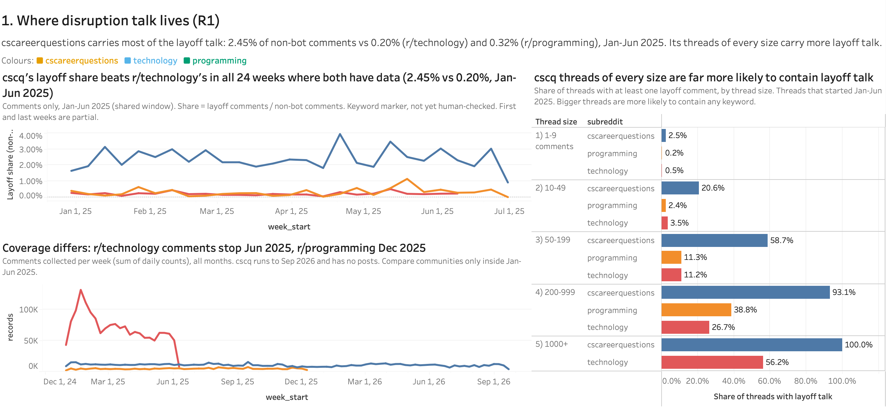
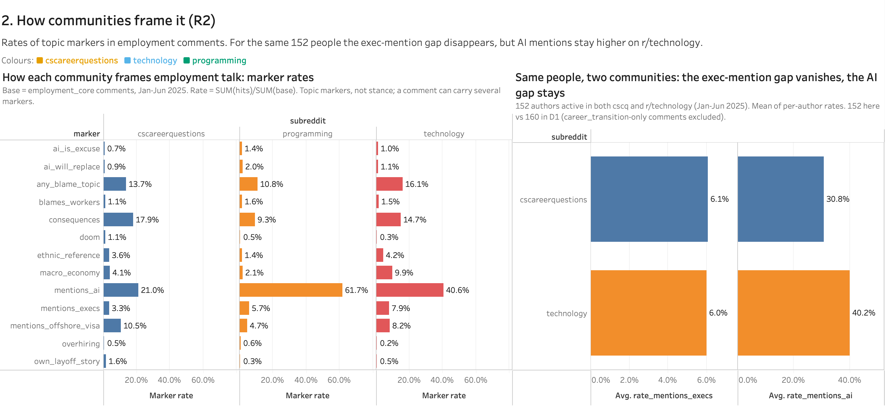
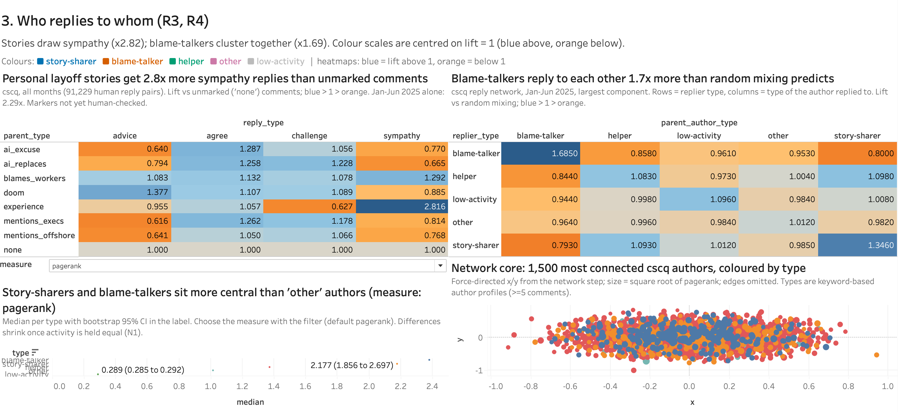
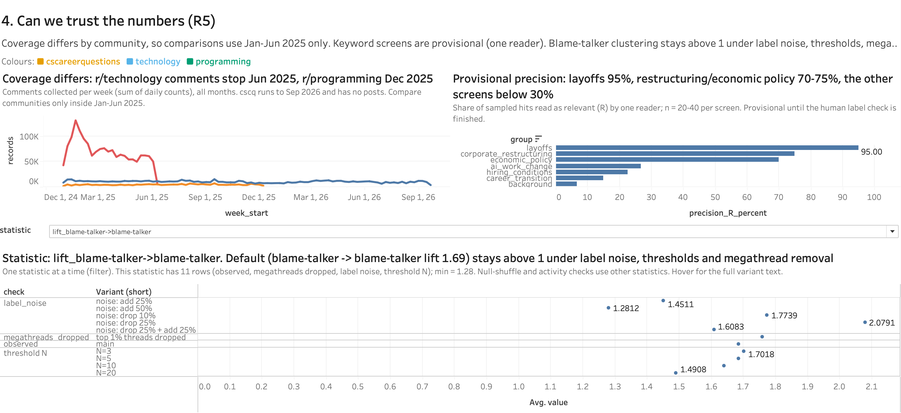
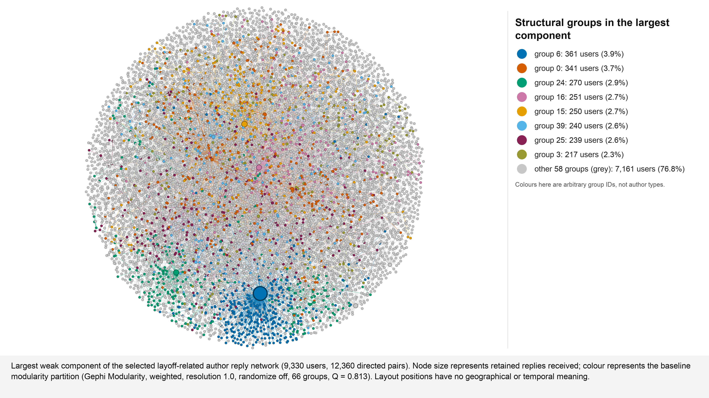
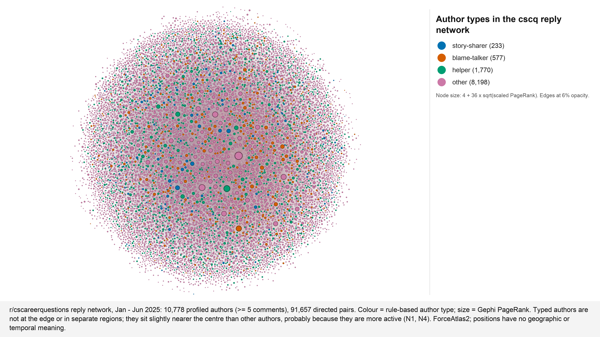
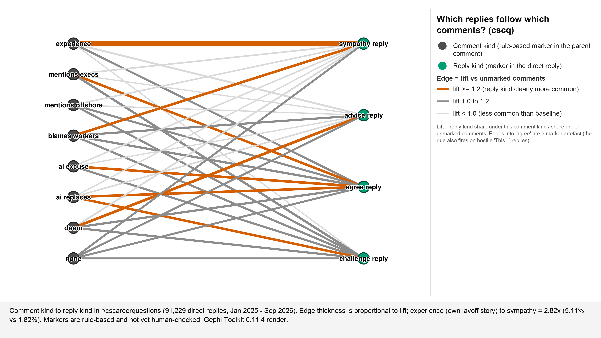
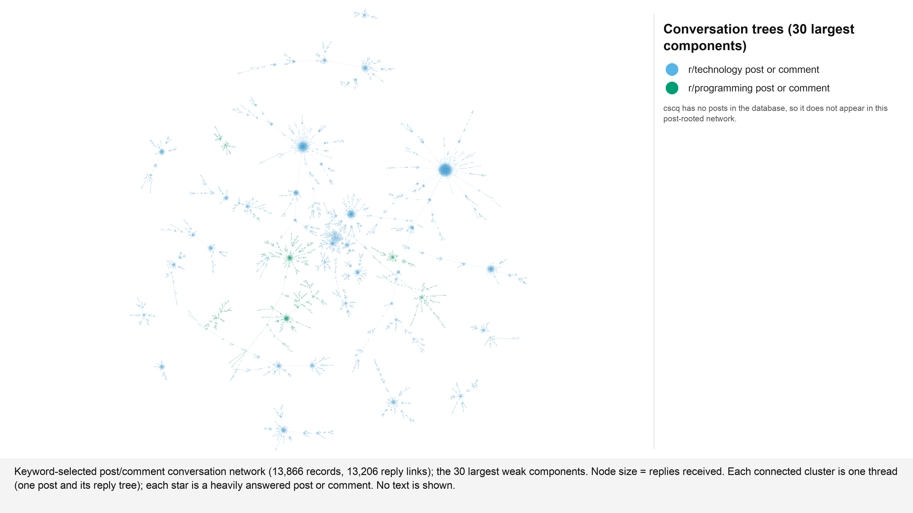

# Solidarity or Blame: the complete project handbook

**CSE3729 Computational Social Media Analysis, BMU, Semester 7, 2026.** Project: "Solidarity or Blame: how Reddit communities discuss disruption in technology employment".
**Date: 27 November 2026** (presentation day).

> **How to use this handbook**
>
> This handbook explains the whole project for a team member who collected the data but has not used Tableau or Gephi. All paths are relative to the project root, the `Archive/` folder (`/Users/vaibhav/Study/Sem 7/Computational Social Media/Archive`), unless they say otherwise.
>
> | If you want to... | Read |
> |---|---|
> | Understand what the project is, what changed, and what went wrong | Part 1 |
> | Know how big the data is, how it was collected and where it lives | Part 2 |
> | Understand the methods and defend every result | Part 3 |
> | Open and present the Tableau workbook | Part 4 |
> | Open and explain the Gephi networks | Part 5 |
> | Set up, run things safely, prepare the talk, answer questions, look up a word | Part 6 |
>
> **15-minute reading path for today's presentation:**
>
> 1. Part 1, section 1.1 (the project on one page) and 1.4 (what changed): about 3 minutes.
> 2. Part 3, "Read this first: three ground rules" and section 3.5 (numbers to remember): about 3 minutes.
> 3. Part 6, section 6.0 (safe-mode rule), 6.4.2 to 6.4.4 (talk plan, speakers, three claims) and 6.4.6 (limitations): about 4 minutes.
> 4. Part 4, workflow 1 (presenting) and Part 5, section 5.3 (opening a project): about 3 minutes. Open the Tableau workbook and the Gephi projects once before the talk.
> 5. Part 6, section 6.4.7 (likely questions): skim, about 2 minutes.
>
> **Three honesty rules that apply everywhere:** (1) the 240-row human label check is not done, so results are "Supported", not "Findings", and all label precision is provisional (one reader: an AI-assisted first pass, not a human check); (2) no causal claims and no claims about the whole population of Reddit users; (3) the "agree" reply marker over-fires on replies starting with "This", so never say that blame draws agreement.

---

## Table of contents

- **[Part 1. The project in plain words: the story, the timeline, what we thought, and the problems we hit](#part-1-the-project-in-plain-words-the-story-the-timeline-what-we-thought-and-the-problems-we-hit)**
    - [1.1 The project on one page](#11-the-project-on-one-page)
    - [1.2 What we had at the start](#12-what-we-had-at-the-start)
    - [1.3 Timeline, August to 26 November 2026](#13-timeline-august-to-26-november-2026)
    - [1.4 What we thought, and how our thinking changed](#14-what-we-thought-and-how-our-thinking-changed)
    - [1.5 Problems we faced](#15-problems-we-faced)
    - [1.6 What is still open, and the next steps](#16-what-is-still-open-and-the-next-steps)
- **[Part 2. The data: how much we had, where it came from, and how it is stored](#part-2-the-data-how-much-we-had-where-it-came-from-and-how-it-is-stored)**
    - [2.1 The data in numbers](#21-the-data-in-numbers)
    - [2.2 How the data was collected](#22-how-the-data-was-collected)
    - [2.3 How the data was processed](#23-how-the-data-was-processed)
    - [2.4 Data dictionary essentials](#24-data-dictionary-essentials)
    - [2.5 Where everything lives](#25-where-everything-lives)
    - [2.6 How to look at the data yourself](#26-how-to-look-at-the-data-yourself)
    - [2.7 Data limits and ethics](#27-data-limits-and-ethics)
- **[Part 3. Methods and every result, explained](#part-3-methods-and-every-result-explained)**
    - [3.1 Methods in plain words](#31-methods-in-plain-words)
    - [3.2 Result cards](#32-result-cards)
    - [3.3 Validity (result R5)](#33-validity-result-r5)
    - [3.4 The concept layer (from docs/PROJECT_REFERENCE_2.md, layer 7)](#34-the-concept-layer-from-docsproject_reference_2md-layer-7)
    - [3.5 Numbers to remember (cheat sheet)](#35-numbers-to-remember-cheat-sheet)
- **[Part 4. Tableau from zero, with our workbook](#part-4-tableau-from-zero-with-our-workbook)**
    - [4.1 What Tableau is](#41-what-tableau-is)
    - [4.2 The ideas you need (read once, then refer back)](#42-the-ideas-you-need-read-once-then-refer-back)
    - [4.3 Installing and starting Tableau on this Mac](#43-installing-and-starting-tableau-on-this-mac)
    - [4.4 Opening our workbook](#44-opening-our-workbook)
    - [4.5 Interface tour](#45-interface-tour)
    - [4.6 Tour of every sheet, dashboard and the story](#46-tour-of-every-sheet-dashboard-and-the-story)
    - [4.7 Step-by-step workflows](#47-step-by-step-workflows)
    - [4.8 Troubleshooting](#48-troubleshooting)
    - [4.9 Practice exercises (with answers)](#49-practice-exercises-with-answers)
    - [4.10 Talking points (1-2 sentences per dashboard)](#410-talking-points-1-2-sentences-per-dashboard)
- **[Part 5. Gephi from zero, with our networks](#part-5-gephi-from-zero-with-our-networks)**
    - [5.1 Network basics in plain words](#51-network-basics-in-plain-words)
    - [5.2 Our four networks](#52-our-four-networks)
    - [5.3 Opening a project in Gephi Desktop 0.11.3](#53-opening-a-project-in-gephi-desktop-0113)
    - [5.4 Interface tour](#54-interface-tour)
    - [5.5 Step-by-step workflows](#55-step-by-step-workflows)
    - [5.6 How to read and explain each figure on a slide](#56-how-to-read-and-explain-each-figure-on-a-slide)
    - [5.7 Troubleshooting](#57-troubleshooting)
    - [5.8 Practice exercises (answers below)](#58-practice-exercises-answers-below)
- **[Part 6. Operating the project, the folder map, presentation prep, glossary](#part-6-operating-the-project-the-folder-map-presentation-prep-glossary)**
    - [6.0 The safe-mode rule for today](#60-the-safe-mode-rule-for-today)
    - [6.1 Setup from scratch on a Mac](#61-setup-from-scratch-on-a-mac)
    - [6.2 Running things, step by step](#62-running-things-step-by-step)
    - [6.3 The folder map](#63-the-folder-map)
    - [6.4 Presentation prep](#64-presentation-prep)
    - [6.5 Glossary](#65-glossary)

---

## Part 1. The project in plain words: the story, the timeline, what we thought, and the problems we hit

This part is the background you need before you open any tool. Read it first. It tells you what the project is about, what the course asked for, what happened when, how our thinking changed, and every problem we ran into, with how we handled it. Later parts explain Tableau, Gephi and the numbers in detail.

All paths are relative to the project root, the `Archive` folder (`/Users/vaibhav/Study/Sem 7/Computational Social Media/Archive`), unless they say otherwise. The older October folder is called `Project/` and sits next to `Archive/` in the subject folder.

**Two words you will hear all day:**
- **cscq** is our short name for **r/cscareerquestions**, a Reddit community (a "subreddit") where people ask about computer-science careers and jobs.
- A **comment** is a reply written under a Reddit post. A **post** (also called a submission) is the thing that starts a thread. Most of our data is comments.

---

### 1.1 The project on one page

**Course.** CSE3729 Computational Social Media Analysis, BMU, Semester 7 (2026). Faculty: Dr. Kiran Sharma and Dr. Jakob Baek Kristensen.

**Title.** *Solidarity or Blame: how Reddit communities discuss disruption in technology employment.*

**The problem, in plain words.** Technology work has been shaken up: layoffs, a hard hiring market, AI changing jobs, companies restructuring. People talk about this online. We wanted to know how they make sense of it together:
- Do people share their own experience ("I was laid off last week")?
- Whom do they blame: executives, offshoring, foreign workers, AI, or themselves?
- How do others answer them: with comfort, advice, agreement or pushback?

**Why it matters: solidarity versus blame.**
- **Solidarity** here means support for the people affected: comfort, sympathy, help.
- **Blame** here means pointing at someone responsible: executives, offshoring, AI used "as an excuse".
- A community that answers a layoff story with comfort behaves very differently from one that turns it into an argument about who is at fault. That difference matters for moderators, career services and researchers (`docs/PROJECT_REFERENCE.md`, section 2).

**Why it matters: sentiment is not stance.** Most studies of online talk measure **sentiment**: is the text positive or negative? We measure what a comment **does** (tells a story, gives advice, blames someone) and how the community **responds**. This is called **stance** or function. The two are different. A sad layoff story and an angry rant about executives can both be "negative". A sentiment tool would lump solidarity and blame together. Our own test showed this: sentiment separates story comments from blame comments only at 0.50, which is chance level (`outputs/17_sentiment_stance/SENTIMENT_STANCE_NOTES.md`; `docs/PROJECT_REFERENCE_2.md`, layer 7).

**The research questions** (final report, `deliverables/final/CSMA_Final_Report_Solidarity_or_Blame.pdf`, section 1):
- **RQ1.** Where does employment-disruption talk live, and is it ambient or event-driven?
- **RQ2.** How do communities frame it: personal experience, evidence, explanations and targets of blame?
- **RQ3.** How do replies respond to stories, doom and blame, and how is the reply network structured?

(A wider list of five research questions is in `docs/RESEARCH_DESIGN.md`. H1 to H3 are the parts we actually tested.)

**The hypotheses**, in the documented wording from the midterm report and the final report:

| | Name | Wording |
|---|---|---|
| **H1** | Community concentration | Employment-disruption language differs between r/cscareerquestions and r/technology in the same observation window. |
| **H2** | Discourse function | Career discussion contains more worker-centred support and experience narratives; technology discussion has more news and industry framing. |
| **H3** | Reply structure | Validated solidarity and blame labels are associated with different reply and engagement patterns. |

A **hypothesis** is a statement we expect to be true and then test with data.

**Status of each hypothesis today:**

| | At the midterm (Oct) | Now (26 Nov) |
|---|---|---|
| H1 | Preliminary support | **Supported** |
| H2 | Not tested | **Supported, then narrowed** (by the same-author test D1) |
| H3 | Not tested | **Supported** |

**Important: "Supported", not "Finding".** The project uses three claim labels (explained in 1.4). Nothing is a "Finding" yet, because the human check of our labels is **not done**. All label precision so far is provisional: one reader checked it, and that reader was an AI-assisted first pass (marked `claude-provisional` in the files), not a human coder. Say "the evidence suggests" or "supported", never "we found" or "we proved".

**The one-sentence answer** (from `deliverables/final/CSMA_Final_Insights.md`):

> In r/cscareerquestions, solidarity follows disclosure, not a shared enemy: people who tell what happened to them get sympathy, while blame topics draw less support and no extra agreement, and who gets blamed comes with the person rather than the community.

**The three core claims** (the section "Three core claims" in `deliverables/final/CSMA_Final_Insights.md`, which is what you present today):
1. **Layoff talk is concentrated in the career community (H1, Supported).** 2.45% of non-bot cscq comments mention layoffs, against 0.20% in r/technology and 0.32% in r/programming (Jan-Jun 2025). Its weekly variability is low in cscq (0.21) and higher in r/technology (0.45): layoffs are ambient in cscq and event-driven in r/technology.
2. **The communities frame disruption differently, and part of the gap follows the person (H2, Supported, then narrowed).** Own layoff stories are 8.9% of layoff comments in cscq vs 3.1% in r/technology. But for the same ~152-160 authors who write in both, executive mentions are about equal (6.6% vs 5.8%) while AI talk still differs by +9.4 points.
3. **Sympathy follows disclosure, not blame (H3, Supported).** Personal layoff stories get sympathy in 5.11% of replies vs 1.82% for unmarked comments (x2.82, all cscq months). Blame topics draw less sympathy (x0.77-0.81) and no extra agreement.

A shorter "argument" version of the same story is in `docs/PROJECT_REFERENCE_2.md`, layer 7. It adds that blame-talkers argue among themselves in a more negative tone; that tone part comes from an AI sentiment model and is only a **Lead**.

**Short key to the codes and terms used in this handbook:**

| Term | Meaning |
|---|---|
| R1-R5 | The five result blocks of the report: R1 where disruption talk lives (H1), R2 how communities frame it (H2), R3 how replies respond (H3), R4 the reply network, R5 validity and robustness |
| D1-D4 | Four extra "directions": D1 same authors in two communities, D2 newcomers who get a reply and come back, D3 the H-1B announcement shock, D4 core vs periphery |
| N1-N5 | The network results inside R4 (for example N3: blame-talkers reply to each other more than chance) |
| Screen | A keyword rule that pulls out candidate comments about a topic (six employment screens, 177,808 candidates in total) |
| Marker | A keyword rule that tags what a comment does or mentions (own layoff story, doom, sympathy, advice, agree, challenge, mentions of executives...) |
| Precision | Of the comments a rule tags, the share that really are what the label says. Ours is provisional (one reader: an AI-assisted first pass) |
| Lift | How much more often something happens than in a baseline. Lift 2.82 = 2.82 times as often as after an unmarked comment |
| Checkpoint | A small file the collector writes to remember how far it got |
| Headless | Running a program without a screen or window (how the Gephi files were made) |

**What we do not claim:** that Reddit is a support community (about 95% of replies to stories are not sympathetic), polarisation, cause and effect, or anything beyond three subreddits and comments only.

---

### 1.2 What we had at the start

**The course requirements**

The handout (`Handout-CSMA-2026.pdf` in the subject folder) sets the semester from **27 July to 28 November 2026**. It is a project-based course: 80% is "experiential learning". The marks are:

| Component | Weight | When | What is assessed | What we had to hand in |
|---|---:|---|---|---|
| **A1** Project Phase Evaluation 1 | 20% | From the 1st week of September | Synopsis finalisation (5%); understanding of problem statement and objectives (10%); identification of data sources (5%). Criteria C1-C5: problem definition, objectives and outcomes, methodology, feasibility and resource planning, individual understanding | 1-2 page synopsis, project timeline, team responsibility matrix |
| **A2** Project Phase Evaluation 2 | 20% | Mid-term exam week | Data collection and preprocessing (10%); data understanding (5%); preliminary analysis (5%). Criteria C6-C10: progress vs plan, technical understanding, problem solving, documentation, individual contribution | Updated synopsis, revised timeline, working prototype or code demo, 1-2 page progress report |
| **Quiz** | 20% | 3rd week of November | MCQ quiz on PrashaSetu over the whole syllabus | (individual) |
| **A3** End-term evaluation | 40% | University calendar | Literature review (5%); work novelty (5%); full analysis and inference (15%); application / use case (5%); report writing (10%). Criteria C11-C15: final draft, technical depth, innovation/application, presentation and communication, individual contribution and learning | Final insights, source code repository, final report, final presentation and demo, group/self contribution matrix |

Where each A3 item lives in our project:

| A3 item | Our file |
|---|---|
| Final insights | `deliverables/final/CSMA_Final_Insights.md` (also `.docx`, `.pdf`) |
| Source code repository | `scripts/`, `tests/`, `gephi/`, `tableau/`, `collection/`; public GitHub repo `lazinWolf/csma-layoff-sentiment` (see problem 26 in 1.5) |
| Final report | `deliverables/final/CSMA_Final_Report_Solidarity_or_Blame.pdf` (12 pages) |
| Final presentation | `deliverables/final/CSMA_Final_Presentation_Solidarity_or_Blame.pptx` (16 slides) |
| Contribution matrix | `deliverables/final/CSMA_Contribution_Matrix_DRAFT.docx` (a **draft** for the team to confirm) |
| Application / use cases | Final report section 7; `docs/PROJECT_REFERENCE.md`, "Application / use cases" |

**The tools**

| Tool | What it is | How we used it |
|---|---|---|
| **Python** (3.12) | Programming language | Every step: cleaning, the database, screens, statistics, network analysis. Exact package versions are in `requirements.txt` (for example pandas 2.2.3, networkx 3.3, scikit-learn 1.5.1, torch 2.8.0, transformers 5.2.0) |
| **Arctic Shift** | A community-run archive of Reddit, with a public API (`https://arctic-shift.photon-reddit.com/api`). An **API** is a web address a program can ask for data | Our collector downloaded posts and comments from it. Not Reddit's own API |
| **SQLite** | A database stored in one file | `data/processed/reddit.sqlite` (about 4 GB; 4.1 GB in Finder) holds all processed data |
| **Tableau** | Drag-and-drop software for charts and dashboards. Named in the handout | Workbook `tableau/CSMA_Solidarity_or_Blame.twbx` (11 sheets, 4 dashboards, 1 story) |
| **Gephi** | Software for drawing and measuring networks. Named in the handout | Four saved projects in `gephi/projects/` and figures in `gephi/figures/` |

The handout also names **Zeeschuimer** (a browser add-on for scraping). We did not use it. We used a custom Python collector against Arctic Shift instead, which Module 2 of the course allows ("custom Python-based scrapers").

**The team and the documented roles**

From `docs/PROJECT_REFERENCE.md` section 4 and `deliverables/MIDTERM_HANDOFF.md`:

| Member | Documented role |
|---|---|
| Vanshit Ahuja | Research framing, hypotheses, shared-window comparison, statistics, literature review, report and slides, QA |
| Vaibhav Jain | Reddit data collection (Arctic Shift), provenance, coverage checks |
| Tanya | Data cleaning, thread linkage, descriptive analysis, community comparison, figures |
| Krish | Lexical and stance baselines, reading sample, coding framework, NLP evaluation. Owns the stance labels |
| Dividh Vijay | All Gephi and network work: exports, edge direction, weights, scope, validation. Owns the reply-structure part of H3 |

What the records show about who produced what:
- The October midterm repository was committed by "vanshitahujaa".
- The public GitHub repo `lazinWolf/csma-layoff-sentiment` has 3 commits by "dividh" (25-26 Nov).
- The final-phase deliverables of **26 Nov** were produced in a final build session on the project laptop with Claude Code: the Gephi projects and figures (via Gephi Toolkit, headless), the Tableau workbook, collection provenance, `requirements.txt`, the human-check kit, the docs refresh, the final report and slides, and the submission zips. For example, `docs/PROJECT_REFERENCE.md` task 5 records that the Gephi slide was "done 26 Nov in the final build session on the project laptop (Gephi Toolkit, with Claude Code), not by the assigned owner".

If you are asked who did what, use these records and the contribution matrix draft, and say the matrix is still a draft.

**The lecture themes we leaned on**

Three lecture themes shaped the method. The slides are in the subject folder.

| Theme | Lecture file | What it says | Where it shows in our project |
|---|---|---|---|
| **Validity and reliability** | `can_you_trust_the_number.pptx` (Kristensen) | **Reliability**: would you get the same number again (for example, would two coders agree)? **Validity**: does the number measure what its name says? "Reliable is not the same as valid." | Our keyword labels are perfectly reliable (same input, same label) but not yet shown to be valid. That is why the 240-row human check exists |
| **Operationalisation** | `from_question_to_measure_v2.pptx` (Kristensen) | Turning a question in words into something you can compute: name the construct and split it, choose the unit (comment, user, thread, week), find the trace. "Sentiment is a tool, not a finding" | We split "blame" into topic vs stance, and "support" into emotional (sympathy) vs informational (advice). We chose different units: comment (R1-R3), person (D1, R4) |
| **Data narratives** | `Lecture - Data Narratives.pptx` | "From graphs to stories"; "Many points. One main message." | The Tableau story steps through four dashboards with one takeaway each, following this lecture (`tableau/README.md`) |

Two more course ideas appear: echo-chamber types (`echo_chamber_types_minimal.pptx`; our N3 result is "consistent with" Type 4, the affective or antagonistic echo chamber) and network measures (`L2-NetworkMeasures.pptx`: degree, components, giant component, which Gephi computes).

---

### 1.3 Timeline, August to 26 November 2026

Dates come from the project docs, file timestamps and the provenance record. Times are IST unless marked UTC.

| When | What happened | Evidence |
|---|---|---|
| 27 Jul 2026 | Semester starts | Handout |
| Aug to early Sep | Synopsis for A1 (problem, objectives, data sources). **The exact submission date is not recorded in the project files.** The original synopsis made a cross-platform claim (Reddit plus other platforms) | Handout (A1 "from 1st week of September"); midterm report section 1 ("the cross-platform claim in the original synopsis") |
| Sep 2026 | Data-collection brief written. Its working title was *"Solidarity or Blame? How Tech Layoffs Spark Support vs Polarization Across Platforms"* | `collection/Documents/CSMA_Tech_Layoffs_Agentic_Reddit_Data_Collection_Prompt.pdf` ("Version: September 2026") |
| 21 Sep, 16:23 | Early pilot dataset written (titles only, keyword-filtered, 2023-2026). Not part of the main database | `Project/data/processed/posts.csv`; `collection/PROVENANCE.md` section 7 |
| 23 Sep (UTC) | Collector and config last edited (06:31-06:37 UTC). **Run 1**: r/technology posts and comments, cscq comments, r/programming posts and comments, 06:43 to 18:37 UTC | `collection/PROVENANCE.md` section 6 |
| 24 Sep (UTC) | **Run 2**, after an 18.6-hour gap: r/technology only, 13:14 to 20:42 UTC | Same |
| 25 Sep, 02:14 | `Project/data/raw.zip` made, two minutes after the last checkpoint | Same |
| Early Oct | Data audit, preprocessing, SQLite database, flat tables, descriptive analysis, 5 figures. Six employment screens and a 200-record reading sample (labels blank) | `docs/PROCESS_REPORT.md`; `outputs/01_profile` to `05_sample` |
| Oct | Gephi network exports: author network (14,507 users, 15,427 edges) and conversation network (13,866 nodes, 13,206 edges). The author network was explored in Gephi and its metrics export was verified in Python on 5 Oct | `gephi/exports/`; `gephi/analysis/FINDINGS.md`; `docs/PROCESS_REPORT.md` section 7 |
| 5 Oct | Midterm package finalised: report, 15-slide deck, H1 shared-window comparison (Jan-May 2025, 11.36x), lexical stance baseline. Directory cleanup | `deliverables/`, `outputs/08_midterm/`; `docs/PROCESS_REPORT.md` ("Status date: 5 October 2026") |
| 6 Oct | Midterm evaluation date printed on the report. Share zip `share/csma-review.zip` built (now stale) | Midterm report cover; file timestamp |
| 14-15 Nov | Three exploration rounds: leads (`09_leads`), language (`10_language`), dynamics (`11_dynamics`). Then a plan titled "Stop exploring, answer the team's own question" | Notes dated 15 Nov; `docs/PROJECT_REFERENCE.md` section 7; `outputs/archive/PLAN_SOLIDARITY_OR_BLAME.md` |
| 19 Nov | **H3 reply analysis** (`12_replies`). Interpretation routine written and applied (`13_interpretation`). Findings-by-hypothesis page (archived 25 Nov). Four directions D1-D4 (`14_directions`). Project tidy-up | `outputs/12_replies/REPLY_NOTES.md`; `docs/INTERPRETATION_ROUTINE.md`; `outputs/14_directions/DIRECTIONS_NOTES.md` |
| 25 Nov | **R4 author-type network** (`15_network`). **Tableau extracts** (`16_tableau`, 15 CSVs). Layered reference `docs/PROJECT_REFERENCE_2.md` first written | `outputs/15_network/NETWORK_NOTES.md`; `outputs/16_tableau/TABLEAU_GUIDE.md` |
| 25-26 Nov | Three commits by "dividh" to the public GitHub repo `lazinWolf/csma-layoff-sentiment`. The repo reflects the state of 26 Nov 03:15 | Commit facts: the team's git record (not re-checked on this laptop). The 03:15 state: `docs/PROJECT_REFERENCE_2.md` ("Before committing or sharing") |
| 26 Nov (early) | **Sentiment and zero-shot stance** as an extra signal (`17_sentiment_stance`), commit `810dc19` | `outputs/17_sentiment_stance/SENTIMENT_STANCE_NOTES.md` |
| 26 Nov (day) | **Final build session**: audit, backups (`Archive.zip` at 19:14), Gephi projects and figures, Tableau workbook, collection provenance, `requirements.txt`, human-check kit, docs refresh and changelog, final report, slides, insights and contribution matrix draft. `raw.zip` made at 18:48 | `docs/CHANGELOG_2026-11-26.md` |
| 26 Nov, 22:29-22:45 | Tableau workbook opened and checked in Tableau Desktop 2026.3 (free edition); fixes followed | `tableau/README.md` |
| 26 Nov, 23:10-23:57 | Submission zips written: full zip (2.46 GB) at 23:10, team zip at 23:21, the two split parts at 23:57. Deadline 23:59 | File timestamps in the subject folder |
| 27 Nov | Final presentation | `docs/PROJECT_REFERENCE.md` section 1 |

Note: "09-14" in folder names are **output folder numbers**, not dates.

---

### 1.4 What we thought, and how our thinking changed

**Where we started**

- **The September brief** imagined a cross-platform study of "support vs polarization" after tech layoffs.
- **The midterm (5-6 Oct)** narrowed this to a **within-Reddit, cross-community pilot**, because we only had Reddit data. It set the objective: develop *validated* solidarity-neutral-blame labels through human coding, then connect them to reply networks and trends. It also widened the scope from "layoffs" to **six employment screens** (layoffs, hiring conditions, AI and work, restructuring, economic policy, career transition).
- **The original expectation for H3** was simple: solidarity and blame comments would draw different replies. A first guess in mid-November (`outputs/archive/PLAN_SOLIDARITY_OR_BLAME.md`) was even more specific: "blame is tolerated when it points up at employers and penalised when it points sideways at other workers". This guess did not survive (see the corrections below).
- **The original expectation for the network (R4)** was "central helpers, peripheral story-sharers". The data contradicted it: position follows activity, not role (N1).

**The decisions we made, and why**

| Decision | What it means | Why |
|---|---|---|
| **Shared window** | Compare communities only over months where all of them have data. The midterm used Jan-May 2025; the November analyses use Jan-Jun 2025 | r/technology comments stop on 9 Jun 2025. Comparing cscq in 2026 with r/technology in 2025 would mix up "the community is different" with "we have data for different times". Trends over time use cscq only |
| **Non-bot denominator** | A **denominator** is the number you divide by. We divide by all comments that are **not** from accounts flagged as likely bots | Bot accounts (found with a name-based flag, `likely_bot`) are not people discussing work, so they should not count in the total. Removing them moves the cscq layoff share from 2.33% to 2.45% (`docs/PROJECT_REFERENCE_2.md`, layer 1) |
| **Interpretation routine with three labels** | Every number goes through six steps (`docs/INTERPRETATION_ROUTINE.md`, written 19 Nov): say it as what people did; compare with what you expected; list rival explanations, including "boring" ones (R1-R8: the label is wrong, the denominator moved, a few threads drive it, coverage differs, timing, length, bots, an outside event); check the number each rival predicts; read 5-10 examples; name the concept | Producing numbers is easy; turning one into a trustworthy claim is not. The routine stops us from over-claiming |
| The three labels | **Lead**: one number, no checks ("we observed... this may indicate"). **Supported**: survived the boring explanations plus one independent measure ("the evidence suggests"). **Finding**: three or more measures agree, examples fit, **and labels checked by a human** ("we find") | Because the human check is not done, **nothing is a Finding**. The best label we can use is Supported |
| **Comments only** | Results R3 and R4 describe comment-to-comment conversation | cscq has 0 posts in our data (problem 1 below) |
| **No new collection** | The team decided not to download more data | Recorded in `collection/PROVENANCE.md` and the README. Instead, every claim says "the collected corpus" and states the limit up front |
| **Question first, no open-ended exploration** | After three exploration rounds produced "a pile" of results without a question (mid-November), every analysis had to start from H1-H3 | `outputs/archive/PLAN_SOLIDARITY_OR_BLAME.md` |

**The corrections (be ready to explain these; they show the routine working)**

| Earlier claim | What the check showed | What we say now |
|---|---|---|
| **"Blame draws agreement"** (the first reading of the H3 reply table showed slightly more "agree" replies under blame topics, x1.0-1.5) | The "agree" reply marker also fires on any reply that starts with "This", including hostile ones. Half of all agree-marker hits start with "This", and the stance model reads only 30% of those as agreement. Read by the stance model (an off-the-shelf zero-shot AI model, not checked by a person), agreement under blame topics is flat (x0.92-1.19, every interval overlapping the baseline) | Blame topics draw **less support and no extra agreement**. Never say blame draws agreement. Correction dated 26 Nov in `outputs/12_replies/REPLY_NOTES.md` |
| **"Blame sideways is penalised"** | The "blame sideways" label (H-1B, offshoring, visas) was about 95% plain *mentions*, not blame. Only 7 of 70 offshoring mentions blamed foreign workers | The labels were renamed as **topic** labels (`mentions_execs`, `mentions_offshore`), not blame |
| **The hiring ratio** (midterm: hiring language 8.50% vs 0.45%, 18.69x) | The hiring screen's provisional precision is only about 22%: most matches are not really about hiring conditions | **Do not quote it.** Only the layoff screen (about 95%) carries headline numbers |
| **"AI as an excuse grew"** (`10_language/LANGUAGE_NOTES.md` said it "more than doubled") | AI talk as a whole roughly doubled. Per 1,000 AI comments, "AI is the excuse" stayed flat (18.0 to 19.3). The boring explanation (the denominator moved) won | "AI as an excuse" **did not grow**. AI became a bigger topic, as a working condition (tools, review), not a growing excuse story |
| **H2 as a pure community difference** | D1 compared the same ~152-160 authors who write in both cscq and r/technology. Their executive **mentions** are about equal (6.6% vs 5.8%), so the community gap disappears; their AI talk still differs by +9.4 points | H2 is **Supported, then narrowed**: who gets blamed comes with the person; topics are shaped by the community. (`docs/PROJECT_REFERENCE_2.md` labels D1 a Lead; the final report lists it as Supported. If asked, say the cross-poster group is small, so treat D1 carefully.) |
| **"Helpers at the centre"** (R4 expectation) | Once activity is matched, story-sharers are not on the edge and helpers are not hubs | N1: **position follows activity, not role** |

---

### 1.5 Problems we faced

The table is long on purpose. A panel may ask about any of these. "Status" means the state on 26-27 Nov.

| # | Problem | What happened | Effect | How we handled it | Status |
|---|---|---|---|---|---|
| 1 | **No cscq posts** | 0 r/cscareerquestions posts were saved, in any month. No checkpoint file exists for that stream | 108,722 cscq replies to posts in Jan-Jun 2025 (about 40% of non-bot comments in that window; source `outputs/15_network/NETWORK_NOTES.md`) have nothing to point at. Layoff stories told *as posts* are invisible. Thread topics are unknown | Use comments only; R3 and R4 describe comment-to-comment conversation. State the limit up front | Open (limit stated) |
| 2 | **Uneven coverage** | cscq comments run to 23 Sep 2026; r/technology comments stop on 9 Jun 2025; r/programming comments on 12 Dec 2025. Posts for both run to Sep 2026 | A trend over time could just be a coverage effect | Shared window (Jan-Jun 2025) for comparisons; trends in cscq only | Handled |
| 3 | **Silent-stop collector bug** | The collector cannot tell "no more data" from "the API failed". On an error it returns nothing, logs "No more ... found" and moves to the next stream, with exit code 0. No log file was configured | Streams ended early without anyone noticing. r/technology comments stopped twice at arbitrary dates | Documented in `collection/PROVENANCE.md` sections 6 and 11, with the fix we would make. **The safe sentence:** "the collector stops silently on API errors, or the run was interrupted; no logs were kept, so the exact cause cannot be confirmed" | Open (documented, not fixed: no new collection) |
| 4 | **Only 3 of 7 subreddits** | The config listed technology, cscareerquestions, programming, ExperiencedDevs, antiwork, jobs, careerguidance. Nothing was saved for the last four | Narrower scope | Results are limited to three subreddits | Open (limit stated) |
| 5 | **Collection settings undocumented until 26 Nov** | The midterm report said "collection settings and completeness are unknown" | The panel could not see how the data was gathered | `collection/` folder built on 26 Nov: exact copies of the October collector code, config and 5 checkpoints, plus `PROVENANCE.md` and the read-only `verify_raw_timeline.py` | Done |
| 6 | **Missing parent comments** | Some comments reply to something we do not have (a post that was not saved, or a missing comment). 65.96% of comments link to a stored submission. In the October author network, 12,032 of 28,077 selected comments lacked their parent | Fewer reply links; some context lost | Missing parents are kept and marked, never invented. Among comment-to-comment replies, 99.33% have their parent | Handled |
| 7 | **Bots** | Some accounts are bots that post many times | They inflate totals | A name-based `likely_bot` flag; bots are left out of denominators (R1 moves from 2.33% to 2.45%) and out of the network | Handled (the flag itself is unverified) |
| 8 | **Deleted and removed text** | 145,840 comments removed and 8,152 deleted; 2,705,044 (94.61%) usable | Some text unreadable | Text states marked explicitly; analyses use available text | Handled |
| 9 | **Heavy tails** | A few people write most comments: cscq authors with 5 or more comments (10,922) wrote 80% of comments (Jan-Jun 2025). The top 1% of users receive 17.8% of replies; 97% of pairs exchange one reply | Averages mislead; a few people can drive a result | Medians, activity matching, profiling only authors with 5+ comments | Handled |
| 10 | **Mega-threads** | A few huge threads hold many comments | One thread could make a month | Robustness check with mega-threads dropped; the blame-talker lift stays above 1 in every variant (minimum 1.28) | Handled |
| 11 | **Score snapshots** | Reddit scores are saved at download time and favour early comments. Medians are 1, but means are 655.2 (posts) and 13.61 (comments) | Vote analyses are biased | Within-thread percentiles, control for early arrival; scores not treated as exposure | Handled |
| 12 | **Keyword labels not validated** | Every label is a keyword rule. Precision was checked provisionally by one reader (an AI-assisted first pass, not a human check) | Nothing can be a Finding | Human-check kit built (problem 27). Results called Supported | Open |
| 13 | **Topic is not stance** | A rule that finds "offshoring" finds the topic, not blame | "Blame" numbers really count mentions | Renamed to topic labels; stance model used as a second view; final claims speak of "blame topics" | Handled in wording |
| 14 | **The "agree" marker over-fires** | It fires on replies starting with "This", including hostile ones | Agreement was overstated | "Blame draws agreement" dropped; stance model used for agreement | Handled |
| 15 | **Hiring screen precision about 22%** | Most hiring matches are not about hiring conditions | The midterm's 18.69x hiring ratio is unreliable | Not quoted anywhere. The other weak screens (AI/work 26.7%, career transition 15%) are not used for headline claims either | Handled |
| 16 | **Mixed windows** | The midterm used Jan-May 2025 (2.32%); November used Jan-Jun 2025 (2.45%); R3 uses all cscq months, Jan 2025-Sep 2026 | Numbers differ slightly between documents | Every number is quoted with its window. R3 also reported for Jan-Jun 2025 alone (4.42% vs 1.93%, x2.29, same direction) | Handled by labelling; "pick one window" was never formally decided |
| 17 | **Polarisation not measurable** | The stance model gives only 9-40 replies per target, and its "disagrees" label fires on 62% of replies, so it is unusable | We cannot measure polarisation, although the original brief was about it | We do not claim it; it is future work after human-checked stance labels | Open |
| 18 | **Tableau never built until 26 Nov** | Extracts existed from 25 Nov, but no workbook | Risk of no Tableau deliverable | Workbook generated by script (`tableau/build_workbook.py`), checked by `tableau/validate_twb.py`, with numbers in `tableau/EXPECTED_VALUES.md` | Done |
| 19 | **Tableau unlicensed** | No paid licence | Could not activate a paid copy | Tableau Desktop 2026.3 free edition ("Use Tableau for free" on the activation screen) | Done |
| 20 | **Tableau ignored our palette** | The custom colours written into the file were ignored | Colour keys did not match | Keys changed to Tableau's default colours: cscq blue, programming orange, technology red. So they differ from the Gephi figures | Done |
| 21 | **Cramped Tableau layouts** | R2a was 36 cramped rows; dashboard 3 was crowded | Hard to read | R2a redrawn as one column per community; R4b moved out of dashboard 3 (it stays a worksheet); dashboard 4 titles shortened. If a "File Recovery" dialog appears after a force-quit, click Delete | Done |
| 22 | **No saved Gephi project before 26 Nov** | In October the author network was explored in Gephi and a metrics CSV exported, but no `.gephi` project of our networks was kept. (`Gephi First Network.gephi` in the subject folder is dated 7 Sep, before our data collection on 23-24 Sep; it was not inspected for this handbook) | Nothing to open in a demo | Four projects built on 26 Nov in `gephi/projects/` with the Gephi Toolkit 0.11.4, run headless, plus `.gexf` fallbacks | Done |
| 23 | **Gephi version and GUI test** | Projects saved by toolkit 0.11.4; the app on the laptop is Gephi Desktop 0.11.3 | Opening the `.gephi` files in the desktop app is recorded as **not tested in the GUI** | If a project will not open, use File > Open on the `.gexf` beside it (`gephi/projects/analysis_notes.md` section 7) | Open (fallback ready) |
| 24 | **Headless PNG export** | "Headless" means running without a screen. Gephi's PNG exporter needs a screen and threw `HeadlessException` | No direct PNGs | Exported as PDF from Gephi Preview, then turned into PNG (`gephi/toolkit/pdf_to_png.py`). Nothing was redrawn | Done |
| 25 | **ForceAtlas2 settings** | ForceAtlas2 (FA2) is Gephi's layout algorithm. The README's starting point (scaling 100) spread the network so wide that the picture looked blank at slide size | Unusable figures | Strong gravity on and lower scaling (for example scaling 10, gravity 1 for the largest component). Note: Gephi's Modularity and FA2 are not bit-for-bit repeatable, so do not re-run them casually | Done |
| 26 | **GitHub repo missing the 26 Nov evening work** | `lazinWolf/csma-layoff-sentiment` reflects 26 Nov 03:15 | It lacks the Gephi projects, the Tableau workbook, `collection/`, `requirements.txt`, the human-check kit and the doc updates | The submission zips hold the complete project | Open |
| 27 | **Human check not done** | 240 rows (12 labels x 20) need two independent coders, or four coders splitting rows 1-120 and 121-240 | No inter-coder agreement; no Findings | Kit ready: `docs/HUMAN_CHECK_GUIDE.md`, `annotations/human_check/check_sheet_coder_A-D.xlsx`, `scripts/score_human_check.py` (writes to `outputs/18_human_check/`) | **Open: the main gap** |
| 28 | **Deadline pressure** | Much final work happened on 26 Nov; the last zips were written at 23:57 for a 23:59 deadline | Some items were left open: the contribution matrix is a draft, the Gephi projects are untested in the GUI, and the GitHub repo is behind | Backups first (`Archive.zip`, `_backup_before_final_2026-11-26/`), a written changelog, and a fact-check pass on the report | Done, with known gaps listed |
| 29 | **Very large files** | Database about 4 GB (4.1 GB in Finder); raw data about 6.2 GB in 29,821 JSON files; `outputs/03_tables` 586 MB; the full submission zip 2.46 GB | Hard to share or upload | Split into Part 1 (code, docs, results, 216 MB) and Part 2 (data, 2.1 GB); raw data zipped as `raw.zip` (623 MB) | Done |

---

### 1.6 What is still open, and the next steps

**Still open:**
1. **The human label check.** This is the single most important open item. Until two coders have coded the 240 rows, every result stays "Supported", no inter-coder agreement exists, and all precision numbers are provisional (one reader: an AI-assisted first pass, not a human check).
2. **The 200-record reading sample** (`annotations/reading_labels_employment.csv`) promised at the midterm is still uncoded.
3. **Coverage gaps** stay, because the team decided not to collect more data.
4. **Polarisation** cannot be measured with the current labels.
5. **Weak screens** (hiring, AI/work, career transition) are not fixed.
6. **One shared window** (Jan-May vs Jan-Jun 2025) was never formally chosen; numbers carry their window instead.
7. **Spikes not matched to events**: the shared mid-May 2025 spike, cscq's top week of 21 April, and the second offshoring spike in mid-December 2025.
8. **Gephi projects** have not been opened in the Gephi Desktop GUI; the `.gexf` files are the fallback.
9. **The GitHub repo** lacks the 26 Nov additions, and the **contribution matrix** is a draft.

**Next steps, in order** (from `deliverables/final/CSMA_Final_Insights.md` and the final report):
1. Run the human check (two coders working alone), then score it with `scripts/score_human_check.py`. Only then upgrade labels to Findings, or revise them.
2. Join the validated stance labels to the reply networks to test the reply-structure part of H3 with human labels. Fine-tune a stance model only after that.
3. Replace or retire the weak screens; date the second offshoring spike.
4. Test D2 (newcomers who got a non-sympathy reply return 50% vs 39% with no reply) with a design that can separate cause from selection.
5. Measure polarisation once stance labels are validated.
6. Add topic modelling and external labour indicators only if a hypothesis needs them.

**If someone asks "what would you do differently?"**, an honest short answer: log every API request during collection so a silent stop is visible, collect cscq posts first in small time windows, and do the two-coder label check before building the big analyses on top of it.

---

## Part 2. The data: how much we had, where it came from, and how it is stored

This part covers everything about the data itself: how big it is, how it was downloaded, how it was turned into a database, what the tables and columns mean, where each file lives, how to look at it yourself, and what it does not let us claim.

Unless a path starts with `/`, it is relative to the project root, `Archive/` (full path: `/Users/vaibhav/Study/Sem 7/Computational Social Media/Archive`). "The subject folder" means its parent, `/Users/vaibhav/Study/Sem 7/Computational Social Media`.

Short names used throughout:

| Short name | Meaning |
|---|---|
| **cscq** | r/cscareerquestions |
| **post** (also called a submission) | The thing that starts a Reddit discussion: a title plus either text or a link |
| **comment** | A reply under a post, either to the post itself or to another comment |
| **record** | One post or one comment |
| **thread** | One post and all the comments under it |
| **UTC** | Universal time. All dates in the data are UTC; India (IST) is UTC + 5:30 |
| **shared window** | Jan–Jun 2025, the only stretch in which all three communities have comments (r/technology's comments end on 9 June) |
| **JSON** | A plain-text file format for structured data; the archive sends its answers as JSON |
| **SQLite** | A database kept in a single file; you query it with SQL, a language for asking questions of tables |
| **denominator** | The "out of how many" number in a percentage |
| **R1-R5, H1-H3** | The report's five results and three hypotheses (see Part 1 and Part 3) |

All numbers in this part were checked on 27 Nov 2026 against the database (opened read-only) or against the documents named next to them.

---

### 2.1 The data in numbers

#### Records by community and kind

| Community | Kind | Records | First record (UTC) | Last record (UTC) | Complete up to the collection date? |
|---|---|---:|---|---|---|
| r/cscareerquestions | comments | 962,337 | 2025-01-01 | 2026-09-23 | Yes |
| r/cscareerquestions | posts | **0** | – | – | **No, never saved** |
| r/technology | comments | 1,657,900 | 2025-01-01 | **2025-06-09** | **No**, about 15 months short |
| r/technology | posts | 76,782 | 2025-01-01 | 2026-09-24 | Yes |
| r/programming | comments | 238,800 | 2025-01-01 | **2025-12-12** | **No**, about 9 months short |
| r/programming | posts | 38,431 | 2025-01-01 | 2026-09-23 | Yes |
| **Total** | | **2,974,250** | | | 115,213 posts + 2,859,037 comments |

Source: database table `records`; the same table appears in `docs/PROCESS_REPORT.md` section 3 and `collection/PROVENANCE.md` section 5.

**What to say in one sentence.** "We have about 3 million Reddit records from three tech communities, January 2025 to September 2026, but coverage is uneven, so every comparison between communities uses January to June 2025."

#### Text state: is the body text still there?

Reddit replaces the text when a user deletes a comment ("deleted") or a moderator removes it ("removed"). The database keeps the record and labels its state in the `text_state` column.

| Text state | Comments | % of comments | Posts | % of posts |
|---|---:|---:|---:|---:|
| available (usable text) | 2,705,044 | **94.61%** | 10,316 | 8.95% |
| removed (by moderators or Reddit) | 145,840 | 5.10% | 10,610 | 9.21% |
| deleted (by the author) | 8,152 | 0.29% | 536 | 0.47% |
| empty | 1 | 0.00% | 93,751 | 81.37% |
| **Total** | **2,859,037** | 100% | **115,213** | 100% |

**Why so many posts are "empty".** Most r/technology and r/programming posts are **link posts**: a title plus a link to a news article, with no body text. An empty body is normal for these and does not mean data is missing. Every post has a title.

By community, comment availability is 95.28% in cscq (42,313 removed), 93.58% in r/technology (102,089 removed) and 99.13% in r/programming (1,438 removed).

#### Monthly comment counts per community

Comments per calendar month (UTC), from `records`. An asterisk marks a partial month where the stream stops; a dash means no data was collected.

| Month | cscq | r/technology | r/programming |
|---|---:|---:|---:|
| 2025-01 | 60,088 | 433,959 | 18,435 |
| 2025-02 | 46,271 | 324,075 | 19,099 |
| 2025-03 | 48,401 | 321,478 | 18,490 |
| 2025-04 | 49,815 | 255,401 | 18,074 |
| 2025-05 | 51,922 | 258,846 | 22,498 |
| 2025-06 | 46,384 | 64,141 * (to 9 Jun) | 20,457 |
| 2025-07 | 53,931 | – | 22,915 |
| 2025-08 | 48,524 | – | 26,194 |
| 2025-09 | 49,284 | – | 23,223 |
| 2025-10 | 44,632 | – | 20,562 |
| 2025-11 | 37,619 | – | 21,265 |
| 2025-12 | 35,531 | – | 7,588 * (to 12 Dec) |
| 2026-01 | 36,664 | – | – |
| 2026-02 | 38,981 | – | – |
| 2026-03 | 54,831 | – | – |
| 2026-04 | 51,384 | – | – |
| 2026-05 | 47,063 | – | – |
| 2026-06 | 43,937 | – | – |
| 2026-07 | 38,534 | – | – |
| 2026-08 | 41,754 | – | – |
| 2026-09 | 36,787 * (to 23 Sep) | – | – |
| **Total** | **962,337** | **1,657,900** | **238,800** |

What to notice:
- r/technology is by far the biggest per month (over 250,000 comments a month) but stops on 9 June 2025.
- cscq is steady at roughly 35,000-60,000 a month for all 21 months. That is why trends over time use cscq only.
- Posts (r/technology and r/programming only) run all 21 months: about 2,800-4,400 r/technology posts and 650-2,600 r/programming posts per month.

#### Sizes on disk

On macOS, Finder shows decimal units (1 GB = 1,000,000,000 bytes), while `du -h` in Terminal shows binary units (1 GiB = 1,073,741,824 bytes). That is why the same file can appear as "4.1 GB" in one place and "3.8G" in another. Exact byte counts are given where they matter.

| What | Where | Size |
|---|---|---|
| Raw JSON (29,821 files in 21 month folders) | `../raw/` (subject folder); identical copy in `../Project/data/raw/` | 6,163,721,355 bytes ≈ 6.16 GB (5.74 GiB) |
| Raw zipped for submission | `../raw.zip` | 623,122,190 bytes ≈ 623 MB |
| Raw zipped straight after collection (25 Sep) | `../Project/data/raw.zip` | 643,427,582 bytes ≈ 643 MB |
| Main database | `data/processed/reddit.sqlite` | 4,105,027,584 bytes ≈ 4.1 GB (3.8 GiB; some docs round to 3.9 GB) |
| Model scores database | `data/processed/model_scores.sqlite` | 54,419,456 bytes ≈ 54 MB (52 MiB) |
| Full-corpus CSV exports | `outputs/03_tables/` | 586 MiB in total |
| … of which comments | `outputs/03_tables/comments.csv.gz` | 484,726,021 bytes ≈ 485 MB (462 MiB) |
| … reply edges / posts / threads / candidates | same folder | 93 MB / 19 MB / 12 MB / 4.6 MB |
| Tableau extracts (15 CSVs) | `outputs/16_tableau/` | 41 MiB |
| Tableau packaged workbook | `tableau/CSMA_Solidarity_or_Blame.twbx` | 760,119 bytes ≈ 0.76 MB |
| Gephi CSV exports (October) | `gephi/exports/` | 6.8 MiB |
| Whole Gephi folder (projects 42 MiB, figures 101 MiB, toolkit 84 MiB) | `gephi/` | 252 MiB |
| Final submission zip | `../CSMA_Solidarity_or_Blame_Final_Submission.zip` | 2,461,342,087 bytes ≈ 2.46 GB |
| … split, part 1 (code, docs, results) | `../CSMA_Submission_Part1_Project_Code_Docs_Results.zip` | 226,228,094 bytes ≈ 226 MB (216 MiB) |
| … split, part 2 (data) | `../CSMA_Submission_Part2_Data.zip` | 2,235,114,015 bytes ≈ 2.24 GB (2.1 GiB) |
| Team zip (adds `team_extras/`) | `../CSMA_Solidarity_or_Blame_Team_Full_Project.zip` | 2,474,077,767 bytes ≈ 2.47 GB |

---

### 2.2 How the data was collected

The authoritative account is `collection/PROVENANCE.md`. Read it if you are asked a detailed question. This section is the short version.

#### Arctic Shift in plain words

**Arctic Shift** (`https://arctic-shift.photon-reddit.com/api`) is a community-run **archive** of Reddit: it stores copies of posts and comments and lets researchers search them by subreddit and date. It is not run by Reddit. Two of its "endpoints" (web addresses that answer queries) were used:

- `posts/search` returns posts;
- `comments/search` returns comments.

Each request asks for "up to 100 items from subreddit X, created after time A and before time B, oldest first". The collector then moves A forward to the newest item it received and asks again. This is called **paging**. It repeats until the archive returns nothing.

#### The collector's settings

The code is in `collection/src/collector.py`; settings are in `collection/config/collection_config.yaml`. Both are unchanged copies of the October `Project/` folder, checked byte for byte.

| Setting | Value |
|---|---|
| Parameters sent | `subreddit`, `after`, `before` (Unix seconds), `limit`, `sort` |
| `limit` | 100 items per request |
| `sort` | `asc` (oldest first, so `after` can move forward) |
| Date range | 2025-01-01 to 2026-12-31 |
| Delay / retries | 0.1 s between requests, 5 retries with back-off |
| Subreddits configured | 7: technology, cscareerquestions, programming, ExperiencedDevs, antiwork, jobs, careerguidance |
| Subreddits actually collected | **3**: technology, cscareerquestions, programming |
| Keyword filter at collection | **None.** Everything posted in the window was downloaded |
| Output | One JSON file per page: `raw/YYYY-MM/<posts or comments>_batch_<save time in ms>.json` |
| Checkpoints | `checkpoints/<type>_<subreddit>_checkpoint.json`, holding the newest timestamp fetched so far |

**Important:** the config file also lists 23 layoff keywords, but the collector never uses them. Only the small pilot (below) used them. Keyword screening of the main data was done afterwards, in the analysis pipeline. That is why our denominators are "all collected comments", not "keyword hits".

Of the 29,821 raw files, 29,665 hold exactly 100 items; the rest are short remainders. 0 JSON parse errors and 0 duplicate records were found (`outputs/01_profile/profile.json`).

#### Run timeline

Reconstructed from the save times inside the file names (`PROVENANCE.md` section 6). Times are UTC.

| When | What happened |
|---|---|
| 23 Sep 06:31-06:37 | Collector code and config last edited |
| 23 Sep 06:43-07:46 | Run 1: r/technology posts |
| 23 Sep 07:46-10:30 | r/technology comments, stopping early at content date 2025-02-01 |
| 23 Sep 10:31-15:29 | cscq comments (complete, to 2026-09-23). **No cscq posts step is visible** |
| 23 Sep 15:29-17:09 | r/programming posts |
| 23 Sep 17:09-18:37 | r/programming comments, ending at content date 2025-12-12. Nothing is saved for the other four subreddits |
| 18.6-hour gap | |
| 24 Sep 13:14-20:42 | Run 2: r/technology only. The last post files, then comments resume exactly where run 1 stopped (2025-02-01) and run up to 2025-06-09 |
| 24 Sep 20:44 (25 Sep 02:14 IST) | `Project/data/raw.zip` created, two minutes after the last checkpoint write |

The final checkpoints (in `collection/checkpoints/`) agree with the newest content in the raw files: cscq comments 2026-09-23, r/technology comments 2025-06-09, r/programming comments 2025-12-12, r/technology posts 2026-09-24, r/programming posts 2026-09-23. **There is no checkpoint for cscq posts.**

#### Why there are no cscq posts, and why the end dates differ

The collector **cannot tell "no more data" from "the API failed"**. If Arctic Shift returns an error, or the retries run out, the code treats it as "finished": it logs "No more ... found", moves on to the next stream and exits normally. No log file was configured, so the screen output is gone.

So the cause is one of two things:
1. this silent-stop path, for example Arctic Shift timing out on a large request; or
2. an interrupted run (a closed terminal, a sleeping Mac). The 18.6-hour gap and a zip made two minutes after the last write fit a manual stop.

**No logs were kept, so we cannot say which.** What is certain is that the data stops where the checkpoints say. For cscq posts, the first `posts/search` request apparently returned nothing usable, so the loop went straight to cscq comments. In a presentation, say: "Some streams stopped early, either because the collector stops silently on an API error or because the run was interrupted; no logs were kept, so we can't say which. We documented the gaps and designed the comparisons around them."

**If asked "why not re-collect?"**: the team decided not to download more data for the final submission (`collection/README.md`, `docs/PROJECT_REFERENCE_2.md` layer 0).

#### The early pilot `posts.csv` (not part of the corpus)

Before the main run there was a small pilot: `Project/data/processed/posts.csv` and `comments.csv` (written 21 Sep 2026; QA report in `collection/reports/QA_REPORT.md`).

- 4,376 posts, of which **2,780 are cscq post titles** (2023-01 to 2026-09). All post bodies are empty: titles only.
- 1,915 comments, all from January-February 2023.
- It was keyword-filtered with the 23 config keywords, and its authors were hashed with a salted scheme different from the one in the database.
- **It is not in `reddit.sqlite`**, and its raw files are no longer on the laptop. No result depends on it. Treat it as a smoke test and do not quote its numbers as part of our data.

#### How to re-run the collector (only if you really need to)

Full instructions: `collection/README.md` (read first) and `collection/docs/RUNBOOK.md` (the original instructions).

1. **Never run it inside `collection/`.** The scripts work out their paths from their own location, so running there would overwrite the shipped checkpoints and reports. Copy the folder somewhere else first, for example to a temporary folder.
2. In the copy, create a Python virtual environment and install the three packages the code uses: `requests`, `pyyaml`, `pandas`.
3. Optionally set the `CSMA_SALT` environment variable (only the pilot's privacy step uses it).
4. Run `python main.py --mode smoke` first: a tiny test (one batch of 10 posts and 10 comments).
5. Run `python main.py --mode collect` for the full collection. With the shipped checkpoints it **resumes** where the original run ended (r/technology comments from 2025-06-09, r/programming comments from 2025-12-12). Delete the copied `checkpoints/*.json` to start from scratch.
6. Watch the console, because nothing goes to a log file. At the end, compare each checkpoint date with today's date. If one is far behind, the stream stopped silently.
7. Output lands in `data/raw/YYYY-MM/` inside the copy. The analysis pipeline expects these month folders at `Archive/raw/`.

To re-check the existing raw data without downloading anything, run the read-only script `collection/verify_raw_timeline.py` with the path of the `raw` folder (about 50 seconds). It reprints the timeline table.

---

### 2.3 How the data was processed

The pipeline is a chain of Python scripts in `scripts/`, run in order by `scripts/run_pipeline.py`. Each stage reads what the previous one built. The main stages were built on 3-4 Oct 2026 (table `research_builds`: features and conversations on 3 Oct, the employment sample on 4 Oct; the screen on 4 Oct per `screening_builds`).

| # | Stage name | Script(s) | What it does | Main output |
|---|---|---|---|---|
| 1 | `profile` | `profile_data.py` | Reads every raw JSON file, counts records per month, community and kind, checks for duplicates and broken files, and builds the SQLite index (`records` table). Never changes the raw files | `outputs/01_profile/`, `reddit.sqlite` |
| 2 | `preprocess` | `preprocess_data.py` | Cleans text, makes author pseudonyms and the bot flag (`features`), and rebuilds the conversation structure (`threads`, `reply_edges`) | `reddit.sqlite`, `outputs/02_preprocessing/` |
| 3 | `screen` | `screen_disruption.py` (rules in `disruption_rules.py`) | Runs the six employment screens over all 2,974,250 records and stores matches with evidence (`disruption_screen`) | `outputs/03_tables/disruption_candidates.csv.gz`, monthly counts |
| 4 | `tables` | `export_tables.py` | Writes flat CSV copies of posts, comments, threads and reply edges | `outputs/03_tables/` |
| 5 | `analysis` | `summarize_data.py`, `preliminary_analysis.py` | Descriptive statistics: coverage, engagement, vocabulary, thread sizes, reply quality | `outputs/04_analysis/` |
| 6 | `plots` (optional) | `plot_eda.py` | Five static descriptive figures (needs Matplotlib) | `outputs/04_analysis/figures/` |
| 7 | `sample` | `sample_data.py` | Draws the 200-record employment reading sample with its context | `outputs/05_sample/employment/` |
| 8 | `gephi` | `gephi/scripts/export_gephi.py` | Exports node and edge CSVs for Gephi (October author and conversation networks) | `gephi/exports/` |
| 9 | `annotations` (optional) | `summarize_annotations.py` | Counts whatever labels the label file contains; it never assigns labels itself | `outputs/07_annotations/` |

A default run (`python scripts/run_pipeline.py`) does all stages except `plots` and `annotations`. It **reuses** the existing database instead of rebuilding it. Rebuilding from scratch needs the raw folder at `Archive/raw/` and `profile_data.py --rebuild`.

The later analysis scripts (`explore_leads.py` to `explore_network.py`, `score_text_models.py`, `export_tableau.py` and others) are not pipeline stages. Each one only reads the database and writes to its own `outputs/NN_*/` folder. They are covered in other parts of this handbook.

#### Pseudonymous author keys

Real usernames are never stored in the database. Each known username is lowercased and turned into a code:

`author_key = "u_" + the first 24 hexadecimal characters of SHA-256(username in lowercase)`

(`scripts/research_common.py`). SHA-256 is a one-way scrambling function: the same name always gives the same code, so we can follow one person across comments without knowing who they are. Deleted or unknown authors get an empty key (`NULL`), and the `author_unknown` flag is 1. They are **not** merged into one fake "deleted user".

| | Comments | Posts |
|---|---:|---:|
| Distinct author keys | 465,864 | 38,144 |
| Records with unknown author | 153,993 | 3,297 |

There are 496,880 distinct author keys overall.

#### The bot flag (`likely_bot`)

A simple name rule: the account is AutoModerator, or its name ends in "bot". The flag is **not** a verified bot check, and flagged records are **not deleted**. Analyses choose to leave them out of denominators. 53,915 comments carry the flag: 47,967 in cscq, 5,176 in r/technology and 772 in r/programming. Only 30 posts carry it. It matters: taking flagged comments out of the denominator moves the R1 cscq layoff share from 2.33% to 2.45% (`docs/PROJECT_REFERENCE_2.md`, layer 1).

#### `own_text` versus quoted text

On Reddit, people quote others by starting a line with `>`. Preprocessing splits each body three ways:

| Column | Contents |
|---|---|
| `clean_text` | Whole body, HTML codes decoded (e.g. `&amp;` becomes `&`), extra spaces collapsed. Case, punctuation, emojis, slang and links are kept |
| `quoted_text` | Only the lines that start with `>` |
| `own_text` | The body **without** those quoted lines: the author's own words |

The screens and the reply **markers** (the keyword rules used later to tag what a comment or reply does, such as telling one's own story or offering sympathy) read `own_text`, so a comment is not counted as "talking about layoffs" just because it quotes someone who did. 92,702 comments contain quoted lines. This is a formatting rule, so quotes written without `>` are not caught.

#### Reply edges and thread depth

Each comment stores two pointers. `link_id` (`t3_...`) names the post at the root of its thread. `parent_id` names what it directly replies to: either the post (`t3_...`) or another comment (`t1_...`). From these, preprocessing builds:

- **`reply_edges`**: one row per comment (2,859,037), saying who it replies to, whether that parent is in our data (`parent_present`), both author keys, the time gap (`reply_delay_seconds`), and the **depth**.
- **Depth** counts the steps down from the post: 1 means a direct reply to the post, 2 a reply to a depth-1 comment, and so on. 2,837,842 comments have a resolved depth (maximum 91, mean 2.97). For 21,195 a parent comment in the chain is missing, so their depth is unknown (`depth_status = missing_parent`).
- **`threads`**: 164,271 rows, one per thread root, with collected comment count, distinct authors, top-level count, maximum depth and missing-parent counts. Thread roots exist even when the post itself was not collected. All 46,403 cscq threads have `post_present = 0`.

Parent availability:

| Parent is a… | Parent present | Parent missing |
|---|---:|---:|
| comment | 1,823,984 (99.33%) | 12,312 |
| post | 627,856 | 394,885 (mostly cscq, which has no posts) |

The missing cscq posts matter for the network. In Jan-Jun 2025, 116,662 of the 288,266 non-bot cscq comments (40.5%) reply directly to a post. They have no parent author, so they drop out of the reply graph. `PROJECT_REFERENCE_2.md` layer 0 gives this as 108,722 replies, about 40% of human comments, presumably counted on a slightly different filter.

#### The six employment screens

A **screen** is a keyword rule (a "regular expression", a text-search pattern) that pulls out **candidate** records. It does not prove a record is relevant. The rules are in `scripts/disruption_rules.py`, version `employment-screen-v1`, run over all 2,974,250 records. They read the title and `own_text` separately, with links removed.

Five of the six facets are **contextual**: the topic words count only if an **employment anchor** (a word such as job, hiring, layoff, salary, engineer, developer or worker) appears in the same title or body.

| Facet | What kinds of words it catches (paraphrased) | Needs anchor? | Candidate records |
|---|---|---|---:|
| `layoffs` | Layoff/laid off/lay off, job cuts, workforce reduction, reduction in force, downsizing, furlough | No | 28,326 |
| `hiring_conditions` | Hiring freeze or slowdown, job search/hunt/market/offers, unemployment, recruiting, interviews, résumés, "hiring" | Yes | 90,004 |
| `ai_work_change` | "AI", artificial intelligence, generative AI, ChatGPT, LLMs, automation | Yes | 58,658 |
| `corporate_restructuring` | Restructuring, reorganisation, mergers, acquisitions, return to office (RTO), offshoring, outsourcing | Yes | 11,396 |
| `economic_policy` | Recession, economy, interest rates, inflation, tariffs, immigration, visas, H-1B, labour market | Yes | 18,792 |
| `career_transition` | Changing or switching careers, reskilling, upskilling, retraining, leaving tech, quitting, resigning | Yes | 14,315 |

Together they retrieve **177,808 candidate records** (173,473 comments and 4,335 posts). **The facets overlap**: one comment can match several, so the facet counts add up to more than 177,808. Never add them together.

Two known weaknesses:
- **Hiring:** the hiring screen's provisional precision is only about 22% (one reader's check: an AI-assisted first pass), so its numbers are **not quoted**. The layoffs screen read at about 95%.
- **Career transition:** its "quit…" pattern also matches the word "quite". It is therefore left out of the "employment core" used in H3 (`outputs/16_tableau/TABLEAU_GUIDE.md`).

All precision figures are provisional, from one reader, because the 240-row human check has not been done.

Facet hits by community and kind (overlapping):

| Community, kind | layoffs | hiring | AI | restructuring | econ/policy | career | Any |
|---|---:|---:|---:|---:|---:|---:|---:|
| cscq comments | 23,443 | 78,966 | 40,268 | 9,279 | 13,867 | 11,279 | 140,618 |
| r/technology comments | 3,386 | 7,480 | 9,437 | 1,455 | 4,044 | 2,073 | 23,408 |
| r/programming comments | 803 | 2,700 | 5,695 | 563 | 754 | 831 | 9,447 |
| r/technology posts | 642 | 436 | 1,872 | 69 | 90 | 45 | 2,607 |
| r/programming posts | 52 | 422 | 1,386 | 30 | 37 | 87 | 1,728 |

These are raw counts. The communities differ hugely in size and coverage, so compare **shares** within the shared window, never raw counts.

The October **layoff flags** (`direct_layoff`, `broad_layoff` in `records`) are older and narrower: direct matches 28,077 comments and 654 posts; broad matches 30,549 comments and 767 posts. They were kept, not replaced.

---

### 2.4 Data dictionary essentials

Full reference: `docs/DATA_DICTIONARY.md`. Records are identified by the **pair** `(kind, id)`, because a post and a comment could in principle share an id.

#### Every object in `reddit.sqlite`, with row counts

| Object | Type | Rows | What it is |
|---|---|---:|---|
| `records` | table | 2,974,250 | One row per post or comment as collected: ids, community, dates, title, original text, text state, score, links, layoff flags, source file |
| `features` | table | 2,974,250 | Prepared fields for the same records: author key, unknown/bot flags, `clean_text`, `own_text`, `quoted_text`, URLs, word and character counts |
| `posts` | **view** | 115,213 | `records` joined to `features`, posts only |
| `comments` | **view** | 2,859,037 | `records` joined to `features`, comments only |
| `threads` | table | 164,271 | One row per thread root with size, author and depth summaries |
| `reply_edges` | table | 2,859,037 | One row per comment: its parent, both author keys, delay, depth |
| `author_reply_edges` | **view** | 1,988,998 | Author → author reply counts (self-replies, unknown authors and missing parents excluded) |
| `disruption_screen` | table | 177,808 | Only records matching at least one screen: six 0/1 facet flags plus `evidence_json` (which words matched, in which field) |
| `reading_sample_employment` | table | 200 | Which records are in the current reading sample, and why |
| `reading_sample` | table | 200 | The older layoff sample's membership (kept for a Gephi scope) |
| `research_builds` | table | 4 | When each preparation stage finished |
| `screening_builds` | table | 1 | Screen version, rule fingerprint, records scanned (2,974,250) |
| `feature_files` | table | 29,821 | Bookkeeping: which raw files were processed |

A **view** is a saved query that looks like a table. Use `comments` and `posts` for most work: they already contain the cleaned text and author fields.

#### The columns you will use most

| Column | Where | Meaning |
|---|---|---|
| `kind`, `id` | most tables | `posts` or `comments`, plus the Reddit id. Always join on both |
| `subreddit` | records | `cscareerquestions`, `technology` or `programming` |
| `created_utc`, `created_month` | records | Creation time in Unix seconds; month as `YYYY-MM` (UTC) |
| `text_state` | records | available / removed / deleted / empty |
| `text`, `title` | records | Original body; post title |
| `own_text`, `quoted_text`, `clean_text` | features | See 2.3 |
| `author_key`, `author_unknown`, `likely_bot` | features | Pseudonym; unknown flag; name-based bot flag |
| `score`, `num_comments` | records | Upvote score and Reddit's reported comment count **at download time** (snapshots, not final values) |
| `link_id`, `parent_id` | records | Thread root (`t3_…`) and direct parent (`t1_…` or `t3_…`) |
| `direct_layoff`, `broad_layoff` | records | The October layoff keyword flags (0/1) |
| `source_file` | records | Which raw JSON file the record came from |
| `layoffs` … `career_transition` | disruption_screen | The six screen flags (0/1) |
| `parent_present`, `same_thread`, `depth`, `depth_status`, `reply_delay_seconds` | reply_edges | Linkage and depth (see 2.3) |
| `collected_comment_count`, `distinct_known_authors`, `max_resolved_depth` | threads | Thread size and shape |

`model_scores.sqlite` is separate. It holds the cached outputs of off-the-shelf models, not human labels: `sentiment` (300,946 rows: VADER and RoBERTa scores), `stance` (470,533) and `reply_stance` (488,166), both zero-shot stance probabilities, plus `meta`. Each row is keyed by comment `id`. These are an extra signal only; nobody has checked them against human labels.

---

### 2.5 Where everything lives

```text
Computational Social Media/                (the subject folder)
├── raw/                                   29,821 raw JSON batches, 2025-01 … 2026-09 (NOT inside Archive)
├── raw.zip                                raw/ zipped for submission (623 MB)
├── Project/                               October folder: original collector, data/raw/ copy, pilot posts.csv
├── CSMA_*.zip                             submission and team zips (see 2.1)
└── Archive/                               the project root
    ├── collection/                        collector code, config, checkpoints, PROVENANCE.md, verify_raw_timeline.py
    ├── data/processed/
    │   ├── reddit.sqlite                  main database (4.1 GB); -shm/-wal are SQLite side files, leave them alone
    │   └── model_scores.sqlite            cached model scores (54 MB)
    ├── outputs/
    │   ├── 01_profile/                    raw-file audit (profile.json, files.csv, monthly.csv …)
    │   ├── 02_preprocessing/              audit.csv, build_summary.json, screening_manifest.json
    │   ├── 03_tables/                     posts/comments/reply_edges .csv.gz, threads.csv, disruption_candidates.csv.gz, manifests
    │   ├── 04_analysis/                   descriptive tables and five EDA figures
    │   ├── 05_sample/employment/          200-record reading sample + context packet (JSONL)
    │   ├── 09_leads/ … 17_sentiment_stance/  read-only analyses (other parts of this handbook)
    │   └── 16_tableau/                    15 CSV extracts + TABLEAU_GUIDE.md
    ├── annotations/
    │   ├── reading_labels_employment.csv  working reading labels for the sample
    │   └── human_check/                   coder workbooks A-D (.xlsx + .csv) for the 240-row check (not yet filled)
    ├── gephi/exports/                     October node/edge CSVs with manifest.json
    ├── tableau/                           the .twbx workbook and its builder
    ├── scripts/                           pipeline and analysis scripts
    └── docs/                              DATA_DICTIONARY.md, METHODOLOGY.md, RUNNING.md, explore.sql …
```

Note: `docs/RUNNING.md` mentions `.cache/` (stage logs) and `.venv-eda/` (a plotting environment), but neither exists in the current `Archive/` folder. Create a fresh virtual environment from `requirements.txt` if you need one.

---

### 2.6 How to look at the data yourself

**Golden rule: open the database read-only in "immutable" mode.** A normal open may create or change the `reddit.sqlite-shm` and `-wal` side files. Immutable mode tells SQLite that the file will not change, so it writes nothing.

#### Option A: the `sqlite3` command-line tool

1. Open Terminal.
2. Run `cd "/Users/vaibhav/Study/Sem 7/Computational Social Media/Archive"`. The quotes are needed because of the spaces.
3. Run `sqlite3 -readonly 'file:data/processed/reddit.sqlite?immutable=1'`.
4. You will see a `sqlite>` prompt. Type `.headers on` and `.mode column` so the results look like a table.
5. Type `.tables` to list tables and views. Type a query ending in `;` and press Enter.
6. Type `.quit` to leave.

Tested on this laptop with `sqlite3` 3.45.3; the side files were unchanged afterwards.

*If it goes wrong:*
- "unable to open database": you are not in the `Archive` folder. Repeat step 2.
- A query seems frozen: full-table queries over 2.9 million comments take 10-30 seconds. Wait.

#### Option B: Python

```python
import sqlite3, urllib.parse
path = "data/processed/reddit.sqlite"
con = sqlite3.connect("file:" + urllib.parse.quote(path) + "?immutable=1", uri=True)
print(con.execute("SELECT COUNT(*) FROM comments").fetchone())
```

`urllib.parse.quote` handles the spaces in the full path. With pandas, `pd.read_sql_query(sql, con)` returns a table.

#### Five example queries

None of these prints text or author keys. Keep it that way when you show results to anyone.

**Q1. How many records per community and kind, and over which dates?** Reproduces the table in 2.1.

```sql
SELECT subreddit, kind, COUNT(*) AS records,
       date(MIN(created_utc),'unixepoch') AS first_day,
       date(MAX(created_utc),'unixepoch') AS last_day
FROM records GROUP BY subreddit, kind;
```

**Q2. What is the monthly layoff share in cscq?** This is layoffs-screen hits divided by non-bot comments.

```sql
SELECT c.created_month AS month, COUNT(*) AS comments,
       SUM(COALESCE(d.layoffs,0)) AS layoff_hits,
       ROUND(100.0*SUM(COALESCE(d.layoffs,0))/(COUNT(*)-SUM(c.likely_bot)),2) AS layoff_pct
FROM comments c
LEFT JOIN disruption_screen d ON d.kind=c.kind AND d.id=c.id
WHERE c.subreddit='cscareerquestions'
GROUP BY c.created_month ORDER BY c.created_month;
```

*What you will see:* 21 rows with shares between about 1.9% and 3.3% (for example 2.36% in 2025-01 and 3.25% in 2026-05). Change the `WHERE` to `c.created_month BETWEEN '2025-01' AND '2025-06'` and group by `c.subreddit` instead of month. You then get the R1 numbers exactly: **2.45% cscq, 0.20% r/technology, 0.32% r/programming**. These are screen-hit shares, a description of the corpus, not a result on their own.

**Q3. Which threads are biggest?**

```sql
SELECT subreddit, collected_comment_count, distinct_known_authors, max_resolved_depth
FROM threads ORDER BY collected_comment_count DESC LIMIT 10;
```

*What you will see:* the top threads are all r/technology. The largest has 8,732 collected comments from 4,929 distinct authors. (The `thread_id` column is left out on purpose: it is a real Reddit id.)

**Q4. How many screen hits per facet, per community?** Reproduces the facet table in 2.3.

```sql
SELECT r.subreddit, r.kind,
       SUM(d.layoffs) AS layoffs, SUM(d.hiring_conditions) AS hiring,
       SUM(d.ai_work_change) AS ai, SUM(d.corporate_restructuring) AS restructuring,
       SUM(d.economic_policy) AS econ_policy, SUM(d.career_transition) AS career,
       COUNT(*) AS any_facet
FROM disruption_screen d JOIN records r ON r.kind=d.kind AND r.id=d.id
GROUP BY r.subreddit, r.kind;
```

**Q5. How much text is usable in each community?**

```sql
SELECT subreddit, kind, text_state, COUNT(*) AS n
FROM records GROUP BY subreddit, kind, text_state ORDER BY subreddit, kind, n DESC;
```

More ready-made queries: `docs/explore.sql` and `docs/research_queries.sql`. Some of them print text and titles, so do not paste their output into slides.

#### Opening the CSV extracts in Excel

| File(s) | Rows | Opens in Excel? |
|---|---:|---|
| `outputs/16_tableau/*.csv` (15 files) | 7 to about 173,000 each | **Yes**: double-click, or Excel → File → Open |
| `outputs/03_tables/threads.csv` | 164,271 | Yes |
| `outputs/03_tables/posts.csv.gz` | 115,213 | Yes, after unzipping (double-click in Finder to unpack the `.gz`) |
| `outputs/03_tables/comments.csv.gz`, `reply_edges.csv.gz` | 2,859,037 | **No.** Excel stops at 1,048,576 rows. Use SQLite or pandas (`pd.read_csv(..., chunksize=100_000)`) |

Tips:
- The Tableau extracts are the friendliest. They contain no comment text, usernames, Reddit ids or author hashes; authors and threads have neutral ids. Column meanings are in `outputs/16_tableau/TABLEAU_GUIDE.md`.
- Timestamps such as `created_utc` are Unix seconds. In Excel, `=A2/86400+DATE(1970,1,1)` turns one into a date (format the cell as a date).
- If accented characters look garbled, use Data → From Text/CSV and choose UTF-8. Menu names vary between Excel versions.
- Never save over a project CSV from Excel. Use "Save As" into your own folder.

---

### 2.7 Data limits and ethics

#### What we can and cannot claim

| We **can** say | We **cannot** say |
|---|---|
| "In the collected corpus…" | Anything about "all of Reddit" or "all tech workers" (no population claims) |
| Comparisons between communities in the shared window, Jan-Jun 2025 | Comparisons over the full 21 months, because coverage differs |
| Trends over time in cscq (comments only) | Trends in r/technology after 9 Jun 2025 or r/programming after 12 Dec 2025 |
| Patterns among comments and replies | Anything about cscq **posts**. Layoff stories told as a post are invisible to us |
| That two things go together | That one causes the other (no causal claims) |
| Screen and marker counts with their provisional precision | That screen hits are confirmed experiences or themes. All labels are rule-based or model-based, and the 240-row human check is **not done**. Results are "Supported", not "Findings" |

Other coverage limits:
- Scores and reported comment counts are **snapshots** from download day.
- Removed and deleted comments (5.4% of all comments) have no text.
- Only 3 of the 7 configured subreddits were collected.
- The connection to Arctic Shift had certificate checking turned off (`verify=False`). The data was checked internally (0 duplicates, 0 parse errors) but not against a second source (`PROVENANCE.md` section 10).
- The screens are English keyword rules: they miss indirect wording and catch unrelated uses.

#### Privacy and ethics

- **Pseudonyms are not anonymity.**
  - The raw JSON files still contain real usernames.
  - `author_key` is an **unsalted** hash. Anyone with a list of usernames could hash them and match the keys.
  - `PROVENANCE.md` section 9 records that the project owner said privacy is out of scope for the submission, so nothing was changed. State this limit if asked.
- **Never show usernames, author keys, Reddit ids or verbatim comment text** in slides, screenshots or the report. Paraphrase instead. Text can be searched back to the original post.
- The Tableau extracts and network outputs use neutral ids (for example `p…`, `t…`, `a…`, `n…`) that cannot be reversed. Prefer them for anything you show.
- The data is public Reddit content taken from an archive, not from Reddit directly.
- Model scores (`model_scores.sqlite`) were computed locally. Per `scripts/score_text_models.py`, no text left the machine.

**One-line summary for a viva:** "Three subreddits, about 3 million records, collected from the Arctic Shift archive with no keyword filter. Some streams stopped early (a silent-stop collector or an interrupted run; no logs, so unconfirmed), so we documented the gaps and compare communities only in Jan-Jun 2025. The data is stored in a 4 GB SQLite database with pseudonymous authors, cleaned own-text and rebuilt reply chains, and screened afterwards by six keyword rules whose precision is still provisional."

---

## Part 3. Methods and every result, explained

This part explains how each number in the report and slides was produced, what it means, and how far you can trust it. Every path is relative to the project root (`Archive/`). If someone asks "where does that number come from?", find the result card below. It names the script, the output folder and the figure to show.

**Read this first: three ground rules for presenting today**

1. **Nothing here is a "Finding".** The 240-row human label check has not been done, so the strongest label any result has is **Supported**. Say "the evidence suggests", never "we find" or "we prove".
2. **Every precision figure is provisional.** It comes from one reading pass, done with an AI assistant and marked `claude-provisional` in the files. It is not human coding.
3. **No causes, no populations.** Every claim covers three subreddits, comments only, in the collected corpus. "Associated with" is the right phrase.

**A naming clash to know about.** The project uses "R" for two different lists:
- **Results R1–R5** are the five report sections (R1 where the talk lives, R2 framing, R3 replies, R4 network, R5 validity).
- **Rivals R1–R8** are the eight "boring explanations" in the interpretation routine (label, denominator, a few threads, coverage, timing, length, bots, outside event).

This part always writes "result R3" or "rival R3" to keep them apart.

---

### 3.1 Methods in plain words

#### Screens, markers and model labels: three kinds of label

Every analysis counts comments that carry some label. There are three kinds, and they differ in what they can be trusted for.

| Kind | What it is | Example | Made by | Trust it for |
|---|---|---|---|---|
| **Screen** | A broad keyword search that **finds candidate comments** about employment. A match is a *retrieval aid*, not a theme. | Six screens: layoffs, hiring conditions, AI and work, restructuring, economic policy, career transition. Together they retrieve **177,808 candidates**. | `scripts/screen_disruption.py`, stored in the `disruption_screen` table | Finding the right comments. Only the layoffs screen (about 95%) is precise enough to quote counts. |
| **Marker** | A narrower rule (a *regex*, a text pattern) that says **what a comment does or talks about**. | `experience` (telling your own layoff story), `mentions_execs`, `mentions_offshore`, `ai_excuse`, `blames_workers` (a noisy topic label about workers' skill or effort), `ai_replaces`, `doom`; and for replies: `sympathy`, `advice`, `agree`, `challenge` | The dict `M` in `scripts/explore_leads.py`; mapped to labels in `scripts/explore_replies.py` (`PARENT`, `REPLY`) | Comparisons between groups. Each has its own known weakness (see section 3.3). |
| **Model label** | The output of an off-the-shelf machine learning model, never trained or checked on our data | VADER and RoBERTa sentiment; zero-shot stance (DeBERTa) such as "blames executives" | `scripts/score_text_models.py`, cached in `data/processed/model_scores.sqlite` | An **extra signal only**. Every model-based result is at most a Lead. |

**Topic vs stance.** Most markers detect a **topic** (what is mentioned), not a **stance** (what the writer thinks). A comment that names a CEO is not necessarily blaming the CEO. Only `experience` describes an act, telling your own story. Keep this in mind whenever the word "blame" appears: "blame-topic comments" means comments that *mention* executives, offshoring or AI as an excuse.

#### Lift and baseline

- **Baseline:** the rate of something among "ordinary" items. In result R3, the baseline is the reply rate under employment comments that match **no** marker (1.82% of their replies are sympathy).
- **Lift:** the rate in your group divided by the baseline rate. Story comments get sympathy in 5.11% of replies, so the lift is 5.11 / 1.82 = **×2.82**.
- **Read it as:** 1.0 = no difference; above 1 = more than usual; below 1 = less than usual.
- **Always give the absolute rates next to the lift.** ×2.82 sounds large, but 5.11% means about 95% of replies to stories are *not* sympathetic.

#### Thread-clustered bootstrap confidence intervals

- A **confidence interval (CI)** is a range that shows how much a number could move if the data were slightly different. A 95% CI of 3.85–6.42% around 5.11% means the true value is very likely in that range.
- A **bootstrap** builds that range by re-sampling the data many times and recomputing the number each time.
- **Thread-clustered** means it re-samples **whole threads**, not single replies. Replies in one thread are not independent (one heated thread produces many similar replies). Re-sampling threads stops a few busy threads from making the result look more certain than it is.
- Code: `thread_boot()` in `scripts/explore_replies.py` (1,000 re-samples); the reply CIs are in `outputs/12_replies/reply_table.csv`.

#### Within-author comparison

Compare **the same person** in two places. If r/technology mentions executives more than cscq, that could be because the place changes how people talk, or because different people post there. Taking only the authors who post in both communities and comparing each with themselves removes the "different people" explanation. This is how D1 works (160 cross-posters).

#### Shared window

Coverage differs by community: r/technology comments stop on 9 Jun 2025, r/programming comments on 12 Dec 2025, and cscq comments run to 23 Sep 2026. To compare communities fairly, comparisons use only the **months all three cover: Jan–Jun 2025**. June is partial for r/technology (its comments end on 9 Jun). The midterm used Jan–May 2025 and counted bots in the denominator. Its cscq rate (2.32%) differs from the final 2.45% mostly because of the denominator: with bots included, Jan–Jun 2025 gives about 2.33%, and removing bots gives 2.45%. Trends over time use cscq only.

#### Null models

A **null model** is a "what if it were random?" version of the network. You shuffle the data in a controlled way many times and see what values you get by chance. A **z-score** says how many standard deviations the real value is from the shuffled average; z above about 3 means it is very unlikely to be chance.

Two nulls were used in result R4 (`outputs/15_network/null_models.csv`):

| Null | What it keeps fixed | What it tests | Blame-talker → blame-talker lift 1.69 |
|---|---|---|---|
| **Degree-preserving** (200 "stub shuffles") | How many replies each person gives and receives | Is the pattern more than "active people meet active people"? | null 1.00, **z = 27** |
| **Within-thread** | Which threads each person is in; replies shuffled only inside threads | Is the pattern more than "they happen to be in the same threads"? | null 1.46, **z = 8** |

**Report the within-thread null.** It is the stricter test. It shows that about two-thirds of the excess comes from sharing threads, and the rest from choosing each other inside threads.

#### Louvain and modularity

- **Community detection** splits a network into groups that reply to each other more than to outsiders. (This is on the course syllabus, Module 5.)
- **Modularity (Q)** scores a split. 0 means no more within-group ties than chance; higher means clearer groups.
- **Louvain** is the standard fast algorithm that searches for the split with the highest Q. Gephi's "Modularity" button runs Louvain.
- **Resolution** is a setting: in Gephi's convention, a lower value gives more, smaller groups.
- **Caution:** no Q in this project was compared with a null model. Don't call any community structure "strong".

**There are three Q values on three different graphs. They are not comparable:**

| Q | Graph | Nodes | Tool |
|---|---|---|---|
| **0.813** (66 groups) | October keyword-selected author network, largest component | 9,330 users | Gephi |
| **0.43** (59 groups) | Result R4: full cscq reply graph, largest component, Jan–Jun 2025 | 30,976 authors | networkx Louvain |
| **0.2723** (81 classes) | Result R4: profiled authors only (5+ comments) | 10,778 authors | Gephi |

The October graph is sparse and tree-like, so it splits into many tight pieces (high Q). The R4 profiled core is a dense, well-mixed block (low Q).

#### k-means

**k-means** is a *clustering* method (also on the syllabus): it puts people into k groups so that people in a group have similar feature values. Here the features were an author's activity, content rates and reply-giving rates. The **silhouette score** picks k: it measures how well separated the clusters are. **ARI** and **NMI** measure how well two groupings match: about 0 means no match and 1 means identical. A **Ward dendrogram** (hierarchical clustering) was a second check.

#### Centrality

Centrality says how "important" a node is in a network. All four were computed in `scripts/explore_network.py`.

| Measure | Plain meaning | Note |
|---|---|---|
| **Degree** | How many people you reply to (out-degree) or get replies from (in-degree) | Exact |
| **PageRank** | You are important if important people reply to you | Scaled so that **1 = average** |
| **Betweenness** | How often you sit on the shortest path between two others (a "bridge") | **Estimated** from 1,000 sampled starting points |
| **Closeness** | How few steps you are from everyone else | **Estimated** from 2,000 sampled sources (harmonic) |

#### The interpretation routine (`docs/INTERPRETATION_ROUTINE.md`)

Every result went through six steps before it was written up:

1. **Say it** as one plain sentence about what people did, without variable names.
2. **Expected?** Compare it with what you predicted: confirmed, surprising, or no difference. A no-difference result counts too.
3. **Rivals.** List the "boring" explanations:

   | Rival | Boring explanation | Typical check |
   |---|---|---|
   | R1 | The label doesn't measure what its name says | Read 20 matches and count the hits |
   | R2 | The denominator moved | Divide by the parent topic |
   | R3 | A few threads or users drive it | Drop the megathreads; count distinct threads |
   | R4 | Coverage differs | Use the shared window |
   | R5 | Timing and position (early comments get votes) | Within-thread percentiles |
   | R6 | Length (long comments match more) | Repeat within a word-count band |
   | R7 | Bots and promotion | Distinct authors; bot flag |
   | R8 | An outside event | Daily counts matched to dated events |

4. **Check.** Each rival predicts a *different* number. Compute it. If the boring prediction holds, rewrite step 1.
5. **Read examples.** Read 5–10 real comment–reply pairs (privately; no verbatim text goes on slides).
6. **Name it.** Link it to a concept from the literature (see section 3.4).

#### Claim labels

| Label | Means | Allowed wording |
|---|---|---|
| **Lead** | One number, no checks yet | "we observed…; this may indicate…" |
| **Supported** | Survived the boring rivals, and one independent measure agrees | "the evidence suggests…" |
| **Finding** | 3+ independent measures converge, examples fit, **labels human-checked** | "we find…" (**nothing qualifies yet**) |

---

### 3.2 Result cards

Each card uses the same nine rows. Paths are relative to `Archive/`.

#### Card R1. Where disruption talk lives (H1)

| | |
|---|---|
| **Question** | Is talk about layoffs concentrated in the career community, and is it steady or bursty? |
| **Answer** | Jan–Jun 2025, share of non-bot comments that match the layoffs screen: **2.45% in cscq, 0.20% in r/technology, 0.32% in r/programming**. Inside threads that mention layoffs at all: **4.06% vs 0.49%** (cscq vs r/technology). **67% vs 21%** of large threads (50+ comments) contain layoff talk (17.8% in r/programming). Weekly variability (CV) is **0.21 / 0.45 / 0.76** (cscq / r/technology / r/programming); peak week divided by median week is 1.6 / 2.4 / 4.7. The midterm (Jan–May 2025) gave 2.32% vs 0.20%, **×11.36**. |
| **How computed** | Layoff screen from `scripts/screen_disruption.py`. Thread spread from `scripts/check_interpretations.py` → `outputs/13_interpretation/C1_h1_thread_spread.csv`. Daily and weekly series from `scripts/export_tableau.py` → `outputs/16_tableau/r1_daily_by_community.csv`, `r1_threads.csv`. Midterm ratio: `outputs/08_midterm/comparison_summary.json`. The CV figures are recorded in `docs/PROJECT_REFERENCE_2.md` (layer 4) and `outputs/archive/PROJECT_REFERENCE_2_by_result.md`. The script that computed them is not identified in `scripts/`, and neither is the generator of the midterm JSON. |
| **Show** | Tableau dashboard 1 "Where disruption talk lives" (sheets R1a weekly layoff share, R1b threads with layoff talk, R5a coverage). Optional October EDA figure: `outputs/04_analysis/figures/03_direct_layoff_shares.png`. It shows the **whole collected corpus over each community's own period** (2.48% / 0.35% / 0.21% of comments), not the shared window, so don't put it next to the 2.45% headline without saying so. |
| **How to read** | R1a: one line per community over weeks (cscq blue, programming orange, technology red). cscq's line sits far above the others. Steadiness is a **relative** idea: on a shared axis a 0.2% line can look flat, so make the steady-vs-spiky point with the CV numbers rather than the eye. (This description is from the sheet definition in `tableau/README.md`; the view was not re-checked for this handbook.) R1b: bars by thread size; in cscq, most big threads contain layoff talk. **CV** (coefficient of variation) = standard deviation ÷ mean of the weekly rate: low means steady, high means spiky. |
| **Rivals checked** | Rival R2 (denominator: r/technology is huge and mostly about other news) → the rate inside layoff threads is still 8× higher. Rival R3 (a few threads) → the 10 busiest threads hold 8.6% of cscq's layoff comments vs 19.8% (technology) and 40.7% (programming). Rival R1 (label) → layoffs screen about 95% precise (provisional). Rival R4 → shared window. Rival R7 → bots removed from the denominator (this moves cscq from 2.33% to 2.45%). |
| **Caveats** | Comments only; no cscq posts. The hiring screen's ratio (×18.69 at the midterm) is unreliable (precision about 22%): **never quote it**. Mid-May 2025 and 21 Apr 2025 spikes are not matched to events. Midterm and final windows differ (Jan–May vs Jan–Jun). |
| **Claim label** | **Supported** |
| **Say it** | "In the career subreddit, layoffs are part of everyday conversation, about 2.5% of comments and steady week to week; in r/technology they are rare news that comes in bursts." |

#### Card R2 + D1. How communities frame it, and does the framing follow the person? (H2)

| | |
|---|---|
| **Question** | Does cscq talk about disruption as personal experience, and r/technology as news and industry? Is the difference the place or the people? |
| **Answer** | Own layoff stories are **8.9%** of cscq layoff comments vs **3.1%** in r/technology (Jan–Jun 2025). Evidence cultures differ: cscq links labour statistics (FRED from 124 different people, BLS from 110); r/technology links news sites; r/programming links GitHub and studies and talks about the craft. Distinctive words: cscq = job search (resume, recruiter, yoe); r/technology = politics (DEI, government, tariffs); r/programming = code and tools. **D1:** for the **160** authors with 2+ employment comments in both communities, executive *mentions* are **6.6% (r/technology) vs 5.8% (cscq)**, a difference of +0.8 points (CI −1.7 to 3.2): **the gap disappears**. Their AI talk still differs by **+9.4 points** (CI 2.7 to 15.3). Across *all* authors the executive gap is 7.8% vs 3.3%. |
| **How computed** | Own stories: `scripts/explore_leads.py` → `outputs/09_leads/lead2_proximity/first_person_vs_other.csv`. Vocabulary: `scripts/explore_language.py` → `outputs/10_language/A_communities/`. Links: `scripts/explore_dynamics.py` → `outputs/11_dynamics/H_sources/`. D1: `scripts/explore_directions.py` → `outputs/14_directions/D1_same_author_two_rooms.csv`. |
| **Show** | Tableau dashboard 2 "How communities frame it" (R2a marker rates by community; R2b same authors in two communities). `outputs/10_language/figures/A_communities_distinctive_terms.png`. D1 has a table only. |
| **How to read** | R2a: one column per community, a bar per marker; compare bar heights across columns. R2b: two panes (executive mentions, AI mentions), one bar per community, **152** cross-posters. In the executive pane the two bars are nearly equal; in the AI pane they are not. The vocabulary figure lists each community's most over-used words (a "Fightin' Words" z-score, explained in card L). |
| **Rivals checked** | Rival "selection" (different people post in each place) was tested directly by D1. Rival R1 → the `experience` marker was 39/40 on layoff comments (provisional). Rival R4 → shared window. Four independent measures agree (stories, framing words, vocabulary, linked sources). |
| **Caveats** | The cross-posters are a small, unusual group: they mention executives and offshoring more than average in *both* places. **152 vs 160:** the Tableau and stance versions use 152 because they leave out career-transition-only comments (152-author executive figures: 6.1% vs 6.0%). These are *mentions*, not blame. The source documents disagree on D1's label: `outputs/14_directions/DIRECTIONS_NOTES.md` says Supported, `docs/PROJECT_REFERENCE_2.md` says Lead. Use **Lead** (the stricter one). The final report (section 5.5) also lists D1 as Supported. If asked, say: "The report lists it as Supported; we treat it cautiously, as a Lead, because the cross-poster group is small (152-160 people)." |
| **Claim label** | R2: **Supported, then narrowed.** D1: **Lead.** |
| **Say it** | "cscq tells stories and cites labour statistics; r/technology cites news. But when we follow the same people across both, their talk about executives is the same: who brings up executives travels with the person, while how much AI gets discussed depends on the community." |

#### Card R3. What kind of comment gets what kind of reply? (H3)

| | |
|---|---|
| **Question** | In cscq, does what a comment does (telling a story, mentioning blame topics, doom) change how people reply? |
| **Answer** | Own layoff stories get sympathy in **5.11%** of replies vs **1.82%** for unmarked comments (**×2.82**, CI 3.85–6.42%). All cscq months: **91,229 reply pairs** under **134,749** employment comments in 18,817 threads. Jan–Jun 2025 alone: 4.42% vs 1.93% (×2.29). Stories get **less pushback** (×0.63) and no extra advice (×0.96). **Doom draws advice (×1.38).** Blame-topic comments draw **less sympathy (×0.77–0.81)** and less advice (×0.62–0.64), and **no extra agreement**: the stance model gives ×0.92–1.19, every CI overlapping the baseline. |
| **How computed** | `scripts/explore_replies.py` → `outputs/12_replies/` (`reply_table.csv`, `parent_summary.csv`). The stance re-check: `scripts/explore_sentiment_stance.py` → `outputs/17_sentiment_stance/T3_reply_stance.csv`. |
| **Show** | `gephi/figures/type_network_lift_slide.png` (12 nodes, 32 edges, weight = lift). Tableau sheet R3, a heatmap on dashboard 3. |
| **How to read** | Gephi figure: comment kinds on the left, reply kinds on the right; edge thickness = lift. **Vermillion** edges have lift ≥ 1.2, mid-grey 1.0–1.2, light grey below 1. The thickest is experience → sympathy (2.82). **Say aloud: the thick edges into "agree" are a marker artefact**, because the agree rule fires on any reply starting with "This", including hostile ones. Tableau R3: a heatmap of comment kind × reply kind, with the lift as the label; blue = more than expected, orange = less, centred on 1. The `blames_workers` → sympathy edge (1.29) is vermillion too, but its CI (1.46–3.31%) overlaps the 1.82% baseline, so don't make a point of it. The "agree" column carries the same artefact warning. |
| **Rivals checked** | "Stories are just requests for help" → advice does not rise (×0.96). Rival R6 (length) → holds for comments of 30–150 words (×2.67). Rival R3 (thread clustering) → thread-clustered CI. "Negativity, not the story, draws sympathy" → ruled out by the sentiment check S2 (same lift at equal parent sentiment; see card S). Votes point the same way (card L). |
| **Caveats** | Reply markers are **not checked by a person**. The `experience` marker is about 11/20 correct on all employment comments; noise pulls a lift toward 1, so the true effect is probably larger. **Never say "blame draws agreement"**, and don't say "debate" either: the model's disagreement label is unusable. Comment-to-comment replies only (no posts). Window is all months, not the shared window. |
| **Claim label** | **Supported** |
| **Say it** | "When someone says 'I was laid off', replies are almost three times as likely to comfort them. Comments about executives, offshoring or AI as an excuse get less comfort and no extra agreement. Solidarity follows disclosure, not a shared enemy." |

#### Card D2. Does getting a reply keep newcomers?

| | |
|---|---|
| **Question** | After someone shares their first layoff story, are they more likely to come back if they get a reply? |
| **Answer** | 1,170 cscq authors followed for 90 days. **Newcomers** (0 prior comments) who got a reply without sympathy came back **50%** of the time (n = 102) vs **39%** with no reply (n = 223). Only 12 newcomers got a sympathy reply: too few to say anything. Regulars (6+ prior comments) return 93–95% whatever happens. |
| **How computed** | `scripts/explore_directions.py` → `outputs/14_directions/D2_sympathy_and_return.csv` |
| **Show** | Table only (no figure). |
| **How to read** | Read along the "0 prior" rows: returned_within_90d_pct by what the first story got. |
| **Rivals checked** | Prior activity: split into activity bands. The sympathy marker catches "good luck" goodbyes to people in acute distress. Leaving may be a good outcome (found a job). |
| **Caveats** | Small groups, wide CIs. Not causal. **Never say sympathy drives people away.** |
| **Claim label** | **Lead** |
| **Say it** | "For newcomers, being answered at all seems to matter: half come back after a reply, against about four in ten with none. It's a lead, not a cause." |

#### Card D3. The H-1B announcement: a shock or a shift?

| | |
|---|---|
| **Question** | Did the H-1B announcement of 19 Sep 2025 change how cscq talks about offshoring for good? |
| **Answer** | Offshoring, H-1B or visa talk went from about **13%** of cscq employment comments in the 8 weeks before to **43%** (42.9%) in the week of the announcement, then 13.5% the next week, then **mostly 5–9%** in weeks 3–12, *below* its earlier level (weeks 6–7 were 12–15%, about the earlier level; the notes' "5–9%" slightly overstates the drop). Framing did not change: about 4% of offshoring comments also mentioned executives in both periods. |
| **How computed** | `scripts/explore_directions.py` → `outputs/14_directions/D3_h1b_shock_weekly.csv`; daily counts `outputs/09_leads/lead4_offshore/cscq_daily_h1b.csv` |
| **Show** | `outputs/09_leads/figures/lead4_daily_h1b.png` (daily) and the weekly table `D3_h1b_shock_weekly.csv` |
| **How to read** | The figure is a **daily** bar chart of H-1B mentions per 1,000 cscq comments, Aug–Oct 2025. It is not the weekly offshoring share. Bars are low through August and early September. The tallest bar (about 100 per 1,000) is right after the 19 Sep proclamation, with another tall bar near 28 Sep, and October is low again. In the weekly table, week 0 is the announcement week. |
| **Rivals checked** | "A lasting shift toward blaming foreign workers" vs "a news shock that changes volume, not content". The share of offshoring comments with an ethnic reference was 16% in the spike week vs about 20% before, so content did not shift. |
| **Caveats** | Rough markers (rival R1). A second spike in week 13 (mid-December 2025, 24%) is **not yet matched to an event**. |
| **Claim label** | **Supported** |
| **Say it** | "In the week of the H-1B announcement, offshoring talk was about three times its usual share (43% vs about 13%), then it fell below where it started. The volume changed around the event; the framing did not. It is a timing pattern, not a proven cause." |

#### Card D4. Are story-sharers newcomers and blamers regulars?

| | |
|---|---|
| **Question** | Do people who share layoff stories sit at the edge of the community (new), and blame-topic talkers at the core (regulars)? |
| **Answer** | **Barely.** Story comments come from slightly more newcomers (17.9% with no comments in the previous 180 days, vs 13.2% for unmarked comments) and slightly fewer regulars (21.0% vs 26.2%). Median prior activity is 9–14 comments for every kind. Story-sharers and blame-topic talkers are **different people** with the **same tenure**. |
| **How computed** | `scripts/explore_directions.py` → `outputs/14_directions/D4_core_periphery.csv`; the "different people" point from `outputs/12_replies/author_roles.csv` (2,392 authors mention offshoring but never share a layoff; 306 do the reverse; 352 do both). |
| **Show** | Table only. |
| **How to read** | Compare `newcomer_pct_0_prior` and `regular_pct_50plus_prior` across comment kinds: they are close. |
| **Rivals checked** | None are recorded in the notes. The groups are large (about 1,000–13,000 comments per kind, 119,056 unmarked), so small samples are not the issue. |
| **Caveats** | Tenure is counted only inside the corpus (from Jan 2025), so some "newcomers" are long-time members. |
| **Claim label** | **No difference** (counts as a result) |
| **Say it** | "Storytellers and people who keep raising blame topics are different people, but not because one group is new and the other old." |

#### Card A. Did "AI as an excuse" grow?

| | |
|---|---|
| **Question** | Did more people start saying "AI is just the excuse for layoffs"? |
| **Answer** | **No.** Per 1,000 AI-related comments, the excuse rate was 18.0 (2025 H1), 20.6 (2025 H2), 19.3 (2026 H1) and 12.2 (2026 H2). Meanwhile AI's share of candidate comments rose from **20% to 38%**. The rise per 10,000 comments (×2.5 in `outputs/10_language/LANGUAGE_NOTES.md`) is a **denominator effect**: AI talk overall doubled, so the excuse count rose with it. "AI will replace you" talk *fell* per 1,000 AI comments (35.2, then about 22, then 15.8). |
| **How computed** | `scripts/check_interpretations.py` → `outputs/13_interpretation/C3_ai_excuse_vs_ai_talk.csv` |
| **Show** | The table. Context figure: `outputs/09_leads/figures/lead3_cscq_ai_themes.png` (four lines per 1,000 cscq comments by month: AI + replacement/layoffs, AI tools named, mandates/usage tracking, AI in hiring). It shows AI tool talk rising sharply from early 2026. It does **not** plot the excuse rate. |
| **How to read** | In the table, look at the `excuse_per_1000_ai` column: flat, then lower, while `ai_share_pct` roughly doubles. |
| **Rivals checked** | This card *is* rival R2 (denominator moved) winning, which corrected an earlier note. |
| **Caveats** | 2026 H2 covers only part of the half-year. Marker-based. |
| **Claim label** | **Supported** (as a correction) |
| **Say it** | "It looked as if 'AI is just an excuse' was spreading, but all AI talk doubled; as a share of AI talk, the excuse claim did not grow." |

#### Card S. Sentiment and stance models (an extra signal)

| | |
|---|---|
| **Question** | Could a sentiment score have done the job? And do stance models confirm the marker results? |
| **Answer** | **S1:** sentiment cannot tell a story from blame. RoBERTa reads 55% of story comments as negative, the same as executive or offshoring comments. The chance that a random story comment is more negative than a random blame-topic comment is **0.50** (RoBERTa) and 0.52 (VADER), where 0.5 is a coin flip. **S2:** within this model run (Jan–Jun 2025), the story → sympathy lift is ×2.35 overall and **×2.33 when parents have the same sentiment**, so negativity does not explain it. **S3:** replies between blame-talkers are negative **50.1%** of the time vs 39.7% between other typed authors, and the gap holds at equal parent sentiment (7–14 points). **T2:** across all authors r/technology blames more (e.g. blames executives 1.6% vs 0.7%), but within the same 152 authors every gap's CI includes zero. **T3:** the agree marker is half wrong: of agree hits starting with "This", the model reads only 30% as agreement, vs 82% of the other hits (4,597 of 9,219 hits start with "This"). |
| **How computed** | `scripts/score_text_models.py` (GPU, 41 minutes, cached in `data/processed/model_scores.sqlite`), then `scripts/explore_sentiment_stance.py` → `outputs/17_sentiment_stance/` (S1–S3, T1–T3 CSVs). |
| **Show** | Tables only. |
| **How to read** | Compare groups, not absolute levels. The blame model is conservative: only 7.9% of executive mentions are read as blame. |
| **Rivals checked** | "Blame-talkers' parents are just more negative" → the gap holds within each parent-sentiment band. "Blame-talkers are negative with everyone" → partly (45.5%), but the inside-group cell is the most negative. |
| **Caveats** | Off-the-shelf models, not trained or checked on our data. Usable: `blames_execs`, `ai_is_excuse`, reply `agrees`. **Not usable:** `blames_offshore` (recall 0.14) and reply `disagrees` (fires on 62% of all replies). Model results are never human coding. |
| **Claim label** | **Lead** (every model-based result) |
| **Say it** | "A sentiment score would lump stories and blame together: both are equally negative. That's why we measured what comments do, not how they sound." |

#### Card R4. The cscq reply network: N1–N5

**Scope.** cscq author reply graph, Jan–Jun 2025. An edge runs from the person replying to the author they replied to. Bots, deleted authors and self-replies are excluded. **108,722 replies to posts were dropped because there are no cscq posts.** Largest connected component: **30,976 authors (97%), 162,024 replies**. The graph is sparse (density 0.00014). Reciprocity is 0.44, the median degree is 2, the top 1% of authors hold 20% of ties, and the average path is about 4.3 steps. Script: `scripts/explore_network.py` → `outputs/15_network/`.

**Author types** (rules, applied in this order, to authors with 5+ comments):

| Type | Rule | n |
|---|---|---:|
| story-sharer | ≥2 employment comments; ≥1 own layoff; layoff stories ≥ blame-topic comments | 233 |
| blame-talker | ≥2 employment comments; ≥2 mention executives, offshoring or AI-as-excuse, and these are ≥25% of their comments | 577 |
| helper | ≥5 replies given; ≥11% contain advice or sympathy | 1,770 |
| other | 5+ comments, none of the above | 8,198 |
| low-activity | under 5 comments | 20,198 |

The helper cut-off was planned at 30%, but that would keep only 191 people, so it was set at the upper quartile (11%) **before** looking at any result. "Blame-talker" means **talks about** blame topics, not stance.

| | N1 | N2 | N3 | N4 | N5 |
|---|---|---|---|---|---|
| **Question** | Are helpers central and story-sharers on the edge? | Does sympathy flow to story-sharers? | Do blame-talkers form their own group? | Do network communities line up with types? | Do the types appear without rules? |
| **Answer** | **No: position follows activity, not role.** Before matching, story-sharers and blame-talkers look central (median PageRank 2.2–2.4 vs 1.0). After matching each with an "other" author of the same activity, the story-sharer gap vanishes (PageRank difference −0.06, CI −0.27 to 0.15). Small gaps remain: blame-talkers +0.18 (CI 0.03 to 0.27), helpers +0.11, and helpers give slightly more than they get. No type is a hub or on the edge. | Story-sharers get **1.6–1.9×** more sympathy, whoever replies: helpers' replies are 6.5% sympathy to story-sharers vs 4.2% to others; "other" authors' replies 1.7% vs 0.9%. | **Yes.** They reply to each other **1.69×** chance (**z = 8**, within-thread null). Challenge-marker replies are **7.2%** inside the group vs **4.5%** overall; agreement is **not** up (5.7%). | **No.** Louvain: **59 communities, Q = 0.43**, but the type mix in each is almost the overall mix (**NMI ≈ 0.005**, ARI 0.0001). | **Partly.** k = 4: story-tellers (151), executive-talkers (329), AI-as-excuse talkers (70), everyone else (4,477). **No helper cluster.** ARI with rules **0.14**. |
| **Files** | `rivals.csv`, `fig_centrality_by_type.png` | `rivals.csv`, `null_models.csv` | `null_models.csv`, `mixing_matrix.csv`, `fig_mixing_lift.png` | `communities.csv`, `bipartite_check.csv` | `kmeans_*.csv`, `fig_kmeans_profiles.png`, `fig_dendrogram.png` |
| **Rivals** | Activity (types need 2+ employment comments, which selects active people) → activity matching and activity bands | Circularity (helpers are defined by sympathy) → compare within the helper row; thread co-location → within-thread null; label noise; megathreads dropped (6.8% vs 4.3%) | Thread co-location → within-thread null; megathreads dropped (1.76); label noise (1.28–2.08); threshold N = 3–20 (1.49–1.70) | Louvain resolution; a bipartite author–thread check gives a different structure again (ARI 0.002) | Silhouette picked k = 2 (any markers vs none); the rule fixed in advance said to then use the best k from 3 to 8 |
| **Label** | **Supported** (no difference) | **Lead** | **Supported**; tone part (S3) a **Lead** | **Supported** (no difference) | **Lead** |

**Show:** `gephi/figures/r4_author_types_slide.png` (colour = type: story-sharer blue, blame-talker vermillion, helper green, other pink; size = PageRank), `gephi/figures/r4_modularity_slide.png` (colour = Gephi class; **the colours are arbitrary group IDs, not types**), `outputs/15_network/fig_mixing_lift.png`, and Tableau dashboard 3 (R4a mixing heatmap, R4c network core map; R4b centrality is a separate worksheet). **Careful: Tableau's colours differ from Gephi's.** In Tableau, blame-talker is blue, helper orange, other red and story-sharer teal.

**How to read the figures:**
- **Author-type map:** coloured nodes are mixed through the whole picture, not in separate corners. They sit slightly nearer the centre because they are more active.
- **`fig_mixing_lift.png`:** three heatmaps. Rows = the replier's type; columns = the type of the author replied to. Orange = above 1, blue = below 1. Left panel: lift over random mixing; the hot cell is blame-talker → blame-talker (1.69). Middle panel: sympathy share of the cell ÷ overall. The helper row is orange everywhere because helpers are defined partly by sympathy, so compare **along a row**: helper → story-sharer is the highest (3.89). Right panel: challenge share ÷ overall; blame-talker → blame-talker is 1.60.

**Caveats:**
- Comments only, so people who posted their story *as a post* are invisible (probably the most peripheral story-sharers).
- **Don't report the story-sharer → story-sharer lift (1.35):** it fails the within-thread null (z = 0.9).
- Q has no null comparison.
- N3 shows topic homophily, not a shared opinion. **Don't call the challenge replies "debate"** and **don't say blame-talkers agree with each other**.

**Say it:** "In cscq, where you sit in the reply network depends on how much you post, not your role. But roles shape who answers whom: storytellers get more comfort, and the people who keep raising blame topics reply to each other 1.7 times more than chance, with more challenges and no more agreement."

#### Card G. The October Gephi author network

| | |
|---|---|
| **Question** | What does the reply network around layoff-matching comments look like? |
| **Answer** | **14,507 users, 15,427 directed pairs** (weight 15,977), average degree 1.0634. **2,199 weak components**; the largest holds **9,330 users (64.31%)**; **1,771** components are just two users. Strong components: 12,951, largest 1,210. Modularity (weighted, resolution 1.0, randomize off): **Q = 0.813, 66 groups**, largest 361 (3.87%); **83.0%** of replies stay within a group. Resolution 0.5 → 113 groups; 1.5 → 49. Attention is concentrated: **top 1% of users get 17.8% of replies**; only 446 of 15,427 pairs exchange more than one reply (**97% exchange one**). |
| **How computed** | October export `gephi/exports/authors_keyword-comments_direct/`, rebuilt on 26 Nov with Gephi Toolkit 0.11.4 (headless) via `gephi/toolkit/run.sh` and `GephiRun.java`. Stats in `gephi/stats/` (e.g. `authors_modularity_runs.csv`). Concentration numbers from `gephi/analysis/FINDINGS.md`. Notes: `gephi/projects/analysis_notes.md`. |
| **Show** | `gephi/figures/largest_component_communities_slide.png`; project `gephi/projects/author_replies.gephi`, workspace "Largest weak component (9,330 users)". Optional: `gephi/figures/conversation_largest_components_slide.png` (13,866 records, 13,206 links; r/technology and r/programming only). |
| **How to read** | Colour = modularity group: the 8 largest have fixed colours and the other 58 are grey. Node size = replies received. The big blue node at the bottom is one user who got 300 replies from 296 people. Positions mean nothing geographically. |
| **Rivals checked** | Every count matches the October baseline. networkx gives Q = 0.8115 on the same partition. The resolution sensitivity runs keep Q near 0.81. |
| **Caveats** | A different scope from R4 (keyword-selected, mixed communities), so **its Q is not comparable** with R4's. The groups are reply clusters, not topics or identities. The modularity run is not bit-for-bit repeatable. |
| **Claim label** | Descriptive (no hypothesis) |
| **Say it** | "The layoff reply network is a crowd of one-off exchanges: two-thirds of users connect into one big component, 97% of pairs talk once, and the top 1% get almost a fifth of the replies." |

#### Card L. Language and dynamics leads

These are vocabulary and voting analyses. **All are Leads.** Scripts: `scripts/explore_language.py` → `outputs/10_language/`, `scripts/explore_dynamics.py` → `outputs/11_dynamics/`. **Fightin' Words** ranks words one group uses unusually often, as a z-score (|z| > 2 ≈ unlikely to be chance; treat it as a ranking only).

| Lead | What it says | Figure |
|---|---|---|
| A. Community vocabularies | cscq = job search; r/programming = craft and AI tools; r/technology = politics and identity (DEI is its most distinctive word) | `outputs/10_language/figures/A_communities_distinctive_terms.png` |
| B. cscq 2025 vs 2026 | Talk moved from immigration and credentials (2025) to AI tools and AI output, e.g. "slop", agents (2026) | `.../B_cscq_2025_vs_2026.png` |
| C. Upvoted vs downvoted | Upvoted comments use first-hand experience words; downvoted ones argue about immigration and about the argument itself | `.../C_cscq_upvoted_vs_downvoted.png` |
| D. Vocabulary over time | Per 10k cscq comments, H1 2025 → H1 2026: slop ×8.7, agents ×5.5; H-1B ×0.6; layoffs steady (×1.1) | `.../D_cscq_vocabulary_over_time.png` |
| E. Language change | Month-to-month change is flat apart from bumps: Sep–Oct 2025 (H-1B) and Jan–Feb 2026 (AI agents) | `outputs/11_dynamics/figures/E_cscq_language_change.png` |
| F. Adoption | AI words reach heavy and occasional users at the same time; "cope" is the regulars' word | `.../F_adoption_by_author_tier.png` |
| G. Style and votes | **Arriving early adds +0.32** to a comment's within-thread score percentile, 10× any style effect; blunt, concrete writing does slightly better | `.../G_style_coefficients.png` |
| H. Sources | The evidence cultures behind result R2; also found promotional accounts that the bot filter misses | Table only, `outputs/11_dynamics/H_sources/` |

**Caveats:** counting words is not understanding meaning. Scores are snapshots. One big thread can dominate a month.

**Say it:** "The vocabulary shows the same three roles: job seekers, craftspeople and news readers. It also shows AI turning from a debate into a working condition in 2026."

---

### 3.3 Validity (result R5)

#### Robustness checks (what each one rules out)

| Check | Rules out | Used on | Outcome |
|---|---|---|---|
| Bots removed from the denominator | Rival R7 | R1 | 2.33% → 2.45% |
| Shared window Jan–Jun 2025 | Rival R4 | R1, R2, D1 | All comparisons are inside it |
| Rate inside layoff threads; top-10 thread share | Rivals R2, R3 | R1 | 4.06% vs 0.49% |
| Thread-clustered bootstrap CI | Rival R3 | R3 | ×2.82 CI 3.85–6.42% vs 1.82% |
| 30–150 word band | Rival R6 | R3 | ×2.67 |
| Same parent sentiment | Negativity | R3 (S2) | ×2.33 vs ×2.35 |
| Within-author comparison | Selection | D1, T2 | Executive gap disappears |
| Stance model on agreement | Rival R1 (agree marker) | R3 | ×0.92–1.19, no extra agreement |
| Activity matching and bands | Activity | N1 | No position difference |
| Degree-preserving and within-thread nulls | Chance, thread co-location | N2, N3 | N3 z = 27 and z = 8 |
| Megathreads dropped (112 threads with ≥305 comments) | Rival R3 | N2, N3 | N3 lift 1.76 |
| Label-noise simulation (drop 10–25% of hits / add 25–50% missed) | Rival R1 | N2, N3 | N3 lift 1.28–2.08 |
| Activity threshold N = 3, 5, 10, 20 | Arbitrary cut-off | N2, N3 | N3 lift 1.49–1.70 |
| Within-thread vote percentile; early-arrival control | Rival R5 | L (C, G) | Timing dominates |

The network and reply checks (reply-table CIs and length band, null models, activity matching and bands, label noise, megathreads, threshold N) are gathered in `outputs/16_tableau/r5_robustness_long.csv`. Tableau sheet R5c shows one statistic at a time: by default, the blame-talker lift (minimum 1.28). The other checks live in their own folders: bots and threads in `13_interpretation/`, within-author in `14_directions/`, and sentiment and stance in `17_sentiment_stance/`. **What did not pass:** the story → story lift (1.35, z = 0.9) and "blame draws agreement". Also note Q was never null-tested. So don't say results "survive every check" without that qualifier.

#### Provisional precision of the screens

**Precision** = of the comments a screen flagged, the share that really are about the topic. Each sampled record was coded R (relevant), P or N (not relevant), and precision counts only R. The project documents do not define P; treat it as "not counted as relevant". All coding is `claude-provisional`: **one reading pass with an AI assistant, not a human check.** File: `outputs/09_leads/screen_audit/manual_precision_by_group.csv` (Tableau R5b).

| Screen | Sampled | Relevant | Provisional precision | Use it? |
|---|---:|---:|---:|---|
| Layoffs | 40 | 38 | **95%** | Yes (headline R1) |
| Corporate restructuring | 20 | 15 | 75% | With caution |
| Economic policy | 20 | 14 | 70% | With caution |
| AI and work | 30 | 8 | 26.7% | Don't quote counts |
| Hiring conditions | 40 | 9 | 22.5% | **Never quote** (kills the 18.7× midterm ratio) |
| Career transition | 20 | 3 | 15% | No. 38% of its matches came only from the word "quite" (a bug) |
| Background (unscreened records) | 30 | 2 | 6.7% | **Not a precision.** It is how many *unflagged* records were relevant anyway, a rough check on what the screens miss |

#### Marker precision notes

- `experience`: 39/40 on layoff comments; about 11/20 on all employment comments (misses: hypotheticals and denials).
- `mentions_offshore`: only 7 of 70 blame foreign workers. It is a topic marker.
- `ai_replaces`: only 7 of 30 endorse the claim; it also catches rejections.
- `agree` reply marker: fires on any reply starting with "This". The stance model reads only 30% of those as agreement.
- Other reply markers (`sympathy`, `advice`, `challenge`): **not checked by a person.**
- `blames_workers`: noisy; its name says "blames", but it measures the topic.
- The model reads only 7.9% of executive mentions as blame.

#### What the human check would change

The kit is ready: `docs/HUMAN_CHECK_GUIDE.md`, coder workbooks in `annotations/human_check/check_sheet_coder_A-D.xlsx`, and the scorer `scripts/score_human_check.py`, which writes to `outputs/18_human_check/`. There are 240 rows, 20 for each of 12 labels: 7 comment labels, `none` (baseline purity) and 4 reply labels. Two coders do all 240 rows, or four coders split them (rows 1–120 and 121–240). **Status: not done.**

What it would give:
1. **Precision per label** with a Wilson 95% CI. With n = 20 the CI is wide: 20/20 still only guarantees about 84%.
2. **Agreement between coders** (percent agreement and Cohen's kappa), which shows the yes/no judgement is reliable and not one person's opinion.
3. **Topic rate vs blame rate** for the 4 blame-topic labels, putting "a topic is not blame" into numbers.

The guide's suggested decision rule:
- precision ≥ 80% with κ ≥ 0.6 → the label can support a **Finding**;
- 50–80% → usable with a caveat;
- below 50% → don't quote counts.

If `experience` and `sympathy` pass, result R3 could become the project's first Finding. If `agree` fails as expected, that confirms dropping "blame draws agreement".

---

### 3.4 The concept layer (from `docs/PROJECT_REFERENCE_2.md`, layer 7)

| Concept | Plain meaning | Our evidence | Verdict |
|---|---|---|---|
| **Solidarity** | People standing with someone in trouble; here, sympathy replies to people who tell their own story | R3 ×2.82; N2; D2 | **Supported.** It follows disclosure, not a shared enemy. |
| **Emotional vs informational support** | Comfort ("sorry, that's awful") vs information ("here's what I'd do") | Stories draw sympathy; doom draws advice (×1.38) | **Supported.** The support matches the need. |
| **Blame as topic vs stance** | Mentioning executives (topic) is not the same as blaming them (stance) | 7 of 70 offshoring mentions blame workers; the model reads 7.9% of executive mentions as blame | **Mostly topic.** Say "blame topics". |
| **Affective (antagonistic) echo chamber** | A group that clusters together but argues, in a hostile tone, rather than agreeing | N3 lift 1.69, z = 8; challenge up, agreement flat; more negative tone at equal parent sentiment (S3) | **Consistent with one**, not proven: the types are topics, not opposing stances. |
| **Polarisation** | Groups with opposing stances that interact less, or more hostilely, across the divide | Only 9–40 replies per target; no usable disagreement label | **Not measurable.** Don't claim it. |
| **Selection vs influence** | Do communities differ because of who joins (selection) or because the place changes people (influence)? | D1 and T2: executive talk and blame stance equal within the same people; AI talk differs | **Lead.** Blame comes with the person; AI talk is shaped by the community. |
| **Participation inequality** | A few people do most of the talking and get most of the attention | Heavy tails; top 1% get 17.8% of replies (Oct); N1 | **Supported.** The network is a crowd, not a set of roles. |
| **Issue-attention cycle** | Attention to an issue jumps with news, then fades | CV 0.21 vs 0.45 / 0.76; D3 | **Supported.** Disruption is a standing condition in cscq and news elsewhere. |
| **Evidence cultures** | What counts as proof in a community | FRED/BLS vs news vs code and studies | **Supported** |

**Warning from the docs:** selection vs influence, participation inequality, the issue-attention cycle and framing/evidence cultures are standard social-media concepts, but they are **not on the course list**. The network methods (centrality, k-means, hierarchical clustering, community detection) **are** in the handout (Module 5). If asked, call the first group "concepts from the wider literature".

**The argument in three claims:**
1. Disruption is a standing condition for those affected and news for everyone else.
2. Communities answer disclosure with support. Blame topics get less support and no extra agreement; the people who keep raising them reply to each other more than chance, with more challenge-marker replies (and, per a sentiment model, a more negative tone, which is only a Lead).
3. Who blames whom comes with the person; what gets talked about is shaped by the community. The network is organised by how much people take part, not by role.

---

### 3.5 Numbers to remember (cheat sheet)

| # | Number | What it is |
|---:|---|---|
| 1 | **2,974,250** | Records: 115,213 posts + 2,859,037 comments |
| 2 | **0** | cscq posts collected (the biggest data limit) |
| 3 | **Jan–Jun 2025** | Shared window for comparing communities |
| 4 | **177,808** | Candidates from the six employment screens |
| 5 | **2.45% / 0.20% / 0.32%** | Layoff share: cscq / r/technology / r/programming (R1) |
| 6 | **4.06% vs 0.49%** | Same, inside threads that mention layoffs |
| 7 | **67% vs 21%** | Large threads containing layoff talk |
| 8 | **CV 0.21 / 0.45 / 0.76** | Weekly variability: steady vs spiky |
| 9 | **×11.36** | Midterm ratio, Jan–May 2025 (2.32% vs 0.20%) |
| 10 | **8.9% vs 3.1%** | Own layoff stories, cscq vs r/technology (R2) |
| 11 | **6.6% vs 5.8%** | Same 160 authors, executive mentions (D1): gap gone |
| 12 | **+9.4 points** | Same authors, AI talk still differs |
| 13 | **5.11% vs 1.82% (×2.82)** | Story → sympathy, all cscq months (R3) |
| 14 | **91,229** | Reply pairs behind result R3 |
| 15 | **×2.29** | The same in Jan–Jun 2025 only |
| 16 | **×1.38** | Doom → advice |
| 17 | **×0.77–0.81 / ×0.92–1.19** | Blame topics: sympathy / agreement (stance model) |
| 18 | **50% vs 39%** | Newcomers returning within 90 days after a reply without sympathy (n = 102) vs no reply (n = 223) (D2, Lead) |
| 19 | **13% → 43%** | Offshoring talk in the H-1B week (D3) |
| 20 | **0.50** | Sentiment separating story from blame (chance) |
| 21 | **30,976 / 162,024** | R4 largest component: authors / replies |
| 22 | **1.69×, z = 8** | Blame-talkers replying to each other (N3) |
| 23 | **7.2% vs 4.5%** | Challenge inside vs overall (N3) |
| 24 | **Q 0.43, NMI ≈ 0.005** | Communities not sorted by type (N4) |
| 25 | **17.8% / 97%** | Oct network: top 1% share of replies / pairs with one reply |

Also useful: layoffs screen precision 95%, hiring 22.5% (never quoted), 240 rows in the human check (not done), October Q = 0.813.

---

## Part 4. Tableau from zero, with our workbook

This part assumes you have never opened Tableau. By the end you should be able to open our workbook, click through the story in front of the class, change and reset a filter, read every chart and its numbers, build one simple chart yourself, and export a picture or PDF if someone asks for one.

All paths are relative to the project root `Archive/` (full path: `/Users/vaibhav/Study/Sem 7/Computational Social Media/Archive`). The main sources for this part are `tableau/README.md`, `tableau/EXPECTED_VALUES.md`, `tableau/build_workbook.py` and `outputs/16_tableau/TABLEAU_GUIDE.md`.

**Who made it (credit as the docs record it).** The data extracts in `outputs/16_tableau/` come from `scripts/export_tableau.py`, which reads the project database. The workbook itself (`tableau/CSMA_Solidarity_or_Blame.twbx`) was generated by the script `tableau/build_workbook.py` on 26 Nov 2026, in the final build session on the project laptop with Claude Code. The generator writes the workbook file directly and never opens Tableau. The workbook was then opened and checked in Tableau Desktop 2026.3 on 26 Nov, 22:29-22:45 IST. Nobody on the team built these charts by hand in Tableau, so do not say anyone did.

---

### 4.1 What Tableau is

**Tableau Desktop** is a program for making charts and interactive dashboards. You point it at data (a spreadsheet, a CSV file, a database) and build charts by dragging column names onto the screen. You do not write code. Tableau works out the chart from what you drag where.

The course handout lists Tableau as the tool "for exploratory data analysis" (`Handout-CSMA-2026.pdf`, "Software's to be used") and links to the free desktop download. The course's "Data Narratives" lecture is the reason our workbook ends in a **story**, a click-through sequence of dashboards.

What our workbook does and does not do:

| It does | It does not |
|---|---|
| Show the R1-R5 results as 11 charts, 4 dashboards and 1 story | Compute anything new. Every number comes from the CSV extracts made by our Python scripts |
| Let you hover over any mark to see the exact number | Read the 4 GB database directly. It only reads 10 small CSVs |
| Let you switch some filters (for example which reply type, or which statistic) | Contain any Reddit text, usernames or Reddit ids. The extracts have neutral ids only |

---

### 4.2 The ideas you need (read once, then refer back)

**Data source**

A **data source** is the connection to one table of data. Our workbook has **10 data sources**, one per CSV file, and none of them are joined or blended. In the Data pane (left side) each one shows a friendly name (its "caption"):

| Caption in Tableau | CSV file (inside the .twbx, under `Data/16_tableau/`) | Used by |
|---|---|---|
| R1/R5 daily volume by community | `r1_daily_by_community.csv` (one row = day x community x posts/comments; 2,400 rows) | R1a, R5a |
| R1 threads | `r1_threads.csv` (one row = thread; 75,422 rows) | R1b |
| R2 marker rates (long) | `r2_marker_rates_long.csv` (community x month x base x marker) | R2a |
| R2 cross-posters (same author) | `r2_cross_posters_same_author.csv` (152 authors x 2 communities = 304 rows) | R2b |
| R3 reply-type lift | `r3_reply_type_lift.csv` (32 rows) | R3 |
| R4 type flows | `r4_type_flows.csv` (125 rows) | R4a |
| R4 centrality by type | `r4_centrality_by_type.csv` (68 rows) | R4b |
| R4 network core nodes | `r4_network_core_nodes.csv` (1,500 rows) | R4c |
| R5 marker precision | `r5_marker_precision.csv` (7 rows) | R5b |
| R5 robustness (long) | `r5_robustness_long.csv` (886 rows) | R5c |

Five more extracts sit in `outputs/16_tableau/` but are not packed into the workbook: `r2_employment_comments`, `r3_reply_pairs`, `r4_authors`, `r4_communities` and `r4_network_core_edges_path`. They are there for anyone who wants to build extra charts.

**Dimensions and measures (blue and green)**

Every column in a data source becomes a **field**. Tableau sorts fields into two kinds:

- A **dimension** is something you group or split by: a category, a name, a date. Examples: `subreddit`, `marker`, `parent_type`, `week_start`.
- A **measure** is a number that can be added up or averaged. Examples: `records`, `facet_layoffs`, `lift_vs_none`.

When you drag a field onto the chart it becomes a **pill** (a rounded label).

**Discrete and continuous**

Pill colour tells you something slightly different from dimension versus measure:

- A **blue pill** is **discrete**. It makes separate headers or separate bars, one per value (for example one row per subreddit).
- A **green pill** is **continuous**. It makes an axis, a smooth scale (for example a percentage axis, or a time axis).

Most dimensions are blue and most measures are green, but not always. In R1a, `week_start` is a date dimension used as a continuous "exact date", so it shows as a **green** pill and draws a time axis. Our `in_shared_window` flag is a number (0/1), but it was set as a discrete dimension so it can be used as a filter.

**Aggregation (SUM, AVG)**

Tableau almost never plots single rows. It **aggregates**: it adds up or averages all the rows that fall into each mark. On a pill you will see this written in front of the field, for example `SUM(records)` or `AVG(rate_mentions_ai)`.

- **SUM** adds the rows up. Most of our charts use SUM.
- **AVG** takes the mean. R2b uses AVG on purpose, because it averages each author's own rate (the same-author design of D1).
- **ATTR** shows the value if every row in the mark has the same value, otherwise `*`. R5c uses it for the full variant text in the tooltip.

**The one rule to remember:** a rate must be made from sums, as in SUM(hits) / SUM(base). Never average rates that were already calculated. Our calculated fields follow this rule.

**Calculated fields**

A **calculated field** is a new field you define with a formula, like a spreadsheet formula. In the Data pane it shows with an `=` sign beside its icon. Our workbook has seven (listed in 4.6). The most important one is:

```
Layoff share (non-bot) = SUM([facet_layoffs]) / (SUM([records]) - SUM([bot_records]))
```

That is "layoff comments divided by all comments not written by bots", the R1 headline.

**Filters**

A **filter** hides rows you do not want. Our sheets use filters such as `kind = comments` (leave out posts) and `in_shared_window = 1` (keep only Jan-Jun 2025, the window where all three communities have data). Filters sit on the **Filters shelf**. Some are also shown as a **filter card** (a dropdown on the right of the sheet) so you can change them while presenting.

**The Marks card**

The **Marks card** controls what each mark (bar, line, circle, square) looks like. Dragging a field onto one of its buttons:

| Button | What it does | Example in our workbook |
|---|---|---|
| Mark type dropdown | Bar, Line, Circle, Square and so on | R1a = Line, R3 = Square (heatmap) |
| **Color** | Colours marks by the field | R1a colour = `subreddit` |
| **Size** | Makes marks bigger or smaller | R4c size = *Size (sqrt pagerank)* |
| **Label** (Text) | Writes the value on the mark | R3 writes the lift in each square |
| **Detail** | Splits marks by the field without colouring them | R4c detail = `node_id` (one circle per node) |
| **Tooltip** | Adds the field to the hover box | R1a tooltip shows layoff comments, records, bot records |

**Worksheets, dashboards and stories**

- A **worksheet** (sheet) is one chart. We have 11: R1a, R1b, R2a, R2b, R3, R4a, R4b, R4c, R5a, R5b, R5c.
- A **dashboard** is a page that places several worksheets together, with a title and notes. We have 4.
- A **story** is a sequence of dashboards (or sheets) shown one after another, like slides. Each step is a **story point**. We have 1 story with 4 points.

---

### 4.3 Installing and starting Tableau on this Mac

**Already installed.** The app is in `/Applications` under the name **Tableau Desktop (Apple silicon) 2026.3**. You do not need to download anything.

**First launch: activation**

1. Open it from Launchpad or by double-clicking it in `/Applications`.
2. An activation screen appears that asks how you want to use Tableau (trial, product key, and so on).
3. Choose **"Use Tableau for free"**. This is the **Desktop Free Edition**, which is what was used to check our workbook on 26 Nov.
4. If it asks you to sign in or create a Tableau account, follow the prompts. Use your own account, never someone else's. The exact screens can change between versions. If the wording differs, look for the free option.

What you will see afterwards is the **Start page**: a "Connect" column on the left (To a File, To a Server), recent workbooks in the middle, and sample workbooks.

**The "File Recovery" dialog**

If Tableau was force-quit or crashed, the next launch may show a **File Recovery** dialog offering to recover an unsaved copy of the workbook.

- **Click Delete.** Our workbook on disk is the good copy. The recovery copy is an unsaved autosave from an earlier session.
- These autosave files live next to the workbook as hidden files. Right now `tableau/` contains two of them, named like `.~CSMA_Solidarity_or_Blame__25778.twbr` and `.~CSMA_Solidarity_or_Blame__31949.twbr`. They are probably what triggers the dialog. Let Tableau remove them through the dialog. Do not delete files in the project folder by hand.

---

### 4.4 Opening our workbook

**The file:** `tableau/CSMA_Solidarity_or_Blame.twbx`.

1. In Finder, go to `Archive/tableau/` and **double-click `CSMA_Solidarity_or_Blame.twbx`**.
   Or, in Tableau, use **File > Open...**, browse to `Archive/tableau/` and choose the `.twbx`.
2. If a dialog says the workbook will be **upgraded** to a newer format, accept it. The file was written in an older format (version 18.1), and Tableau upgrades it silently the first time it is saved.
3. The workbook opens on the **story**, "Solidarity or Blame (story)". The worksheet and dashboard tabs are along the bottom.

**Why `.twbx` and not `.twb`?** A `.twbx` is a **packaged workbook**: a zip file holding the workbook definition (`CSMA_Solidarity_or_Blame.twb`) plus the 10 CSV files it uses, under `Data/16_tableau/`. The data travels inside the file, so it opens on any computer.

The `.twb` next to it is the same workbook unpacked. It reads the CSVs from `../outputs/16_tableau/`, and it is not certain that Tableau resolves that relative path. **Always open the `.twbx`** for presenting and submitting.

---

### 4.5 Interface tour

Open any worksheet tab, for example **R1a Weekly layoff share**, and find each of these:

| Area | Where | What it is for |
|---|---|---|
| **Menus** | The Mac menu bar at the very top of the screen: File, Data, Worksheet, Dashboard, Story, Analysis, Map, Format, Server, Window, Help | Everything. Export lives under Worksheet/Dashboard/File; Presentation Mode under Window |
| **Toolbar** | The row of icons under the window title | Undo/redo, save, new sheet, swap rows/columns, sort, "fit" dropdown (Standard / Fit Width / Entire View), **Presentation Mode** icon near the right end, **Show Me** button at the far right |
| **Data pane** | Left column, "Data" tab | Lists the data sources at the top, then fields: dimensions above the line, measures below. Calculated fields show `=` beside the icon |
| **Analytics pane** | Tab next to "Data" | Reference lines, trend lines (not used in our workbook) |
| **Pages, Filters, Marks cards** | Narrow strip to the right of the Data pane | **Filters shelf** shows active filters; **Marks card** has Color / Size / Label / Detail / Tooltip |
| **Columns and Rows shelves** | Two long strips across the top of the chart area | Fields here define the chart. Columns = horizontal direction, Rows = vertical |
| **View (canvas)** | The big area in the middle | The chart itself. Hover any mark for a tooltip |
| **Right-side cards** | Right edge of the sheet | Colour legend and filter dropdowns (R2a, R4a, R4b and R5c have a dropdown filter here) |
| **Sheet tabs** | Bottom of the window | One tab per worksheet, dashboard and the story. The three icons at the right of the tab bar make a new worksheet, dashboard or story |
| **Show Me** | Toolbar, far right | Suggests chart types for the fields you have selected. Handy when building something new |

Tip: to see the whole chart without scrolling, use the toolbar "fit" dropdown and pick **Entire View**.

---

### 4.6 Tour of every sheet, dashboard and the story

Each worksheet has a **takeaway title** (the main message as a sentence), a grey **caveat line** under it, and the same caveat repeated as the sheet caption. To check any number, hover over the mark and compare with `tableau/EXPECTED_VALUES.md`.

**Colours.** Tableau 2026.3 ignored the custom colours written into the file and used its default palette, assigned alphabetically. The dashboard colour keys were changed to match what Tableau actually draws:

- **Communities:** cscareerquestions **blue**, programming **orange**, technology **red**. Exception: R2b has only two communities, so there **technology is orange**. Its bars are labelled, so read the labels.
- **Author types (R4c):** blame-talker blue, helper orange, other red, story-sharer teal.
- **Heatmaps (R3, R4a):** an orange-blue scale centred on lift = 1. **Blue = more than expected, orange = less.**

These Tableau colours differ from the Gephi figures, so do not compare colours across the two tools.

"cscq" below means r/cscareerquestions.

**R1a Weekly layoff share**

- **Question:** Is layoff talk concentrated in one community, and is it steady or spiky?
- **Data:** R1/R5 daily volume by community (`r1_daily_by_community.csv`).
- **Columns:** `week_start` (exact date, continuous). **Rows:** calculated field *Layoff share (non-bot)*.
- **Marks:** Line, colour = `subreddit`. Tooltip: SUM of `facet_layoffs`, `records`, `bot_records`.
- **Filters:** `kind = comments`; `in_shared_window = 1`.
- **Calc:** `Layoff share (non-bot) = SUM([facet_layoffs]) / (SUM([records]) - SUM([bot_records]))`, shown as a percentage with two decimals.
- **How to read it:** Each line is one community. Higher means a bigger share of that week's comments mention layoffs.
- **Expected:**
  - The cscq line stays above r/technology in **24 of 24** weeks where both have data.
  - There are 27 weeks on the line (first 2024-12-30, last 2025-06-30). The first and last weeks are partial.
  - The r/technology line stops at week 2025-06-09.
  - Top weeks: cscq 2025-04-21 (3.94%); r/technology 2025-05-12 (0.50%); r/programming 2025-05-19 (1.14%).
  - Whole-window totals, if you remove `week_start`: cscq **2.45%** (7,065 / (302,881 - 14,615)), programming **0.32%**, technology **0.20%**.

**R1b Threads with layoff talk**

- **Question:** Is layoff talk spread across threads of every size?
- **Data:** R1 threads (`r1_threads.csv`).
- **Rows:** *Thread size*, then `subreddit`. **Columns:** *Share of threads with layoff talk*.
- **Marks:** Bar, colour = `subreddit`, label = the share. **Filter:** `in_shared_window = 1`.
- **Calcs:**
  - *Thread size* = `CASE [size_band] WHEN "1-9" THEN "1) 1-9 comments" WHEN "10-49" THEN "2) 10-49" WHEN "50-199" THEN "3) 50-199" WHEN "200-999" THEN "4) 200-999" WHEN "1000+" THEN "5) 1000+" ELSE [size_band] END`. The "1)…5)" prefixes make the bands sort small to large.
  - *Share of threads with layoff talk* = `AVG([has_layoff_talk])`. This is the average of a 0/1 flag, so it is the share of threads.
- **How to read it:** Longer bar = more threads of that size contain at least one layoff comment.
- **Expected:**

| Thread size | cscq | technology | programming |
|---|---:|---:|---:|
| 1-9 | 2.5% | 0.5% | 0.2% |
| 10-49 | 20.6% | 3.5% | 2.4% |
| 50-199 | 58.7% | 11.2% | 11.3% |
| 200-999 | 93.1% | 26.7% | 38.8% |
| 1000+ | 100% (3 threads) | 56.2% | none |

- **Caveat:** Bigger threads are more likely to contain any keyword, so compare within a size band, not across bands.

**R2a Marker rates by community**

- **Question:** How does each community frame employment talk (executives, offshoring, AI, the economy, doom, and so on)?
- **Data:** R2 marker rates (long) (`r2_marker_rates_long.csv`).
- **Rows:** `marker`. **Columns:** `subreddit` and then *Marker rate*, which gives one column of bars per community.
- **Marks:** Bar, colour = `subreddit`, label = the rate.
- **Filters:**
  - `base = employment_core`, a **dropdown** card. The options are `all_screened`, `employment_core` and `layoff_comments`.
  - `in_shared_window = 1`.
- **Calc:** `Marker rate = SUM([hits]) / SUM([base_comments])`.
- **Expected (default base, Jan-Jun 2025):**
  - mentions_ai: cscq 21.0%, technology 40.6%, programming 61.7%.
  - mentions_execs: 3.3% / 7.9% / 5.7%.
  - mentions_offshore_visa: 10.5% / 8.2% / 4.7%.
  - macro_economy: 4.1% / 9.9% / 2.1%.
  - own_layoff_story: 1.6% / 0.5% / 0.3%.
  - Base comments: cscq 40,950, technology 22,081, programming 4,091.
- **Caveat:** These are **topic** markers, not stance. "mentions_execs" means executives are mentioned, not blamed. A comment can carry several markers.
- **Note on the report's 8.9% vs 3.1%:** The report quotes own layoff stories as 8.9% vs 3.1% of *layoff* comments. That is a different base from the default here. If you switch the dropdown to `layoff_comments`, the extract gives about 8.8% vs 3.0% (computed from the CSV while writing this handbook). Quote the report's figure in the talk. The small gap is between the extract and the analysis tables, and its cause was not traced.

**R2b Same authors two communities**

- **Question:** Is the framing gap about the people or about the place?
- **Data:** R2 cross-posters (same author) (`r2_cross_posters_same_author.csv`). These are 152 authors active in both cscq and r/technology, Jan-Jun 2025.
- **Rows:** `subreddit`. **Columns:** AVG(`rate_mentions_execs`) and AVG(`rate_mentions_ai`), shown as two panes side by side.
- **Marks:** Bar, colour = `subreddit`. Each bar is labelled with its own value only. No filter.
- **Expected:**
  - Exec mentions: cscq **6.06%** vs technology **6.00%** (no gap).
  - AI mentions: **30.82%** vs **40.19%** (gap stays).
- **How to read it:** Compare with R2a. Across whole communities, r/technology mentions executives far more (7.9% vs 3.3%). For the same people the gap disappears, but the AI gap remains.
- **Why the numbers differ from D1:** The report's D1 figures (6.6% vs 5.8%, about 152-160 authors) come from the analysis tables. D1 also counted comments that matched only `career_transition`, giving 160 authors instead of 152. The message is the same.
- **Colour trap:** Here technology is **orange**, not red.

**R3 Reply-type lift**

- **Question:** What kind of comment gets what kind of reply?
- **Data:** R3 reply-type lift (`r3_reply_type_lift.csv`).
- **Rows:** `parent_type`. **Columns:** `reply_type` (advice, agree, challenge, sympathy).
- **Marks:** Square (a heatmap). Colour and label = SUM(`lift_vs_none`). Diverging scale, 0 to 2, centred on 1. Tooltip: pct, replies, hits. No filter.
- **Definition:** Lift = how often that reply type follows this kind of comment, divided by how often it follows an unmarked ("none") comment. 1.0 means no difference.
- **Expected (key cells):**
  - experience → sympathy **2.816**. That is 5.11% vs 1.82%, from 1,232 vs 72,747 replies. The "x2.82" headline.
  - doom → advice **1.377**.
  - mentions_execs → sympathy **0.814**; mentions_offshore → sympathy **0.768**; ai_excuse → sympathy **0.770**. Blame topics get less sympathy.
  - experience → challenge 0.627.
  - The "none" row is all 1.000.
- **Scope:** cscq, **all months** (91,229 reply pairs between non-bot authors, self-replies excluded; the reply labels are rule-based markers, not human coding). Jan-Jun 2025 alone gives x2.29. Note: the sheet's own caveat line says "human reply pairs"; there "human" means "not a bot", not "human-coded". Say "non-bot reply pairs" aloud.
- **WARNING: the agree column.** Some blame-topic rows show agree lifts of about 1.26-1.29 in blue (mentions_execs 1.262, ai_excuse 1.287, ai_replaces 1.258; mentions_offshore is only 1.050). **Do not read this as "blame draws agreement."** The "agree" keyword marker also fires on hostile replies that start with "This", so it over-counts. The stance model found no extra agreement (x0.92-1.19). If asked, say: "the agree marker is unreliable, so we make no claim about agreement."

**R4a Who replies to whom**

- **Question:** Do author types reply to their own kind more than chance predicts?
- **Data:** R4 type flows (`r4_type_flows.csv`).
- **Rows:** `replier_type`. **Columns:** `parent_author_type` (the type of the author being replied to).
- **Marks:** Square heatmap. Colour and label = SUM(`lift_vs_random_mixing`), scale 0.5 to 1.5 centred on 1.
- **Filter:** `reply_function = all`, a **dropdown** card. It can also be set to sympathy, advice, agree or challenge.
- **Expected (default "all"):**
  - blame-talker → blame-talker **1.685**, the "1.69x" headline (N3).
  - story-sharer → story-sharer 1.346.
  - helper → helper 1.083.
  - blame-talker → story-sharer 0.800 and story-sharer → blame-talker 0.793. Each replies to the other about 20% less than random mixing predicts.
- **Scope:** cscq reply network, Jan-Jun 2025, largest connected component (30,976 authors).
- **Type definitions:** These are in the network part of this handbook. In short:
  - story-sharer (233): has shared an own layoff story.
  - blame-talker (577): at least 25% of their comments mention executives, offshoring or AI-as-excuse.
  - helper (1,770): at least 11% of replies give advice or sympathy.
  - All types are keyword-based.
- **Presenter note:** The title says "1.7x" whatever the dropdown shows. The headline is for **all**, so keep it on "all" during the talk.

**R4b Centrality by author type (worksheet only, not on a dashboard)**

- **Question:** Which author types sit in central network positions?
- **Data:** R4 centrality by type (`r4_centrality_by_type.csv`).
- **Rows:** `type`, sorted by median, highest first. **Columns:** SUM(`median`).
- **Marks:** Circle, colour = type, label = calc *Median (95% CI)*.
- **Filters:**
  - `measure = pagerank`, a dropdown. Ten measures are available, including degree, betweenness and closeness.
  - `type` limited to the five types. The "minus other" rows are hidden.
- **Calc:** `Median (95% CI) = STR(ROUND(SUM([median]),3)) + " (" + STR(ROUND(SUM([ci95_lo]),3)) + " to " + STR(ROUND(SUM([ci95_hi]),3)) + ")"`. This is a text label. The confidence interval (CI) is written as a label, not drawn as a whisker.
- **Expected (pagerank medians):** blame-talker 2.380; story-sharer 2.177; helper 1.372; other 1.014; low-activity 0.289.
- **Read with N1:** The title says story-sharers and blame-talkers "sit more central". The network result N1 is that **position follows activity, not role**: the differences shrink once activity is held equal. Say that if you show this sheet.

**R4c Network position map**

- **Question:** What does the network core look like?
- **Data:** R4 network core nodes (`r4_network_core_nodes.csv`).
- **Columns:** SUM(`x`). **Rows:** SUM(`y`). The x/y positions come from a force-directed layout made in the network step.
- **Marks:**
  - Circle, colour = `type`, size = calc *Size (sqrt pagerank)*.
  - Detail = `node_id`, giving one circle per author.
  - Tooltip: pagerank, comments, degree_in_core.
  - **No edges are drawn.**
- **Calc:** `Size (sqrt pagerank) = SQRT(SUM([pagerank]))`. The square root stops the biggest node from covering its neighbours: the largest is about 29x the median pagerank, but only about 5.4x the median in size.
- **Expected:** 1,500 nodes: other 985, helper 223, blame-talker 218, story-sharer 74.
- **How to read it:** This is a picture of the core, not a test. Look at whether the types sit in separate regions, but make no claim from the picture itself. The tested network results (N1-N5) are in the network part of this handbook, not on this sheet.

**R5a Coverage over time**

- **Question:** Where does collection coverage differ between communities?
- **Data:** R1/R5 daily volume by community (the same source as R1a).
- **Columns:** `week_start`. **Rows:** SUM(`records`) (comments per week).
- **Marks:** Line, colour = `subreddit`. **Filter:** `kind = comments`, **all months**.
- **Expected:**
  - cscq: 2025-01-01 to 2026-09-23, 962,337 comments.
  - programming: to 2025-12-12, 238,800.
  - technology: to 2025-06-09, 1,657,900.
  - Total 2,859,037 comments.
- **How to read it:** The lines stop at different dates. That is why every comparison between communities uses Jan-Jun 2025 only. The chart shows comments only (`kind = comments`); the fact that cscq has no posts is stated in the caveat line, not shown by the chart.

**R5b Marker precision**

- **Question:** How far can we trust each keyword screen?
- **Data:** R5 marker precision (`r5_marker_precision.csv`).
- **Rows:** `group` (screen), sorted highest first. **Columns and label:** SUM(`precision_R_percent`).
- **Marks:** Bar. Tooltip: n (sampled), R (relevant), P (a third code that the project docs do not define; it is not counted as relevant).
- **Field rename:** The CSV's column `N` (read as not relevant) appears as **N (not relevant)** so it cannot clash with `n`. It is not drawn.
- **Expected:**
  - layoffs 95.0%.
  - corporate_restructuring 75.0%; economic_policy 70.0%.
  - ai_work_change 26.7%; hiring_conditions 22.5%; career_transition 15.0%; background 6.7%.
  - Samples were 20-40 hits per screen.
- **Caveat:** These are **provisional**, read by **one** reader (an AI-assisted first pass, not a human check). The 240-row human label check has not been done. The low hiring precision is why the hiring-screen ratio is not quoted.

**R5c Robustness of a headline**

- **Question:** Does the blame-talker clustering (lift 1.69) survive label noise, other activity thresholds and dropping megathreads?
- **Data:** R5 robustness (long) (`r5_robustness_long.csv`).
- **Rows:** `check`, then calc *Variant (short)*. **Columns and label:** AVG(`value`).
- **Marks:** Circle. Tooltip: lo, hi, ATTR(`variant`), the full text.
- **Filter:** `statistic = lift_blame-talker->blame-talker`, a **dropdown**. It has 92 statistics in total.
- **Calc:** *Variant (short)* is a `CASE [variant] WHEN "<long text>" THEN "<short label>" … ELSE [variant] END` that turns long variant descriptions into short labels. Examples:
  - "drop 10% of hits + add missed hits = 0% of observed (10 reps)" becomes "noise: drop 10%".
  - The top-1%-threads variant becomes "top 1% threads dropped".
- **Expected (default statistic):**
  - observed 1.685; top 1% threads dropped 1.759.
  - noise: drop 10% 1.774; noise: drop 25% 2.079; noise: add 25% 1.451; noise: add 50% **1.281**; noise: drop 25% + add 25% 1.608.
  - Threshold N=3 1.702, N=5 1.685, N=10 1.640, N=20 1.491.
  - **Minimum 1.28, all above 1.**
- **Presenter note:** The title names whichever statistic is selected, but the "1.69 / min 1.28" wording applies to the default only. Keep the default during the talk.

**Dashboard 1: Where disruption talk lives (R1)**



*Figure 4.1. Dashboard 1, "Where disruption talk lives" (screenshot from the 26 Nov check in Tableau Desktop 2026.3). Note: the "Colours:" line in this capture is outdated (it lists the old palette); it was fixed in the final workbook, where cscq is blue, r/programming orange and r/technology red.*

- **Layout:** R1a (top left), R5a (bottom left), R1b (right, full height).
- **Text:** Title, a one-line takeaway and a community colour key.
- **Takeaway text:** "cscareerquestions carries most of the layoff talk: 2.45% of non-bot comments vs 0.20% (r/technology) and 0.32% (r/programming), Jan-Jun 2025. Its threads of every size carry more layoff talk."

**Dashboard 2: How communities frame it (R2)**



*Figure 4.2. Dashboard 2, "How communities frame it" (screenshot from the 26 Nov check). Note: the "Colours:" line in this capture is outdated; it was fixed in the final workbook (cscq blue, r/programming orange, r/technology red).*

- **Layout:** R2a (left, wider), R2b (right).
- **Takeaway text:** "For the same 152 people the exec-mention gap disappears, but AI mentions stay higher on r/technology."

**Dashboard 3: Who replies to whom (R3, R4)**



*Figure 4.3. Dashboard 3, "Who replies to whom" (screenshot from the 26 Nov check, taken BEFORE the last layout fix). The capture still shows R4b (centrality, bottom left) and its "measure" dropdown; in the final workbook R4b is only a worksheet, and dashboard 3 holds R3, R4a and R4c with no filter card. The "Colours:" line is also outdated. Read the "agree" column of the left heatmap as a marker artefact (the agree marker over-fires on replies starting with "This"); it does not show that blame draws agreement. In the subtitle "91,229 human reply pairs", "human" means non-bot authors; the reply labels are rule-based markers, not human coding, and the 240-row human check is not done.*

- **Layout:** R3 (top left), R4a (top right), R4c (bottom, full width). There is no filter card on this dashboard, so R4a shows its default "all".
- **Takeaway text:** "Stories draw sympathy (x2.82); blame-talkers cluster together (x1.69). Colour scales are centred on lift = 1 (blue above, orange below)."

**Dashboard 4: Can we trust the numbers (R5)**



*Figure 4.4. Dashboard 4, "Can we trust the numbers" (screenshot from the 26 Nov check, cropped to the dashboard area). Note: the "Colours:" line in this capture is outdated; in the final workbook cscq is blue, r/programming orange and r/technology red, which matches the lines drawn.*

- **Layout:** R5a and R5b on top, R5c full width below. R5c has a **statistic dropdown** on this dashboard (the only dashboard filter in the workbook).
- **Takeaway text (paraphrased):** Comparisons use Jan-Jun 2025 only. The screens are provisional (one reader: an AI-assisted first pass, not a human check). Blame-talker clustering stays above 1 under label noise, thresholds and megathread removal.

**Check status:** Dashboards 1 and 2 were re-checked in the app after the last fixes. Dashboards 3 and 4 had a layout change afterwards and were **checked structurally only** (by script), not reopened in Tableau (`tableau/README.md`). Look at them yourself before the talk (workflow 1, step 1).

**The story: "Solidarity or Blame (story)"**

The story is titled "Solidarity or Blame: how Reddit communities discuss disruption in tech employment" and sized 1366 x 768. It has four story points, shown as captions along the top:

1. "R1: layoff talk lives in cscareerquestions (2.45% vs 0.20%)" shows dashboard 1.
2. "R2: same people, different frames; the AI gap persists" shows dashboard 2.
3. "R3/R4: stories get sympathy, blame-talkers cluster" shows dashboard 3.
4. "R5: coverage, precision and robustness caveats" shows dashboard 4.

The dashboards are set to "automatic" size, so they fill the screen when shown directly and shrink to fit inside the story without scrollbars.

---

### 4.7 Step-by-step workflows

**Workflow 1: Presenting**

1. **Before the talk (10 minutes):**
   1. Open the `.twbx`.
   2. Click the dashboard tabs **3 Who replies to whom** and **4 Can we trust the numbers**. Check that nothing is cut off. Hover R3's experience/sympathy square (2.816), R4a's blame-talker/blame-talker square (1.685) and R5c's "noise: add 50%" (1.281).
   3. Compare with `tableau/EXPECTED_VALUES.md`. If a dashboard looks cramped, present the single worksheet tabs instead.
2. Click the **Solidarity or Blame (story)** tab at the bottom.
3. Check the dropdowns are at their defaults. In the story only R5c's dropdown is visible (dashboard 4: statistic = lift_blame-talker->blame-talker). The others are on the worksheet tabs: R2a base = employment_core, R4a reply_function = all, R4b measure = pagerank. Check those tabs before you open the story.
4. **Presentation Mode:** choose **Window > Presentation Mode**, or click the Presentation Mode icon near the right end of the toolbar (a screen-shaped icon). This hides the menus and shelves and shows only the view. On Windows the shortcut is F7. On the Mac the shortcut may differ, so check the Window menu, which shows it next to the item. Press **Esc** to leave.
5. Move between story points by clicking the **caption boxes** along the top, or the left/right **arrows** beside them.
6. For extra space you can also use macOS full screen (green window button, or View/Window menu, depending on the version).
7. **Recommended click path (about 4-5 minutes):**
   1. Point 1. Hover the cscq line in R1a, then point to R5a: "coverage differs, so we compare Jan-Jun 2025 only."
   2. Point 2. In R2a point to mentions_execs (3.3% vs 7.9%), then to R2b (6.06% vs 6.00%): "same people, no gap."
   3. Point 3. In R3 point to experience → sympathy 2.82. In R4a point to blame-talker → blame-talker 1.69. Do **not** point at the agree column.
   4. Point 4. In R5b point to "layoffs 95%"; in R5c point to "min 1.28, all above 1". End with "the human label check is still open."

**If something goes wrong:** If a story point is blank or errors, leave the story and click the dashboard tab directly. If a dashboard errors, use the worksheet tabs (R1a … R5c). Every number lives on the worksheets.

**Workflow 2: Changing a filter and resetting it**

Example A, R4a reply type:

1. Click the **R4a Who replies to whom** tab. (Dashboard 3 has no filter card, so this must be done on the worksheet.)
2. On the right, find the dropdown card **reply_function** (it shows "all").
3. Choose **challenge**. The heatmap redraws for challenge replies only. You will see, for example, blame-talker → blame-talker about 1.90. These cells use the same measure (`lift_vs_random_mixing`), restricted to challenge replies. `TABLEAU_GUIDE.md` suggests reading such views with `share_lift` along a row instead, so treat this as exploration and not a reported number.
4. **The title still says 1.7x.** That number belongs to "all".
5. **Reset:** choose **all** again. Use challenge or sympathy for demos, **not agree** (the agree marker is unreliable).

Example B, R5c statistic:

1. Open **R5c Robustness of a headline** (or dashboard 4, which has the dropdown too).
2. In the **statistic** dropdown pick another statistic, for example `lift_story-sharer->story-sharer`.
3. The title updates to name it, but the grey caveat ("min = 1.28") still describes the default.
4. **Reset:** choose `lift_blame-talker->blame-talker` again.

**Tip:** If you get lost, close the workbook **without saving** (File > Close, then "Don't Save") and reopen it. The file on disk always has the defaults.

**Workflow 3: Editing a calculated field**

Work on a copy first: **File > Save As…** with a new name (for example `CSMA_practice.twbx`) in your own folder, not in `tableau/`. If Save As is not available in the Free Edition, edit anyway and close without saving afterwards.

1. Open sheet **R1a**.
2. In the Data pane (left), with the data source "R1/R5 daily volume by community" selected, find **Layoff share (non-bot)** under Measures.
3. Right-click it (or click its small dropdown arrow) and choose **Edit…**. A formula box opens.
4. Change the formula, for example to `SUM([facet_layoffs]) / SUM([records])` (no bot correction).
5. Read the message at the bottom of the box. "The calculation is valid" means it parsed. Click **OK** (or Apply).
6. The chart updates. The cscq numbers drop slightly, because the denominator now includes bot comments.
7. To undo, press **Cmd+Z** or edit the formula back to `SUM([facet_layoffs]) / (SUM([records]) - SUM([bot_records]))`.

**If X goes wrong:**
- "The calculation contains errors": check the square brackets and the field spelling (copy names exactly from the Data pane, or drag the field into the formula box).
- If you mix aggregated and plain fields (for example `SUM([a]) / [b]`), Tableau says you cannot mix aggregate and non-aggregate arguments. Wrap both in SUM.

**Workflow 4: Building a new chart from scratch (weekly layoff share)**

This rebuilds R1a by hand. It is good practice and shows you understand it.

1. Click the **New Worksheet** icon (first icon at the right end of the sheet tabs), or use **Worksheet > New Worksheet**.
2. In the Data pane, select the data source **R1/R5 daily volume by community** at the top.
3. **Create the calc:**
   1. Choose **Analysis > Create Calculated Field…**.
   2. Name it **My layoff share**. "Layoff share (non-bot)" already exists, so use a different name.
   3. Type: `SUM([facet_layoffs]) / (SUM([records]) - SUM([bot_records]))`.
   4. Click OK.
4. **Format as a percentage:** right-click *My layoff share* in the Data pane, then **Default Properties > Number Format… > Percentage**, 2 decimals.
5. Drag **week_start** to **Columns**. Tableau first shows YEAR(week_start) as a blue pill. Click the pill's dropdown arrow and choose **Exact Date**. Click the arrow again and make sure **Continuous** is selected. The pill turns green.
6. Drag **My layoff share** to **Rows**.
7. Drag **subreddit** to **Color** on the Marks card. The mark type should become **Line** automatically; if not, choose Line in the Marks dropdown.
8. **Add the filters:**
   1. Drag **kind** to the Filters shelf, tick only **comments**, and click OK.
   2. Drag **in_shared_window** to Filters, tick only **1**, and click OK.
9. **Check yourself:** the cscq line should peak at 3.94% in week 2025-04-21.
10. Now drag **week_start** off the Columns shelf (drop it anywhere in the grey area) and put **subreddit** on Rows. In the Marks dropdown choose **Bar** (or Automatic). Hover each bar, or click **Label** on the Marks card and tick *Show mark labels*. You should see **2.45%** (cscq), **0.32%** (programming) and **0.20%** (technology). Press Cmd+Z to go back.
11. Double-click the sheet tab to rename it, for example "My R1".

**If X goes wrong:**
- Bars instead of a line: `week_start` is discrete (blue). Make it continuous.
- Numbers far too small or too big: you used `records` without filtering `kind = comments`, so posts are mixed in.
- The cscq and r/programming lines run past June 2025, and the whole-window numbers no longer match 2.45% / 0.32%: you forgot `in_shared_window = 1`.

**Workflow 5: Exporting**

Menu names below are the usual Tableau Desktop ones. Check them in your version, because wording varies a little.

| You want | Do this |
|---|---|
| A picture of one chart | Open the worksheet, then **Worksheet > Export > Image…**. Choose what to include (title, legend), click Save, and pick PNG |
| A picture of one dashboard | Open the dashboard, then **Dashboard > Export Image…** |
| A picture of a story point | Open the story, then **Story > Export Image…** (if present in your version) |
| Slides | **File > Export As PowerPoint…**. Choose which sheets/dashboards/story. Each becomes a slide image |
| A PDF | **File > Print to PDF…** and choose this sheet / selected sheets / whole workbook. On the Mac this may instead be **File > Print…** then the PDF button. Check |
| The data behind a chart | Worksheet > Export > Data… (or Crosstab to Excel) |

Whether the Free Edition allows every export option is not recorded in the project docs. **Check** before relying on it. The final report and slides already contain figures, so exports are a nice-to-have.

**Workflow 6: Saving**

- **File > Save** keeps the `.twbx` format and upgrades the file format silently.
- **File > Save As…** lets you choose "Tableau Packaged Workbook (*.twbx)". Always pick `.twbx` so the data travels with it.
- **Save a copy, not the original.** The submitted `tableau/CSMA_Solidarity_or_Blame.twbx` is what the zips contain. Also, running `build_workbook.py` again **overwrites** any GUI edits in `tableau/` (`docs/RUNNING.md`).
- **Free Edition:** the project docs do not record whether the Free Edition can save locally without limits. Saving to Tableau Public should also be possible with an account, but this was not tried either. **Check** on this Mac with a test copy before you need it.

**Workflow 7: Regenerating and validating the workbook**

You only need this if the extracts in `outputs/16_tableau/` change, or the `.twbx` gets damaged.

1. Open Terminal and go to the project root:
   `cd "/Users/vaibhav/Study/Sem 7/Computational Social Media/Archive"`
2. Build:
   `PYTHONDONTWRITEBYTECODE=1 python3 -B tableau/build_workbook.py`
   This rewrites `tableau/CSMA_Solidarity_or_Blame.twb` and `.twbx`. The output is deterministic: the same CSVs always give byte-identical files. It needs only Python 3 and pandas.
3. Validate:
   `PYTHONDONTWRITEBYTECODE=1 python3 -B tableau/validate_twb.py`
   - It checks that both files parse, that every field exists, that dashboards and story points reference real sheets, and that the `.twbx` holds the 10 CSVs byte-identical to `outputs/16_tableau/`.
   - It also **rewrites** `tableau/EXPECTED_VALUES.md`.
   - Success ends with **"PASS: all structural checks"**. Failure prints "FAIL: n problem(s)" and exits with code 1.

**Warning:** Step 2 overwrites the checked workbook and any GUI edits. Back up the `.twbx` first.

**If Tableau will not open a rebuilt file**, the generator can leave parts out so you can find the problem (`tableau/README.md`):
- `--no-story`: try this first. The story is the least-tested part.
- `--zone-attr type-v2`: a newer file dialect.
- `--no-dashboards`, `--only R1a,R3`, `--skip R4b`.
- `--dash-size fixed`.
- `--out-dir DIR --name NAME`: write the variant to a folder **outside** the project.

**Workflow 8: Publishing to Tableau Public (optional)**

1. **Server > Tableau Public > Save to Tableau Public…** (wording may vary).
2. Sign in or create a free Tableau Public account.
3. Give it a name and save. You get a web link.

**Before you do this:** anything on Tableau Public is **visible to everyone on the internet, including the data**. Our extracts contain no Reddit text, usernames or Reddit ids, but the course did not ask for publishing. Agree it with the team first. It is not needed for the submission.

---

### 4.8 Troubleshooting

| Problem | Likely cause | Fix |
|---|---|---|
| **"Data source not found"** or a red "!" on a data source | You opened the `.twb`, not the `.twbx`, or moved the `.twb` away from `outputs/` | Open `tableau/CSMA_Solidarity_or_Blame.twbx`. If you must use the `.twb`, use **Data > [source name] > Edit Connection…** (or the dialog's Browse) and point it to `outputs/16_tableau/<file>.csv` |
| **Colours do not match the Gephi figures, or R2b's orange is technology** | Tableau ignored the custom palette and assigns its default colours alphabetically per field | Expected. Keys on the dashboards name the real colours: cscq blue, programming orange, technology red. In R2b technology is orange. Read the bar labels |
| **You want to change a colour** | | Click the colour legend's dropdown, then **Edit Colors…**, pick an item and a colour. Do this only on a copy |
| **Labels are cramped or overlapping** | Small window or the story's smaller area | Toolbar fit dropdown > **Entire View**; enlarge the window; present the single worksheet; or turn off labels via Marks > Label. R2a was already redrawn because its first version had 36 cramped rows |
| **"File Recovery" dialog on start** | An earlier session was force-quit; the hidden `.~…twbr` autosave files in `tableau/` | Click **Delete**. The saved `.twbx` is the good copy |
| **"This workbook will be upgraded" / version prompt** | The file was written in an older format (18.1) | Accept. If you then save, save as a copy (workflow 6) |
| **A prompt to update the Tableau app itself** (if one appears; not recorded in the docs) | A newer Tableau version is available | Skip it before the talk. 2026.3 is the version the workbook was checked with |
| **A dropdown shows something unexpected and the title doesn't match** | A filter was changed (R4a, R4b, R5c) | Set it back to the default (workflow 2), or close without saving and reopen |
| **Story point looks empty** | Story zones are the least-proven part of the generated file | Use the dashboard tabs directly. To rebuild, use `--no-story` or `--zone-attr type-v2` (workflow 7) |
| **Numbers differ from the report by a little** | Different base or window (for example R2b 152 vs D1 160 authors; R3 all months x2.82 vs Jan-Jun x2.29) | Quote the report's number and explain the base |

---

### 4.9 Practice exercises (with answers)

Do these on a **copy** of the workbook (File > Save As, new name), or close without saving afterwards.

**Exercise 1.** On R1a, what is cscq's highest weekly layoff share, and in which week?

**Answer.** 3.94%, week of 2025-04-21. Hover the highest point of the blue line.

**Exercise 2.** On R2a, switch the base dropdown to `layoff_comments`. What happens to own_layoff_story for cscq versus r/technology? Then reset.

**Answer.** It rises to roughly 8.8% (cscq) vs 3.0% (technology), from 1.6% vs 0.5% on the default base. The report quotes 8.9% vs 3.1%. Reset the dropdown to `employment_core`.

**Exercise 3.** On R3, which reply type rises most for "doom" comments, and why must you not use the agree column to say blame draws agreement?

**Answer.** Advice, lift 1.377 ("doom draws advice", x1.38). The agree marker over-fires on replies starting with "This", including hostile ones. The stance model found no extra agreement (x0.92-1.19), so we make no claim about agreement.

**Exercise 4.** On R4b, change the measure from pagerank to **degree**, note the order, and reset to pagerank. What should you say when someone asks "are blame-talkers more central"?

**Answer.** With degree, the medians are story-sharer 23 and blame-talker 23 (tied), helper 13, other 9, low-activity 2 (from `r4_centrality_by_type.csv`). The default pagerank order is blame-talker 2.380 > story-sharer 2.177 > helper 1.372 > other 1.014 > low-activity 0.289. Say: "Position follows activity, not role (N1). Once activity is held equal, the type differences shrink."

**Exercise 5.** Build the weekly layoff-share line from scratch (workflow 4). Then remove `week_start` to get one number per community. What three numbers do you see?

**Answer.** cscq 2.45%, programming 0.32%, technology 0.20%. If you get other numbers, check the `kind = comments` and `in_shared_window = 1` filters and the non-bot denominator.

---

### 4.10 Talking points (1-2 sentences per dashboard)

- **Story opening:** "This Tableau workbook shows our main results as four dashboards. Every number comes from our Python extracts, and every comparison between communities is limited to Jan-Jun 2025, when all three communities have data."
- **Dashboard 1, Where disruption talk lives:** "Layoff talk is concentrated in r/cscareerquestions: 2.45% of non-bot comments versus 0.20% on r/technology and 0.32% on r/programming. cscq is higher in all 24 comparable weeks, and its threads of every size contain more layoff talk. This supports H1."
- **Dashboard 2, How communities frame it:** "The communities talk about employment differently. r/technology mentions executives and the economy more, and r/programming mentions AI most. But for the same 152 people posting in both places, the executive-mention gap disappears (6.06% vs 6.00%), while the AI gap stays. So H2 is supported but narrowed: for these 152 authors the executive gap is absent, and we do not generalise beyond them."
- **Dashboard 3, Who replies to whom:** "Personal layoff stories get 2.8 times more sympathy replies than unmarked comments, and blame topics get less sympathy. In the reply network, blame-talkers reply to each other 1.69 times more than random mixing predicts. That supports H3. We make no claim about agreement, because our agree marker is unreliable."
- **Dashboard 4, Can we trust the numbers:** "Coverage differs by community, so we compare only Jan-Jun 2025. Our layoff screen looks precise (95%), but other screens are much weaker, and all precision figures are provisional (from one reader: an AI-assisted first pass, not a human check) because the 240-row human label check is not done yet. The blame-talker clustering stays above 1 under every robustness check (minimum 1.28)."
- **If asked "is this causal?":** "No. These are descriptive patterns in three subreddits over the collected period. We make no causal claim and no claim about the wider population."

---

## Part 5. Gephi from zero, with our networks

This part assumes you have never opened Gephi. By the end you should be able to:

- explain every network word on our slides;
- say what each of our four networks is made of;
- open the saved projects and find the numbers;
- redo the main steps by hand if someone asks "how did you get that?".

All paths are relative to the project root `Archive/`. The full path is `/Users/vaibhav/Study/Sem 7/Computational Social Media/Archive`.

**Read this first: three warnings for today.**

1. **The saved projects have not been opened in the Gephi app yet.** They were built on 26 Nov in the final build session on the project laptop, using Claude Code to drive the **Gephi Toolkit 0.11.4** (Gephi's engine, run with no window). The app on the Mac is **Gephi Desktop 0.11.3** (`/Applications/Gephi.app`). The docs say plainly that opening the projects in the app is untested (`gephi/README.md`, `gephi/projects/analysis_notes.md` section 7, `docs/CHANGELOG_2026-11-26.md`). Open them once before you present. If one will not open, use the `.gexf` fallback (section 5.3.4).
2. **Practise on a copy.** Do File > Save As to a new name before you click anything that recalculates. Re-running Modularity or a layout changes group numbers and positions, and then the slides no longer match the project.
3. **Labels are rule-based and not yet human-checked.** The 240-row human check is not done. Everything coloured by "type" or "kind" uses provisional marker precision from one reader (an AI-assisted first pass, not a human check). Results are "Supported", not "Findings".

The documented owner of the Gephi and network work is **Dividh Vijay**: exports, edge direction, weights, scope, validation, and the reply-structure part of H3. The 26 Nov Gephi projects and figures were produced in the final build session, "not by the assigned owner" (`docs/PROJECT_REFERENCE.md`, task 5).

---

### 5.1 Network basics in plain words

#### 5.1.1 How this links to the course

The course handout (`Handout-CSMA-2026.pdf`) has two network modules:

| Module | What the handout lists | Where it shows up in our project |
|---|---|---|
| **Module 4: Introduction to network analysis** | Types of social networks (friend, user-generated, content, affiliation); undirected vs directed; weighted vs unweighted; bipartite networks; adjacency and incidence matrices | Our reply networks are **user-generated interaction networks**. They are **directed** (who replied to whom) and **weighted** (how many replies). The **type network** is **bipartite**: comment kinds on one side, reply kinds on the other. NETWORK_NOTES N4 uses an **author × thread incidence matrix** (10,778 × 9,485) |
| **Module 5: Network metrics and algorithms** | Degree, paths, centrality, cliques, clustering coefficients, giant components, diameter; hierarchical and k-means clustering; degree, closeness, betweenness and eigenvector centrality; community detection vs clustering; agglomerative and divisive methods | Degree and components (all four networks); giant component filter (October network); modularity community detection (October and R4); k-means and Ward hierarchical clustering, and Girvan–Newman, a divisive method (R4, `outputs/15_network/NETWORK_NOTES.md` N4–N5) |

#### 5.1.2 Nodes and edges

- **Node** (also called a vertex): one "thing" in the network. In our author networks, a node is one pseudonymous Reddit user. In the conversation network, a node is one post or comment.
- **Edge** (also called a link or tie): a connection between two nodes. In our networks, an edge means "this one replied to that one".
- **Directed edge**: an edge with an arrow. A→B ("A replied to B") is not the same as B→A. All four of our networks are directed.
- **Undirected edge**: no arrow, just "these two are connected". Friendship is the usual example.
- **Weighted edge**: the edge carries a number. In the October author network, weight = the number of replies from A to B. In the type network, weight = **lift** (explained in 5.2.3).
- **Adjacency matrix** (Module 4): a table with one row and one column per node. The cell (A, B) holds the weight of A→B, or 0 when there is no edge. Gephi stores the same information as an **edge list**: one row per edge with Source, Target and Weight. That is what `gephi/exports/*/edges.csv` is.

#### 5.1.3 Degree

- **Degree** = how many edges touch a node.
- **In-degree** = how many edges arrive. In our author networks, this is **how many different users replied to you**.
- **Out-degree** = how many edges leave. This is **how many different users you replied to**.
- **Weighted in-degree** (also called in-strength) = the sum of the weights of the incoming edges. Here, **how many replies you received in total**. In the October export this column is `InWeightRetained`. Gephi calls it "Weighted In-Degree".
- **Average degree.** In a directed network, Gephi's "Average Degree" report gives the mean in-degree, which equals the mean out-degree. For the October network that is 15,427 edges / 14,507 users = **1.0634**. A "total degree" average counting both directions would be twice that. Do not mistake the factor of two for an error (`gephi/README.md` section 2).

**Example from our data.** In the October network, one user receives 300 replies from 296 distinct users: weighted in-degree 300, in-degree 296. That is the big blue node at the bottom of the largest-component figure (`analysis_notes.md` section 3).

#### 5.1.4 Paths and components

- **Path**: a chain of edges from one node to another. A→B→C is a path of length 2 from A to C.
- **Shortest path (distance)**: the fewest edges needed to get from one node to another.
- **Diameter**: the longest shortest path in the network.
- **Connected component**: a set of nodes that can all reach each other by some path, with no links to the rest. Two types matter in a directed network:
  - **Weak component**: ignore the arrows. If you could walk from A to B treating every edge as a two-way street, A and B are in the same weak component.
  - **Strong component**: respect the arrows. A and B must reach each other **in both directions** along the arrows.
- **Giant component** (or largest weak component, LWCC): the biggest weak component. When one component is far bigger than the rest, people call it "giant".

**Our numbers (October network).** 2,199 weak components. The largest has **9,330 users (64.31%)**. 1,771 components are just two users. There are 12,951 strong components, and the largest strong one has only **1,210** users. Lots of people are linked by a chain of replies, but very few can reach each other both ways.

**Cscq numbers, from Python (`outputs/15_network/NETWORK_NOTES.md`).** These are for the full cscq reply graph, Jan–Jun 2025, not for a Gephi project. The LWCC holds 30,976 authors (96.9%). The average path is about 4.3, and the diameter is at least 11 (estimated from 500 sampled starting points). The largest **clique** (a group in which everyone is linked to everyone) has 8 members.

#### 5.1.5 Clustering coefficient

The **clustering coefficient** asks: "of my neighbours, how many are also neighbours of each other?" It counts closed triangles.

- 1 = all my contacts know each other (a tight circle of friends).
- 0 = none of them do (a star, like a help desk).

For the cscq reply graph, global clustering is **0.015** and average local clustering is **0.035**: very few closed triangles. NETWORK_NOTES sums it up: "a crowd answering questions, not a set of friendship circles". In the October network, only 243 users have a positive clustering coefficient (`gephi/analysis/FINDINGS.md` section 5).

#### 5.1.6 Centralities: who is "important", in five different senses

A **centrality** is a score that says how central a node is. Each centrality uses a different idea of "central".

| Centrality | Plain-words idea | Watch out |
|---|---|---|
| **Degree** | How many direct contacts you have | Our simplest and most honest attention measure |
| **Closeness** | How few steps you need to reach everyone else | In a fragmented directed graph it misleads. In the October export, 4,110 users scored the maximum closeness of 1, mostly because they reach only one neighbour (FINDINGS section 5). We do **not** use closeness to pick out important users |
| **Betweenness** | How often you sit on the shortest path between two other people (a "bridge" or "broker") | A position on modelled paths. It does not prove that anyone actually passed information through you |
| **Eigenvector** | You are central if your contacts are central ("it's who you know") | Sensitive to settings and to the network's shape |
| **PageRank** | Google's version of eigenvector centrality for directed graphs: a random walker follows reply arrows, and with probability 0.15 jumps to a random node. Your score is the share of time it spends on you | It is a position score, not a popularity count. It can rank highly a user who gets few replies from well-placed people |

The handout's Module 5 lists degree, closeness, betweenness and eigenvector. **PageRank** is not on the list. Present it as a member of the eigenvector family, adapted for directed networks.

**What our projects actually contain** (from `gephi/stats/run_*.log`): type network, Degree and Weighted Degree only; conversation network, Degree and Connected Components; October author network, Degree, Weighted Degree, Connected Components and Modularity (on the largest component); R4, all of those plus **PageRank** (the only network with Gephi PageRank). The saved projects do **not** hold betweenness, closeness or eigenvector columns. Those exist only in the October GUI export `gephi/input/authors_keyword-comments.csv`, which `gephi/analysis/FINDINGS.md` analyses. Betweenness and PageRank for cscq authors were computed in Python (NETWORK_NOTES N1).

#### 5.1.7 Communities and modularity

- **Community** (also group or cluster): a set of nodes with many edges inside it and few edges to the outside.
- **Community detection vs clustering** (Module 5). Community detection uses only the **edges**. Clustering methods such as k-means use **features** of each node (rates, counts). Our project does both on cscq. Louvain communities (edges) do not line up with author types (NMI about 0.005, N4). k-means (features) partly recovers them: it finds story-sharers and two kinds of blame-talker, but no helper cluster (ARI 0.14, N5, a lead).
- **Modularity (Q)**: a score for a split of the network into groups. It compares the share of edges inside groups with what you would expect if edges were placed at random. It runs from about −0.5 to 1; higher means more edges inside groups than chance. Textbooks often treat about 0.3 or more as clear structure, but that is only a rule of thumb. A very sparse, almost tree-like graph (like our October component: 12,360 pairs on 9,330 users) tends to get a high Q, so a high Q is not proof that the groups mean anything (`gephi/analysis/FINDINGS.md` section 4).
- **Louvain**: the algorithm behind Gephi's Modularity button (Blondel et al. 2008, as cited in Gephi's report). It is **agglomerative**: it starts with every node alone and keeps merging groups while Q goes up. Girvan–Newman is **divisive**: it starts with everything together and keeps cutting the most "between" edges.
- **Resolution**: a knob in Gephi's Modularity dialog. **In Gephi, a lower resolution gives more, smaller groups and a higher one gives fewer, larger groups.** On our October LWCC: 0.5 gave 113 groups, 1.0 gave 66 and 1.5 gave 49, while Q stayed near 0.81.
- **Randomize**: a tick-box that shuffles the order in which nodes are visited. We set it to **Off**, so runs are as repeatable as Gephi allows (see 5.7).
- Gephi's Modularity **ignores direction**: it treats A→B as a plain link.

#### 5.1.8 Layouts: why the picture's positions mean nothing geographically

A network has no natural shape. A **layout algorithm** chooses x and y positions for drawing. **ForceAtlas2** (FA2), the one we used, treats the network like a physics toy:

- every pair of nodes **pushes apart**, like magnets;
- every edge **pulls** its two ends together, like a spring;
- **gravity** pulls everything towards the centre so that small pieces do not fly away. **Strong gravity** is a stronger version of that pull.

After enough rounds (iterations), the forces balance. Nodes that reply to each other a lot end up close, and loosely linked ones drift apart.

**What positions do NOT mean.** Left, right, top and bottom carry no meaning at all. Nothing on the map is a place, a date or an opinion. Distance means only "connected through more or fewer replies". Every caption of ours says "positions have no geographical or temporal meaning". Say it aloud too.

---

### 5.2 Our four networks

All four are saved in `gephi/projects/`. Their statistics are in `gephi/stats/` and their figures in `gephi/figures/`.

| Project file | Node = | Edge = | Weight = | Nodes / edges | Data source |
|---|---|---|---|---|---|
| `author_replies.gephi` | a user | replying user → parent author | number of retained replies | 14,507 / 15,427 (weight 15,977) | October export, all 3 communities |
| `r4_cscq_author_types.gephi` | a profiled cscq author (≥ 5 comments) | replying author → parent author | replies | 10,778 / 91,657 (weight 115,171) | cscq, Jan–Jun 2025 |
| `type_network_lift.gephi` | a comment kind or a reply kind | comment kind → reply kind | lift | 12 / 32 (weight sum 33.62) | cscq, Jan 2025 – Sep 2026 |
| `conversations.gephi` | a post or comment | replying comment → parent | 1 per reply | 13,866 / 13,206 | October export, r/technology and r/programming threads |

#### 5.2.1 `author_replies.gephi`: the October author reply network

**How it was built.** It comes from `gephi/scripts/export_gephi.py`. The settings are recorded in `gephi/exports/authors_keyword-comments_direct/manifest.json`, created 3 Oct 2026.

- **Scope `keyword-comments`, match `direct`.** Take every comment flagged by the direct layoff keyword rule, in any of the three communities. There is no community or date filter (`subreddit: null`). That gives 28,077 selected comments across 7,312 threads.
- **Edge direction:** "replying author → author of parent comment/submission". The parent does not itself need to mention layoffs.
- **Exclusions:** the manifest lists 12,032 replies with a missing parent, 12,033 with an unknown parent author, and 67 self-replies, and calls these quality counts overlapping. As a check, 28,077 − 12,033 − 67 = **15,977**, which matches the retained weight sum.
- **Nodes:** only users who appear on a retained edge, so there are no isolated nodes.
- **Caveat** from the manifest: "Keyword scopes are retrieval heuristics, not validated layoff relevance."

**Key statistics** (Gephi 26 Nov, matching the Python baseline exactly; `analysis_notes.md` section 3):

| Measure | Value |
|---|---:|
| Users / directed pairs / summed weight | 14,507 / 15,427 / 15,977 |
| Average Degree / Average Weighted Degree | 1.0634 / 1.1013 |
| Weak components; largest | 2,199; **9,330 users (64.31%)** |
| Two-user components | 1,771 |
| Strong components; largest | 12,951; 1,210 |
| Largest component after the filter | 9,330 nodes, 12,360 edges, weight 12,845 |
| Modularity on the LWCC (weighted, resolution 1.0, randomize off) | **Q = 0.813, 66 groups**, largest 361 (3.87%) |
| Sensitivity | resolution 0.5: 113 groups (Q 0.809); resolution 1.5: 49 groups (Q 0.810) |
| Replies that stay inside one group | 10,666 of 12,845 = **83.0%** |
| Independent check (networkx) | Q = 0.8115 |

**Participation numbers** from the same October network (`gephi/analysis/FINDINGS.md`):

- The top 1% of users receive **17.8%** of replies.
- **97.1%** of directed pairs exchange only one reply.
- 446 pairs exchange more than one reply, and only 18 pairs recur across threads.

Remember these belong to the October network, not to R4.

The project has two **workspaces** (a workspace is like a tab inside one project file): the full network and the largest weak component, which matches the figure.



Colour = modularity group (8 largest coloured, the other 58 groups grey); size = replies received, scaled 5 to 30. How to talk through it: section 5.6.

#### 5.2.2 `r4_cscq_author_types.gephi`: the R4 author-type network

**Where it comes from.** `outputs/15_network/network_profiled.gexf`, written by `scripts/explore_network.py` (NETWORK_NOTES, 25 Nov).

- **Window:** r/cscareerquestions only, Jan–Jun 2025.
- **Nodes:** the **10,778 profiled authors**, meaning authors with at least 5 comments inside the cscq LWCC. The ~20,000 low-activity authors are **not** in this file.
- **Edges:** 91,657 directed replying-author → parent-author pairs. Weight = number of replies (sum 115,171).

**Author types** (rule-based, not human-checked):

| Type | Rule (short) | Authors | Colour |
|---|---|---:|---|
| story-sharer | ≥ 2 employment comments, ≥ 1 own layoff, layoff stories ≥ blame-topic comments | 233 | blue #0072B2 |
| blame-talker | ≥ 2 employment comments, ≥ 2 mention executives / offshoring / AI-as-excuse, and these are ≥ 25% | 577 | vermillion #D55E00 |
| helper | ≥ 5 replies given, ≥ 11% contain advice or sympathy | 1,770 | green #009E73 |
| other | profiled, none of the above | 8,198 | pink #CC79A7 |

"Blame-talker" means the **topic**, not the stance. The rule finds people who talk about these subjects, not necessarily people who blame.

**Gephi statistics** (`analysis_notes.md` section 4; `stats/run_r4.log`):

| Measure | Value |
|---|---:|
| Average Degree / Weighted Degree | 8.504 / 10.686 |
| Weak components | 49; the largest has 10,730 authors (99.55%) |
| PageRank | directed, p = 0.85, ε = 0.001, weighted; range 1.48e-5 to 6.51e-3 |
| Modularity (weighted, resolution 1.0, randomize off) | **Q = 0.2723, 81 classes**. A repeat run gave 0.2726 with 84 |

There are 49 components instead of 1 because removing the low-activity authors cut off the links that held 48 small pieces to the main cloud.

**Do not mix up the two Q values.**

- **Q = 0.43** (59 communities) is Louvain in Python on **all 30,976 authors** of the cscq LWCC (NETWORK_NOTES N4).
- **Q = 0.27** is Gephi on the **10,778 profiled authors only**.

They are not comparable. Both agree on the point that matters: interaction groups exist, but they do not line up with author types. Inside the 8 largest Gephi classes the type mix stays close to the overall mix. For example, blame-talkers are 3.9–7.3% of each class against 5.4% overall.

Two workspaces: colour = type (below) and colour = Gephi modularity class (`figures/r4_modularity_slide.png`).



Size = Gephi PageRank (4 + 36 × sqrt of scaled PageRank, so small values stay visible); edges at 6% opacity. A radial check on the saved layout found typed authors **slightly nearer the centre** (median distance: blame-talker 857, story-sharer 873, helper 948, other 1,015), which fits N1. There is no SVG for R4 (it would be about 44 MB); use the PDF.

#### 5.2.3 `type_network_lift.gephi`: the "type network" (comment kind → reply kind)

This network is not made of people. It is a summary of **what kind of reply follows what kind of comment** on cscq. It is our **bipartite** example (Module 4): two kinds of node, and edges only go from one kind to the other.

- **Input:** `outputs/12_replies/gephi/type_nodes.csv` and `type_edges.csv`. These cover 91,229 direct replies (self-replies excluded) across 18,817 threads, **all cscq months, Jan 2025 – Sep 2026** (`outputs/12_replies/REPLY_NOTES.md`).
- **12 nodes.** On the left are **8 comment kinds**: experience (own layoff story), mentions execs, mentions offshore, blames workers, ai excuse, ai replaces, doom, and **none** (the unmarked baseline). On the right are **4 reply kinds**: sympathy, advice, agree, challenge. (`outputs/12_replies/REPLY_NOTES.md` describes it as a 12-node network: 8 comment kinds including none, plus 4 reply kinds.)
- **32 edges**, one from every comment kind to every reply kind (8 × 4).
- **Weight = lift.** Lift = (the share of replies of that kind under this comment kind) ÷ (the share under unmarked comments). Lift 1 means "same as baseline", above 1 "more common", below 1 "less common". The `none` edges are exactly 1 by definition.
- **Layout:** fixed in two columns, with no force layout. Edge thickness = 7 × lift.
- **Colour bands:**

| Band | Colour | Count |
|---|---|---:|
| lift ≥ 1.2 | vermillion #D55E00 | 7 |
| 1.0–1.2 | mid grey | 14 |
| < 1.0 | light grey | 11 |

**The 7 vermillion edges** (`gephi/stats/type_network_edges.csv`):

| Edge | Lift | How to read it |
|---|---:|---|
| experience → sympathy | **2.82** (5.11% vs 1.82%) | The headline H3 result |
| doom → advice | 1.38 | Doom draws advice. The REPLY_NOTES check found this label mixes advice with rebuttal |
| blames workers → sympathy | 1.29 | `blames_workers` is a **noisy** label (REPLY_NOTES). Do not build a claim on it |
| ai excuse → agree | 1.29 | **Marker artefact**, see below |
| ai replaces → agree | 1.26 | **Marker artefact** |
| mentions execs → agree | 1.26 | **Marker artefact** |
| ai replaces → challenge | 1.23 | The challenge marker fires more often here. It is a rule-based rate; REPLY_NOTES warns not to claim "debate" from it |

**The light-grey edges below 1 matter too.** Sympathy under mentions execs is 0.81, under mentions offshore 0.77 and under ai excuse 0.77. That is the "blame topics draw less sympathy (×0.77–0.81)" result. Experience → challenge is 0.63: own stories get less pushback.



**Statistics here are trivial.** Every comment node has out-degree 4 and every reply node in-degree 8. "Weighted degree" is a sum of lifts, which has no meaning. The value of this network is the picture, not the metrics.

#### 5.2.4 `conversations.gephi`: the conversation network

- **Input:** `gephi/exports/conversations_keyword-posts_direct/` (manifest created 3 Oct 2026).
- **Scope `keyword-posts`:** threads whose **post** matches the direct layoff rule (654 threads), plus every collected reply in them (13,206 comments).
- **Node** = one post or comment. There are **13,866 records**: 654 posts and 13,212 comments, of which 6 are placeholders for records missing from the database.
- **Edge** = replying comment → its parent. **13,206** edges, weight 1 each. No endpoints are missing.
- **Communities:**

| Subreddit | Records |
|---|---:|
| technology | 11,578 |
| programming | 2,282 |
| blank (missing records) | 6 |

  **cscq is absent** because the database has no cscq posts.
- **The TextPreview column was never imported**, so no text is stored or drawn.

**Statistics** (`analysis_notes.md` section 5):

- Average Degree 0.952; the maximum in-degree is 891 replies to one record.
- **660 weak components**, the largest 2,190 records (15.79%). 558 are single records, such as posts that got no retained reply.
- The 30 largest components hold 12,156 records.



Each connected cluster is one thread (one post and its reply tree; each of the 30 components holds exactly one post). Each star is a heavily answered post or comment. Light blue = r/technology, green = r/programming; size = replies received.

---

### 5.3 Opening a project in Gephi Desktop 0.11.3

#### 5.3.1 Steps

1. Open **Gephi** from Applications. The first launch can be slow. A "Welcome" window may appear. You can close it, or use its "Open Graph File..." button.
2. **File > Open...** and go to `Archive/gephi/projects/`.
3. Choose one of these:
   - `type_network_lift.gephi` (tiny; open this first to check that it works);
   - `author_replies.gephi`;
   - `conversations.gephi`;
   - `r4_cscq_author_types.gephi` (the largest: 91,657 edges, so it is slow).
4. Wait for the progress bar at the bottom right to finish.
5. **Switch workspaces** with the workspace switcher (its place varies by version: a selector or tabs near the bottom or top of the window) or the **Workspace** menu in the menu bar (if present: Next/Previous or the list of workspaces). Not checked in Gephi 0.11.3; look for it once before the talk.
   - `author_replies.gephi`: "Full network (14,507 users)" and "**Largest weak component (9,330 users)**".
   - `r4_cscq_author_types.gephi`: "**R4 author types (colour = type)**" and "R4 Gephi modularity (8 largest coloured)".
   - `conversations.gephi`: "Conversation network (posts and comments)" and "**30 largest components (figure)**".
   - `type_network_lift.gephi`: one workspace, "Comment kind to reply kind (lift)".

   The bold ones match the slides.

#### 5.3.2 What you should see (expected, not yet confirmed in the app)

- **Overview tab** with the graph in the middle, already coloured, sized and laid out. The colours, sizes and positions are saved in the project.
- **Context panel** (top right) with the node and edge counts. These should match `stats/run_verify.log`:

| Workspace | Nodes | Edges |
|---|---:|---:|
| Full network | 14,507 | 15,427 |
| Largest weak component | 9,330 | 12,360 |
| R4 (either workspace) | 10,778 | 91,657 |
| Type network | 12 | 32 |
| Conversation network | 13,866 | 13,206 |
| 30 largest components | 12,156 | 12,126 |

- **Overview vs Preview.** The Overview drawing is a rough live view: edges may look thick and the colours dull. The polished look is in the **Preview** tab, after you press **Refresh**.

#### 5.3.3 If it looks like a hairball

A "hairball" is a dense ball of lines in which you can see nothing. It is normal for R4 in the Overview, because 91,657 edges are drawn at full strength.

- Go to **Preview** and press **Refresh**. Preview uses the saved edge opacity. If the Preview settings reset to defaults, set edge opacity to about **6** for R4, **45** for the author network and **60** for the conversation network.
- In Overview, hide edges with the edge toggle on the toolbar under the graph. The icon name may differ.
- Zoom with the mouse wheel. To recentre, use the "centre on graph" button (a magnifier icon) on the same toolbar.
- **Do not run a new layout** to "fix" it unless you are working on a copy. That moves every node, and the figure no longer matches.

#### 5.3.4 If a `.gephi` will not open: the GEXF alternatives

The projects were saved by Toolkit 0.11.4, one patch release newer than the app, and this has not been tested. If you get an error or an empty window:

1. **File > Open...** and choose the `.gexf` file beside the project:
   - `author_replies_largest_component.gexf` (the 9,330-user figure workspace);
   - `r4_cscq_author_types.gexf` (the types workspace);
   - `type_network_lift.gexf`.
2. An **Import report** dialog appears. Check that the graph type says **Directed** and that the node and edge counts match the table above. Choose "New workspace", then OK. Option wording may differ.
3. The GEXF files carry positions, colours, sizes and every attribute column, so the picture should look the same.
4. The conversation network has **no** GEXF fallback. If its project will not open, show the slide PNG.

---

### 5.4 Interface tour

The window has three main tabs along the top: **Overview**, **Data Laboratory** and **Preview**.

#### 5.4.1 Overview: where you work on the graph

| Area | Where (usual default) | What it does |
|---|---|---|
| **Graph window** | Centre | The live drawing. Scroll to zoom, right-drag to pan, click a node to select it. A toolbar under it toggles labels and edges and sets edge colour and size |
| **Appearance** panel | Top left | Colours and sizes nodes and edges. Choose **Nodes** or **Edges**, then the icon for **colour** (palette), **size** (circles), label colour or label size. Then choose **Unique** (one value for all), **Partition** (one colour per category, e.g. modularity class or type) or **Ranking** (a scale from a number, e.g. PageRank). Press **Apply** |
| **Layout** panel | Bottom left | Choose a layout algorithm from the drop-down ("---Choose a layout"), edit its settings, then press **Run**. The same button becomes **Stop** |
| **Context** panel | Top right | Live counts: nodes, edges, directed or undirected, and the share of the graph visible after filters |
| **Statistics** panel | Right, a tab next to Filters | A list of measures with a **Run** button each: Average Degree, Avg. Weighted Degree, Network Diameter, Graph Density, HITS, Modularity, PageRank, Connected Components, Avg. Clustering Coefficient, Eigenvector Centrality, Avg. Path Length |
| **Filters** panel | Right, a tab next to Statistics | A **Library** tree (Attributes, Edges, Operator, Topology, ...) and a **Queries** box below it. Drag a filter into Queries, then press **Filter** |

If a panel is missing, open it from the **Window** menu (Window > Statistics, Window > Filters, and so on).

Betweenness and closeness have no button of their own. In Gephi they come from **Network Diameter**, which computes all the path-based measures. This is the usual Gephi arrangement, but menu names can differ between versions.

#### 5.4.2 Data Laboratory: the spreadsheet view

- A table of the **Nodes** or **Edges**, with a switch at the top left.
- Every column you imported is here, plus one new column for each statistic you run: Degree, Component ID, Modularity Class, PageRank, and so on.
- Click a column header to sort.
- The toolbar has **Export table**, Add column, Search and replace. Exact labels may differ.

#### 5.4.3 Preview: the final picture

- **Left:** the Preview Settings panel, with a **Presets** drop-down at the top and then sections for Nodes, Node Labels, Edges and Edge Arrows.
- **Centre:** the rendered drawing.
- **Bottom left:** the **Refresh** button. Nothing updates until you press it.
- **Export:** a button on the Preview tab, or **File > Export > SVG/PDF/PNG file...**.

---

### 5.5 Step-by-step workflows

Practise on a copy: **File > Save As...**, e.g. `author_replies_PRACTICE.gephi`, in a folder **outside** `gephi/projects/`. Menu wording below is from Gephi 0.10–0.11 and may differ slightly.

#### Workflow 1: Run statistics and read the reports

Use `author_replies.gephi`, workspace "Full network (14,507 users)".

1. Make sure no filter is active. The Filters > Queries box should be empty, and Context should show 14,507 nodes.
2. **Statistics** panel > **Average Degree** > **Run**. A report window opens. **Expect: Average Degree 1.063.** Close it, or save it with the save icon in the report window.
3. **Avg. Weighted Degree** > Run. **Expect 1.101.**
4. **Connected Components** > Run. In the dialog, keep **Directed** selected, then OK. **Expect** "Number of Weakly Connected Components: 2199" and "Number of Strongly Connected Components: 12951". The report cites Tarjan (1972).
5. Switch to the **"Largest weak component (9,330 users)"** workspace.
6. **Modularity** > Run. In the dialog:
   - **Randomize:** **untick** it (Off);
   - **Use edge weights:** **tick** it (On);
   - **Resolution:** **1.0**.

   Press OK. **Expect: Modularity ≈ 0.813, Number of Communities 66.** The report repeats the parameters ("Randomize: Off, Use edge weights: On, Resolution: 1.0").
7. **PageRank** > Run. Keep **Directed**, Probability **0.85**, Epsilon **0.001**, and tick **Use edge weights**. These are the R4 settings in `stats/r4_pagerank_report.html`. Our saved author project has no PageRank, so this adds a new column.
8. Go to **Data Laboratory > Nodes**. New columns appear: Degree, In-Degree, Out-Degree, Weighted Degree (and the weighted in/out versions), Component ID, Strongly-Connected ID, Modularity Class and PageRank. Sort by **Weighted In-Degree** in descending order: the top value should be **300**.

**Reports already saved** from the real run, if you just want to show them: `gephi/stats/*_report.html`, e.g. `authors_full_connected_components_report.html`, `authors_lwcc_modularity_r1_report.html`, `r4_modularity_report.html` and `r4_pagerank_report.html`. They open in any browser.

**If X goes wrong**

- Modularity gives 65 or 67 groups, or Q = 0.812. Gephi's Louvain is not bit-for-bit repeatable (5.7). Small differences are expected.
- Modularity gives **thousands** of groups. You ran it on the full network instead of the largest component. Each of the 2,198 small components becomes its own group (the October GUI export showed 2,253 classes this way).

#### Workflow 2: Filter to the Giant Component

Use the **Full network** workspace, not the largest-component workspace, which is already filtered.

1. **Filters** panel > **Library** > expand **Topology**.
2. Find **Giant Component** and **drag** it into the **Queries** area ("Drag filter here").
3. Click the **Filter** button at the bottom of the panel.
4. **Check the Context panel:** **Nodes 9,330 (64.31% visible), Edges 12,360.**
5. To go back, click Filter again to switch it off, or right-click the query and choose Remove.

**If X goes wrong.** If the count is not 9,330, clear every other query first. Also check that you are on the Full network workspace.

#### Workflow 3: Colour by modularity class

1. Run Modularity first (Workflow 1, step 6). Otherwise "Modularity Class" will not be in the list.
2. **Appearance** > **Nodes** > **colour** icon > **Partition** tab.
3. In the drop-down choose **Modularity Class**. A list of classes with random colours appears, largest first, with percentages.
4. Optional: click a colour square to change one class's colour. Use "Palette..." to pick a scheme.
5. Press **Apply**.

**Matching our figure.** Our slide uses fixed colours for the 8 largest groups and grey #C8C8C8 for the other 58. The mapping is in `gephi/stats/authors_lwcc_palette.csv`. If you re-ran Modularity, your class numbers will be different, so this mapping no longer applies. Applying a Partition also **replaces** the saved colours.

For **R4**, choose the partition column **type** instead to get the author-type colouring. Note that R4's `Modularity Class` (Gephi, 81 classes) is not the same as its `community` or `cluster` columns, which came from Python (Louvain and k-means).

#### Workflow 4: Size by in-weight or PageRank

1. **Appearance** > **Nodes** > **size** icon (circles) > **Ranking** tab.
2. Choose **InWeightRetained** (October network) or **PageRank** (R4) from the drop-down. In R4, pick Gephi's capitalised `PageRank`, not the lower-case `pagerank` column that came from Python (networkx).
3. Set **Min size 5, Max size 30**. Our author figure used exactly 5–30, a linear scale over 0 to 300 replies.
4. Press **Apply**.

The R4 figure used a square-root scale (4 + 36 × sqrt), set by code. In the app you can approximate it with the **spline** (curve) editor in the Ranking tab, if your version shows one, or just use linear 5–30.

#### Workflow 5: Lay out with ForceAtlas2 (the settings that worked here)

1. **Layout** panel > drop-down > **ForceAtlas 2**.
2. Set the properties. These are the names in the FA2 panel, and the values come from `gephi/stats/*_layout_settings.txt`:

| Setting | Author LWCC | R4 | Conversations (30 components) |
|---|---|---|---|
| Threads | 4 | 4 | 4 |
| Approximate Repulsion (Barnes-Hut), Approximation | on, 1.2 | on, 1.2 | on, 1.2 |
| **Scaling** | **10** | **10** | **1** |
| **Gravity** | **1** | **1** | **8** |
| **Stronger Gravity** | **on** | **on** | off |
| LinLog mode | off | off | off |
| Dissuade Hubs | off | off | off |
| Edge Weight Influence | 1.0 | 1.0 | 1.0 |
| Tolerance (speed) | 1.0 | 1.0 | 1.0 |
| Iterations used | 1,500 | 1,000 | 2,000 |
| Then Prevent Overlap | 200 iterations | 100 iterations | 200 iterations |

3. Press **Run**. Watch the graph. When it stops changing much, the layout has **settled**. For scale: the headless run of 1,500 iterations on the 9,330-user component took about 30 seconds (`stats/run_relayout_authors.log`); in the app, speed depends on the machine. The app shows no iteration counter (as far as we know), so judge by eye.
4. Then tick **Prevent Overlap** and press **Run** again for a short time. This pushes touching nodes apart without changing the overall shape. Press **Stop**.

**Why not the README's "scaling 100"?** `gephi/README.md` section 6 suggested it. It was tried first and spread the tree-like component over about 50,000 units, so nodes were invisible at slide size. LinLog was no better. **Strong gravity** pulls the many small branches in and gives a readable round cloud (`analysis_notes.md` section 3). On R4, without strong gravity, the 48 tiny components fly off and the core renders as a dot.

**When to stop.** Stop once the shape looks stable and the small pieces are no longer flying around. ForceAtlas2 never "finishes" by itself.

#### Workflow 6: Preview and export a figure

1. Go to the **Preview** tab.
2. Optionally choose a **Presets** entry, e.g. Default Straight.
3. Set these. Names may differ slightly:
   - **Node Labels > Show Labels:** off (on only for the type network);
   - **Edges > Opacity:** 45 (author), 6 (R4), 60 (conversation);
   - **Edges > Color:** "mixed" was used for the author figure and "source" for R4;
   - **Edge Arrows:** off or size 0 (our figures show no arrows);
   - **Background:** white.
4. Press **Refresh**. Wait: R4 can take a while.
5. **File > Export > SVG/PDF/PNG file...** Choose a file type and press **Options...** to set the PNG size (e.g. 4000 px). Save to a practice folder, **not** over `gephi/figures/`.

#### Workflow 7: Export tables from Data Laboratory to CSV

1. **Data Laboratory** > choose **Nodes** (or **Edges**).
2. Click **Export table**.
3. Tick the columns you want. Keep all the original columns plus the new statistic columns. Set the separator to comma and the encoding to UTF-8.
4. Save, e.g. `nodes_practice.csv`.
5. **Check the row count** in a spreadsheet, without the header. Full network: 14,507 nodes or 15,427 edges. Largest component: 9,330 nodes or 12,360 edges.

With a filter on, the export may include only the visible rows or all rows, depending on the version and option. Always check the count. The real exports from 26 Nov are `gephi/stats/nodes_full_metrics.csv` (14,507), `edges_full.csv` (15,427), `nodes_largest_component_modularity_r1.csv` (9,330) and `edges_largest_component.csv` (12,360).

#### Workflow 8: Reproduce headlessly with `gephi/toolkit/run.sh`

"Headless" means running Gephi's engine as a program with no window. This is how every saved project and figure was made.

**What `run.sh` does, step by step:**

1. Finds the project root and Java. It uses `JAVA_HOME`, defaulting to the JDK 23 at `/Library/Java/JavaVirtualMachines/jdk-23.jdk` (installed on this Mac). It needs JDK 17 or newer.
2. If the Gephi Toolkit jar `gephi/toolkit/lib/gephi-toolkit-0.11.4-all.jar` (88 MB) is missing, it downloads it from Maven Central.
3. **Checks the jar's SHA-256 fingerprint** against `2a2f8226…65afa`. If even one byte differs, `shasum -c` fails and the script stops (`set -e`). This proves you run the exact published Gephi code.
4. Compiles `gephi/toolkit/src/GephiRun.java` into a temporary build folder.
5. Runs it with `-Djava.awt.headless=true -Xmx6g` (no screen, up to 6 GB of memory) in the chosen **mode**.

**Modes and how long they took** (from `gephi/stats/run_*.log`):

| Mode | What it does | Time on 26 Nov | Safe? |
|---|---|---:|---|
| `verify` | Re-opens every saved project and prints nodes, edges, weight sums, colours and extents | **2 s** | **Yes: changes nothing** |
| `type` | Builds the type network | 1 s | Overwrites type files |
| `authors` | October network: stats, filter, 3 modularity runs, layout, figure, project | 448 s (~7.5 min) | **Overwrites** |
| `r4` | R4: stats, PageRank, modularity, layout, 2 figures, project | 2,414 s (~40 min) | **Overwrites** |
| `conv` | Conversation network | 173 s (~3 min) | **Overwrites** |
| `all` | type, authors, r4, conv and verify | roughly 50 min, adding the above | **Overwrites everything** |

Some timings came from first runs with 1 thread. The scripts now use the final settings by default, but that default path "was compiled but not executed end to end" (`analysis_notes.md` section 1). There are also fix-round modes (`relayout_authors`, `relayout_conv`, `recolor_authors`, `layout_conv_full`), listed in the header of `run.sh`.

**PNGs and slides are separate steps.** Afterwards, from `gephi/toolkit/`:

- `python -B pdf_to_png.py 4000 ../figures/<name>.pdf` (needs `pymupdf`);
- then `python -B make_slides.py` (needs Pillow). This adds the legend panel and caption strip; the drawing itself is untouched.

**Recommendation for today:** run only **`./run.sh verify`** from `gephi/toolkit/`, and compare with `gephi/stats/run_verify.log`. If you ever re-run another mode, do it on a **copy of the whole `Archive/` folder**, because those modes overwrite the projects, figures and statistics that the report and slides quote.

---

### 5.6 How to read and explain each figure on a slide

Use this pattern for every figure: **what a dot is → what a line is → what colour and size mean → the one thing to notice → the limit.**

**Largest component (October author network)**

- *Say:* "Each dot is a user in the largest connected piece of our October layoff-keyword reply network: 9,330 users, 64% of all users. A line is a reply. Colour is the group Gephi's modularity found: 66 groups, Q = 0.81. Only the 8 biggest are coloured; the grey is 58 smaller groups. Size is replies received."
- *Notice:* Gephi splits it into many small groups. The largest holds only 3.9% of users, yet 83% of replies stay inside a group. The big blue node is one user with 300 replies from 296 people.
- *Limit:* "Groups are reply neighbourhoods, not topics or opinions. Positions have no meaning. And this colour palette means something else on the next slide."

**R4 author types**

- *Say:* "Each dot is one of 10,778 active cscq authors, Jan–Jun 2025. Colour is the rule-based type: blue story-sharer, vermillion blame-talker, green helper, pink other. Size is PageRank."
- *Notice:* the colours are **mixed everywhere**. There is no blame corner and no support corner. Typed authors sit slightly nearer the centre, probably because they are more active (N1: position follows activity, not role).
- *Limit:* "Types come from keyword rules that have not been human-checked. Gephi's Q of 0.27 here is not comparable to the 0.43 in our notes, which covered all 30,976 authors."
- *Watch the colours.* The same blue, vermillion and green mean **groups** on the previous slide and **types** on this one. Say so when you change slides.

**Type network (comment kind → reply kind)**

- *Say:* "Left: what a comment does. Right: what the reply does. Thickness and colour show lift, meaning how much more common that reply is than under an unmarked comment. Vermillion means at least 1.2 times."
- *Notice:* the **thickest line**: experience → sympathy, **2.82×** (5.11% vs 1.82%). Replies to someone's own layoff story carry sympathy far more often than replies to unmarked comments. Blame topics (execs, offshoring, AI-as-excuse) draw *less* sympathy: the light lines, 0.77–0.81.
- **The agree edges: say this, or someone will misread the slide.** "The three vermillion lines into *agree reply*, from ai excuse, ai replaces and mentions execs, are a **marker artefact**. Our agree rule also fires on hostile replies that start with 'This…'. When a stance model reads the same replies, agreement under blame topics is flat (×0.92–1.19). So this does **not** show that blame draws agreement."
- *Also:* blames workers → sympathy (1.29) is vermillion, but `blames_workers` is a noisy label. Do not draw a conclusion from it.
- *Limit:* "This is rule-based and not yet human-checked. The experience marker's precision is about 11 in 20, from one reader (an AI-assisted first pass, not a human check). The result is Supported, not a Finding. Noise pulls lift towards 1, so the true effect is probably larger."

**Conversation network**

- *Say:* "Here each dot is a post or comment, not a person. The network has 654 layoff-keyword threads from r/technology (blue) and r/programming (green); this picture shows the 30 largest threads, 12,156 of the 13,866 records. Lines are replies."
- *Notice:* each cluster is one thread. The stars are posts or comments that drew many replies; one record drew 891. Conversations are trees with a few hubs.
- *Limit:* "cscq is missing because the database has no cscq posts. It is a stretch figure, not one of our hypotheses."

---

### 5.7 Troubleshooting

| Problem | Why | What to do |
|---|---|---|
| **Gephi is slow, freezes, or says "out of memory"** | Large graphs (R4: 91,657 edges) and Preview renders need memory. Gephi Desktop picks its maximum memory (Java "Xmx") automatically | Close other apps and other workspaces. To raise the limit, the file `/Applications/Gephi.app/Contents/Resources/gephi/etc/gephi.conf` has a `default_options=` line; adding e.g. `-J-Xmx6g` there raises it (the file says the automatic value "can be overridden by specifying -J-Xmx"). Back up the file first, and only do this if needed. **Not today:** editing a file inside `Gephi.app` can break the app's code signature, so macOS may refuse to open it. Before the talk, just close other apps and use the `*_slide.png` figures if Gephi is too slow. |
| **Java errors when running `run.sh`** | No JDK 17+ at the default path | Check that `/Library/Java/JavaVirtualMachines/jdk-23.jdk` exists, or set `JAVA_HOME` to another JDK 17+ |
| **`run.sh` stops at the checksum line** | The jar is corrupt or a different file | Delete `gephi/toolkit/lib/gephi-toolkit-0.11.4-all.jar` and re-run. It will be downloaded again, which needs network access |
| **ForceAtlas2 is very slow** | Many nodes, or Approximate Repulsion is off | Make sure Approximate Repulsion (Barnes-Hut) is on, raise Threads to 4, and hide edges in Overview while it runs |
| **The layout explodes or becomes a dot** | Scaling too high (100) or no strong gravity | Use the table in Workflow 5: scaling 10, gravity 1, Stronger Gravity on (author and R4) |
| **Preview is blank** | (a) Refresh not pressed; (b) every node at (0,0); (c) the layout spread too wide, so the nodes are tiny | (a) Press Refresh. (b) Run a layout first: the full conversation workspace was saved at (0,0) once and fixed in the fix round. (c) Use the settings above. (The HeadlessException on PNG export happened only in the windowless toolkit run, which is why our figures went via PDF; it should not affect the app) |
| **Class numbers change between runs** | Louvain is not bit-for-bit repeatable, even with Randomize off. On R4, three runs gave Q 0.2723 / 81 classes, then 0.2726 / 84, then 0.2723 / 81 | Treat class numbers and group sizes as one run's output. Compare sizes and Q, not class IDs. The saved projects, `stats/` CSVs and figures all come from the same run, so they match each other |
| **"Randomize" option** | Randomize = On shuffles the node order and can find a slightly better split, but the result changes every run | Keep it **Off**, as we did, and record the setting in your notes |

---

### 5.8 Practice exercises (answers below)

1. Why does Gephi's Average Degree for the October network come out as 1.0634 and not 2.13?
2. The October network has 2,199 weak components but 12,951 strong components. Explain the difference in one sentence.
3. You run Modularity on the largest component with resolution 0.5. Do you expect more or fewer groups than at 1.0? What did our run give?
4. A classmate says: "Gephi found Q = 0.27 for R4, but your notes say 0.43. One of them is wrong." Answer them.
5. On the type network slide, someone points at the thick vermillion edge from "mentions execs" to "agree reply" and says: "So blaming executives gets agreement." What do you say?
6. Why is cscq missing from the conversation network?
7. In the R4 figure, blue and vermillion dots are mixed throughout the cloud. Which network result does that support, and what is its label?
8. Which centrality did we deliberately **not** use to identify important users in the October network, and why?

**Answers**

1. In a directed network, Gephi's Average Degree report gives the mean in-degree (equal to the mean out-degree): 15,427 / 14,507 = 1.0634. A total-degree average would count each edge twice.
2. Weak components ignore arrow direction. Strong components need paths in both directions, which is much rarer, so the network breaks into many more (and mostly single-user) strong components. The largest strong component has only 1,210 users.
3. **More** groups. In Gephi, a lower resolution gives more, smaller groups. Our run gave **113** groups at 0.5, against 66 at 1.0 and 49 at 1.5. Q stayed near 0.81.
4. Neither is wrong: they are computed on different graphs (see 5.2.2), so they are not comparable. Both agree that the groups do not line up with author types.
5. That edge is a **marker artefact**. The rule-based "agree" marker also fires on hostile replies that begin with "This…". A stance model finds agreement under blame topics flat (×0.92–1.19). We do not claim that blame draws agreement. What holds is that blame topics draw *less sympathy* (×0.77–0.81).
6. The conversation network is rooted in **posts** that match the layoff rule, and the database contains **no cscq posts**: 0 were collected, plausibly because the collector stops silently on any API error.
7. N4 ("interaction communities are not type communities") and N1 ("position follows activity, not role"). Both are **Supported** (no-difference results), and both rest on rule-based types that have not been human-checked.
8. **Closeness.** In the fragmented, directed October graph, 4,110 users got the maximum closeness of 1, mostly because they reach only one neighbour, so a perfect score says nothing about importance.

---

## Part 6. Operating the project, the folder map, presentation prep, glossary

*Written 27 Nov 2026 for the presenter. "ARCH" means `.../Computational Social Media/Archive`. All paths below are relative to ARCH unless they start with "SUBJ", which means the subject folder `.../Computational Social Media`. Every number comes from the project docs or from files I read; where two sources disagree I say so.*

### 6.0 The safe-mode rule for today

You are presenting today. Nothing in this project needs to be re-run to present it. Several commands **overwrite saved results** (they are marked "OVERWRITES" below). The only commands I would run today are:

1. `./run.sh verify` in `gephi/toolkit/` (re-opens the Gephi projects, changes nothing);
2. the unit tests (best on a scratch copy, see 6.2.3);
3. `python3 scripts/score_human_check.py` (only if coders have finished; it prints a message and writes nothing if the files are blank);
4. opening the Tableau workbook and the Gephi projects **once, before the talk**, to be sure they open.

Everything else: read, do not run.

---

### 6.1 Setup from scratch on a Mac

**What you need.** Python 3.12 (the project Mac has 3.12.2, from Anaconda at `/opt/anaconda3/bin/python3`), the data file, and optionally the apps. `requirements.txt` says versions were verified against 3.12; older bytecode caches show the scripts also ran on 3.14, but 3.12 is the safe choice.

**Steps:**

1. In Terminal go to the project root (the folder containing `README.md`): `cd ".../Computational Social Media/Archive"`. Every command below assumes you are here.
2. Make a virtual environment (an isolated set of Python packages): `python3 -m venv venv`
3. Activate it: `source venv/bin/activate`. You should see `(venv)` in the prompt.
4. Install the pinned packages: `pip install -r requirements.txt`. The file pins numpy 1.26.4, pandas 2.2.3, openpyxl 3.1.5, Pillow 11.3.0, networkx 3.3, scipy 1.13.1, scikit-learn 1.5.1, matplotlib 3.9.2, vaderSentiment 3.3.2, torch 2.8.0, transformers 5.2.0 and pymupdf 1.24.10.
5. **Light install:** torch and transformers are very large downloads and are needed only by `scripts/score_text_models.py`. Their results are already stored in `data/processed/model_scores.sqlite`. Delete the "optional heavy NLP" block (and the pymupdf line) from a copy of the file if you only want to read or re-plot results.

**If something goes wrong.** `ModuleNotFoundError` means the venv is not active or the install stopped early; activate it and rerun step 4. Check `python3 --version` if a pin fails to install.

**Where the data must sit.**

| Item | Required location | Size | Needed for |
|---|---|---|---|
| Working database | `data/processed/reddit.sqlite` (also `reddit.sqlite-wal` and `-shm`, SQLite side files: leave them alone) | about 4 GB (4.1 GB in Finder) | every analysis script (they open it read-only) |
| Model scores | `data/processed/model_scores.sqlite` | about 54 MB | `explore_sentiment_stance.py` |
| Raw JSON | `raw/YYYY-MM/` **inside ARCH** | about 6.1 GB | only a from-scratch rebuild with `run_pipeline.py` |

The raw data is **not** inside ARCH. It sits in `SUBJ/raw/` (21 month folders, 2025-01 to 2026-09; an identical copy is in `Project/data/raw/`). `scripts/project.py` expects `ARCH/raw`, so a rebuild needs a link: from ARCH, `ln -s ../raw raw`. I counted 29,821 JSON files in `SUBJ/raw/`, matching `collection/PROVENANCE.md` and `docs/METHODOLOGY.md`. Some team notes say 29,844; that figure could not be reproduced, so use 29,821 or say "about 29,800 batch files".

**Apps (only to present or inspect):** `/Applications/Gephi.app` (0.11.3) and `/Applications/Tableau Desktop (Apple silicon) 2026.3.app`. For the Gephi toolkit you also need a JDK 17+; the project Mac has JDK 23 at `/Library/Java/JavaVirtualMachines/jdk-23.jdk`, which is the default in `run.sh`.

**A note on the docs.** `docs/RUNNING.md` and `docs/PROJECT_REFERENCE.md` say to run scripts with `.venv-eda/bin/python`. That environment is **not** in ARCH (it is excluded from sharing). Use the `python` of your own venv instead, and add `-B` so Python does not write `__pycache__` folders into the project.

---

### 6.2 Running things, step by step

**6.2.1 The October pipeline (`scripts/run_pipeline.py`)**

It runs stage scripts in order with the current Python and writes a log per stage under `.cache/logs/`. The last recorded run (`outputs/pipeline_run.json`) is 5 Oct 2026 and did only `preprocess`.

| Stage | Script(s) | Writes to |
|---|---|---|
| `profile` | `profile_data.py` | `outputs/01_profile/`. **Skipped ("reused") if the database and `profile.json` already exist** |
| `preprocess` | `preprocess_data.py` | `data/processed/reddit.sqlite`, `outputs/02_preprocessing/` |
| `screen` | `screen_disruption.py` | candidate CSV, screening manifests |
| `tables` | `export_tables.py` | `outputs/03_tables/` (586 MB of CSVs) |
| `analysis` | `summarize_data.py`, `preliminary_analysis.py` | `outputs/04_analysis/` |
| `plots` | `plot_eda.py` | `outputs/04_analysis/figures/` (optional, not in the default) |
| `sample` | `sample_data.py` | `outputs/05_sample/employment/` |
| `gephi` | `gephi/scripts/export_gephi.py` (two networks) | `gephi/exports/` |
| `annotations` | `summarize_annotations.py` | `outputs/07_annotations/` (optional) |

Commands: `python -B scripts/run_pipeline.py` (default stages: all except `plots` and `annotations`), or `python -B scripts/run_pipeline.py --stages analysis gephi`.

**OVERWRITES** the database `data/processed/reddit.sqlite` (stages `preprocess` and `screen` write to it), `outputs/03_tables`, `04_analysis`, the reading sample and `gephi/exports`. Because the database exists in ARCH, a default run does **not** stop even if `raw/` is missing (the "needs raw JSON" error only fires when the database is also missing); `profile` is simply reused and the later stages rewrite your results. `python scripts/profile_data.py --rebuild` regenerates the whole database. This October pipeline produced the descriptive layer; it did not produce the November results.

**6.2.2 The November analysis scripts, in order**

All open the database read-only (`mode=ro`) and write only to their own folder. Run each from ARCH as `python -B scripts/<name>.py`. Seeds are fixed, so a re-run should give the same CSVs (the network notes say two runs gave identical CSVs), but each **OVERWRITES** its output folder, so there is no reason to run any today.

| # | Script | Output folder | Runtime and notes |
|---|---|---|---|
| 1 | `explore_leads.py` | `09_leads` | Runtime not recorded. Defines the marker regexes (`M`) that later scripts import |
| 2 | `explore_language.py` | `10_language` | About 4 min, about 280 MB |
| 3 | `explore_dynamics.py` | `11_dynamics` | About 100 s, about 240 MB. Imports the tokenizer from the language script |
| 4 | `explore_replies.py` | `12_replies` | About 40 s, 655 MB. Step 8 also writes `check_sheet.csv` (the 240 rows). **Do not re-run once coders have started**: the coder workbooks are checked against that file. I did not verify that a re-run reproduces it byte for byte |
| 5 | `check_interpretations.py` | `13_interpretation` | Runtime not recorded |
| 6 | `explore_directions.py` | `14_directions` | Runtime not recorded |
| 7 | `explore_network.py` | `15_network` | 353 s (about 6 min), peak 1,435 MB (from its log and manifest). Needs networkx, scipy, scikit-learn. Needs `12_replies` code |
| 8 | `export_tableau.py` | `16_tableau` | Runtime not recorded. **Needs `15_network` first.** Writes no text, usernames or Reddit ids |
| 9 | `score_text_models.py` | `data/processed/model_scores.sqlite` | 41 min on a GPU (per the notes). Needs torch, transformers, vaderSentiment. First run downloads models from the Hugging Face hub (network); afterwards set `HF_HUB_OFFLINE=1`. It scores comments with off-the-shelf models; it is an extra signal, not human labels |
| 10 | `explore_sentiment_stance.py` | `17_sentiment_stance` | About 40 s. Reads the cache from step 9 and imports `explore_network` |

Extras: `export_reading_packet.py` (context packet for the reading sample), `build_share_package.py` (the stale review zip; do not use), `validate_outputs.py` (checks table row counts and figure inputs; it **rewrites `outputs/validation.json`**, so skip it today).

**Privacy warning:** `outputs/15_network/examples.txt` and `outputs/17_sentiment_stance/examples.txt` contain verbatim Reddit text. Never open them on a shared screen.

**6.2.3 Tests**

```
python -B -m unittest discover -s tests -v
python -B -m unittest discover -s gephi/tests -v
```

Expect 34 tests in `tests/` (15 in `test_research.py`, the rest for the human-check scorer; they need pandas and openpyxl) and 3 in `gephi/tests`, all passing on 26 Nov. Some tests use temporary folders, but the build session ran them on a scratch copy of the project, so do the same (copy the code folders elsewhere; which data files the tests need is not recorded). **What you will see:** `ok` lines and `OK` at the end. A missing-package error means the venv is not active.

**6.2.4 The human-check kit (the 240-row label check)**

**Status: not done.** No coder has filled the files; there is no agreement or kappa figure. Everything below is the plan, from `docs/HUMAN_CHECK_GUIDE.md`.

*What it checks.* 12 rule-based labels, 20 fired texts each: `experience`, `mentions_execs`, `mentions_offshore`, `blames_workers`, `ai_excuse`, `ai_replaces`, `doom`, `none` (comments, rows 1-160) and `sympathy`, `advice`, `agree`, `challenge` (replies, rows 161-240), in `outputs/12_replies/check_sheet.csv`. One question per row: does the machine label correctly describe this text? `yes`, `no` or `unsure`.

**Step 1: build the coder files (already built).** `python3 -B scripts/build_human_check_workbooks.py .` writes `annotations/human_check/check_sheet_coder_{A,B,C,D}.{xlsx,csv}`. It refuses to overwrite files that already contain answers unless you add `--force`. **Never use `--force` once anyone has coded.**

**Step 2: choose the setup.**

| Setup | Who | What | Time per guide |
|---|---|---|---|
| Recommended | Coders A and B, each all 240 rows | every row coded twice | 60-90 min each |
| Alternative | A and B rows 1-120; C and D rows 121-240 | each label stays in one pair, so each gets its own kappa | A/B 40-50 min; C/D 30-40 min |

**Step 3: code alone.** Open your own workbook (sheet `Coding`; sheet `Instructions` is a short guide). Fill only `label_correct` (yes/no/unsure), `notes`, and on the 80 blame-topic rows `blamed_target` (yes/no: does the author actually blame that target). Fill the xlsx **or** its csv twin, not both. Do not discuss rows or look at another coder's file until all have finished.

**Step 4: score.** From ARCH: `python3 scripts/score_human_check.py` (needs pandas and openpyxl). It validates every file against `check_sheet.csv` (240 rows, ids 1-240, allowed values) and stops with `ERROR: <file>, row_id ..., column ...` on a bad file. It writes to `outputs/18_human_check/` (does not exist yet): `precision_by_label.csv` (yes/(yes+no) with a Wilson 95% interval), `agreement_by_label.csv` (percent agreement and Cohen's kappa), `disagreements.csv`, and a slide-ready `SUMMARY.md`.

**Step 5: adjudicate.** The coders meet, discuss only the rows in `disagreements.csv`, and write final answers to `annotations/human_check/adjudicated.csv` with columns `row_id,final_label_correct` (optional `final_blamed_target`). Rerun the scorer. **Never edit your own coding file after seeing the other coder's answers.**

**Step 6: read the result.** The guide's suggested rule: precision of 80% or more and kappa of 0.6 or more can support a Finding; 50-80% needs a caveat; below 50% do not quote the label's counts. Intervals are wide with 20 rows; never present a pooled precision as a corpus rate.

If this is finished before you speak, you may say so, with the numbers from `SUMMARY.md`. If not, say "pending".

**6.2.5 The collector (Arctic Shift)**

Code: `collection/`. Provenance: `collection/PROVENANCE.md`.

**Safe check (read-only, about 50 s):** `python3 -B collection/verify_raw_timeline.py "<SUBJ>/raw"` re-derives the coverage table, the two runs (23 and 24 Sep 2026) and the 18.6-hour gap from the raw files.

**To collect again (not needed; the team decided against more data):**

1. **Copy the folder first** and work in the copy: `cp -R collection /tmp/csma_collect && cd /tmp/csma_collect`. Running inside `collection/` would overwrite the shipped checkpoints and QA report and create `data/` in the submission.
2. New venv; `pip install requests pyyaml pandas` (the three packages the code actually imports).
3. Optional: `export CSMA_SALT="<your own secret>"` (only for the pilot's privacy step).
4. `python main.py --mode smoke` (tiny test), then `python main.py --mode collect`. Modes: `smoke|collect|process|qa|full`. With the shipped checkpoints a run **resumes** where the original stopped (r/technology comments from 2025-06-09, r/programming from 2025-12-12).
5. It needs the network. **The collector stops silently on any API error** and writes no log, so watch the console and compare the final checkpoint dates with today.

Known issues (silent stop, TLS verification off, no logs, unsalted hash) are in PROVENANCE section 11.

**6.2.6 The Tableau generator and the workbook** (the full walkthrough, with every sheet explained, is in Part 4; this is the short version for today)

**To present (what you actually need):**

1. Double-click `tableau/CSMA_Solidarity_or_Blame.twbx`. On the activation screen choose "Use Tableau for free" (wording may differ by version). If a **File Recovery** dialog appears after a force-quit, click **Delete**.
2. It opens on the Story "Solidarity or Blame (story)": four story points = four dashboards (1 Where disruption talk lives; 2 How communities frame it; 3 Who replies to whom; 4 Can we trust the numbers). The 11 worksheet tabs (R1a, R1b, R2a, R2b, R3, R4a, R4b, R4c, R5a, R5b, R5c) hold single views.
3. Compare with `tableau/EXPECTED_VALUES.md`. You should see R1 2.45% / 0.20% / 0.32%, R3 x2.82, R4a 1.69.
4. Leave the dropdowns at their defaults (pagerank; blame-talker to blame-talker lift), because the titles show the selected measure but the headline numbers are for the defaults.
5. If Tableau offers to upgrade the file format, accept, then File > Save (keeps `.twbx`).

**Honest status.** It was opened in Tableau Desktop 2026.3 on 26 Nov 22:29-22:45 and all four story points rendered. After that check dashboards 3 and 4 had their layout changed and were verified **structurally only**; open them yourself. Menu wording varies by version.

**Colours.** Tableau ignored the custom palette: cscq blue, programming orange, technology red; the Gephi figures use other colours.

**To regenerate (OVERWRITES, and erases any edits made in the Tableau GUI):**
`PYTHONDONTWRITEBYTECODE=1 python3 -B tableau/build_workbook.py` then `python3 -B tableau/validate_twb.py` (rewrites `EXPECTED_VALUES.md`; exit code 1 on failure). It reads `outputs/16_tableau/*.csv` (15 extracts; 10 are used and packed into the `.twbx`). If Tableau will not open the file, try `--no-story` first, then `--zone-attr type-v2` (more flags in `tableau/README.md`).

**6.2.7 The Gephi toolkit run and opening the projects** (the full walkthrough, with every network explained, is in Part 5; this is the short version for today)

**Opening in Gephi Desktop (do this once before the talk):**

1. Open Gephi 0.11.3, File > Open, choose a file in `gephi/projects/` (`author_replies.gephi`, `r4_cscq_author_types.gephi`, `type_network_lift.gephi`, `conversations.gephi`).
2. Switch workspace with the workspace switcher (its place varies by version: a selector or tabs near the bottom or top of the window) or the **Workspace** menu in the menu bar (if present: Next/Previous or the list of workspaces). Not checked in Gephi 0.11.3; look for it once before the talk. For the slides use "Largest weak component (9,330 users)", the two R4 workspaces, the type network and "30 largest components (figure)".
3. Go to **Preview** and press **Refresh**. Statistics columns (Degree, Component ID, Modularity Class, PageRank) are in the **Data Laboratory**.
4. **What you will see:** coloured clusters of dots, no labels (except on the type network).
5. **Not tested:** the projects were saved by toolkit 0.11.4 and the app is 0.11.3, and the docs say opening them in the GUI has not been tested. **If one will not open**, use File > Open on the `.gexf` next to it (`author_replies_largest_component.gexf`, `r4_cscq_author_types.gexf`, `type_network_lift.gexf`), or show the ready pictures in `gephi/figures/*_slide.png`. They include a legend and caption.

**Safe toolkit command:** `cd gephi/toolkit && ./run.sh verify`. It compiles `src/GephiRun.java` into a temp folder, checks the jar's SHA-256 and re-opens every project, printing node and edge counts (they should match: 14,507 / 15,427 for the October author network; 9,330 for its largest component; 10,778 / 91,657 for R4; 12 / 32 for the type network; 13,866 / 13,206 for conversations). It downloads the 88 MB jar from Maven Central only if missing.

**OVERWRITES:** modes `authors`, `r4`, `conv` and `all` re-run Gephi's Modularity and ForceAtlas2, which are **not bit-for-bit repeatable** (R4 gave Q = 0.2723 with 81 classes on two runs and 0.2726 with 84 on another), and replace `gephi/projects`, `figures` and `stats`, which the notes and slides quote. Do not run them.

---

### 6.3 The folder map

**6.3.1 ARCH, top level**

| Path | What it is | Open it when |
|---|---|---|
| `README.md` | Entry page: start-here table, corpus facts, layout | you are lost |
| `requirements.txt`, `requirements-eda.txt` | Pinned packages (3.12); the older matplotlib-only list | setting up (6.1) |
| `docs/` | 12 Markdown docs, this handbook (`PROJECT_HANDBOOK.md`/.html/.pdf, images in `handbook_img/`), plus two SQL files (below) | you need a definition, method, or the one-page overview |
| `outputs/` | Every generated result, numbered folders (6.3.3) | you need a number or table behind a slide |
| `scripts/` | Python scripts (6.3.4) | you are asked "how was this computed" |
| `tests/` | `test_research.py`, `test_score_human_check.py` (34 tests) | before claiming "tests pass" |
| `data/processed/` | `reddit.sqlite` (about 4 GB; 4.1 GB in Finder), `model_scores.sqlite` (about 54 MB), side files | running scripts; never edit |
| `gephi/` | Networks: `projects/` (4 `.gephi`, 3 `.gexf`, `analysis_notes.md`), `figures/` (PDF, PNG, SVG, `*_slide.png`), `stats/` (Gephi tables, HTML reports, logs), `toolkit/` (`run.sh`, `src/GephiRun.java`, `pdf_to_png.py`, `make_slides.py`, 88 MB jar), `exports/` (original node/edge CSVs), `input/` (the October Gephi metrics CSV), `analysis/` (Python check of those metrics, `FINDINGS.md`), `rankings/` (top-20 author tables), `scripts/`, `tests/`, `README.md` | opening a network, explaining a figure |
| `tableau/` | `CSMA_Solidarity_or_Blame.twbx` (open this), `.twb`, `build_workbook.py`, `validate_twb.py`, `EXPECTED_VALUES.md`, `README.md` | showing dashboards |
| `collection/` | Collector code, config, 5 checkpoints, `PROVENANCE.md`, `verify_raw_timeline.py`, run book, QA report | "how did you collect?" |
| `annotations/` | `human_check/` (coder workbooks A-D, xlsx plus csv; coding not done) and `reading_labels_employment.csv` (200-record reading sample, labels blank). Only these belong to the human-coding story | the human check |
| `deliverables/` | `CSMA_Midterm_*` (pptx, docx, pdf), `MIDTERM_HANDOFF.md`, and `final/` | submission documents |
| `share/` | `csma-review.zip`, a **stale 6 Oct snapshot**. Do not send it | never |

`.cache/`, `.venv-eda/` and `raw/` are deliberately not in ARCH.

`deliverables/final/` holds: `CSMA_Final_Report_Solidarity_or_Blame` (.docx, .pdf; 12 pages), `CSMA_Final_Presentation_Solidarity_or_Blame` (.pptx, .pdf; 16 slides), `CSMA_Final_Insights` (.md, .docx, .pdf), and `CSMA_Contribution_Matrix_DRAFT` (.docx, .pdf; for the team to confirm).

**6.3.2 `docs/`**

| File | What it is |
|---|---|
| `PROJECT_REFERENCE.md` | **The one-page master**: problem, hypotheses, team, data, method, timeline, results, caveats, open tasks, file map |
| `PROJECT_REFERENCE_2.md` | The project as layers 0 (collection) to 7 (concepts), with verdicts |
| `INTERPRETATION_ROUTINE.md` | How a number becomes a claim (say it, expect, rivals, check, read, name) |
| `METHODOLOGY.md`, `DATA_DICTIONARY.md` | Processing decisions; every field and output |
| `RUNNING.md` | Run guide (read 6.1 first, because of the `.venv-eda` note) |
| `RESEARCH_DESIGN.md`, `PROJECT_BRIEF.md`, `PROCESS_REPORT.md` | Brief and questions; October summary; October process and results |
| `HUMAN_CHECK_GUIDE.md`, `CODING_STARTER.md` | Coder guide for the 12 labels; codebook starter for the reading sample |
| `CHANGELOG_2026-11-26.md` | What was added or changed on the final day |
| `PROJECT_HANDBOOK.md` (+ .html, .pdf) | This handbook |
| `explore.sql`, `research_queries.sql` | Starter SQL for the database |


**6.3.3 `outputs/`**

| Folder | Content |
|---|---|
| `01_profile`, `02_preprocessing` | Raw-file audit; database build audit |
| `03_tables` | Full CSV exports (586 MB): `comments.csv.gz` (462 MB), `posts.csv.gz`, `reply_edges.csv.gz`, `disruption_candidates.csv.gz`, `threads.csv` |
| `04_analysis` | Midterm descriptive tables and 5 figures |
| `05_sample/employment` | 200-record reading sample and context packet |
| `07_annotations` | Label counts for the reading sample (labels still blank) |
| `08_midterm` | H1 shared-window comparison; lexical stance baseline |
| `09_leads` ... `14_directions` | Leads, language, dynamics, replies (H3), interpretation checks, four directions. Notes: `LANGUAGE_NOTES.md`, `DYNAMICS_NOTES.md`, `REPLY_NOTES.md`, `DIRECTIONS_NOTES.md` |
| `12_replies/check_sheet.csv` | The 240 rows of the human check |
| `15_network` | R4: author types in the cscq reply network, `NETWORK_NOTES.md`, `network_profiled.gexf` |
| `16_tableau` | 15 tidy CSVs and `TABLEAU_GUIDE.md`; no text, usernames or ids |
| `17_sentiment_stance` | VADER, RoBERTa and zero-shot stance results (extra signal, no human labels), notes |
| `archive`, `README.md`, `pipeline_run.json`, `validation.json` | Superseded plans; folder index; run records |
| `18_human_check` | **Does not exist yet**; the scorer creates it |

There is no `06_` folder (the number was skipped).

**6.3.4 `scripts/`**

Pipeline: the stage scripts in 6.2.1 plus `validate_outputs.py`. Shared helpers: `project.py` (paths), `dataset.py`, `research_common.py` (text cleaning, `author_key`), `disruption_rules.py` (the six screens). November analysis: the ten scripts in 6.2.2. Human check: `build_human_check_workbooks.py`, `score_human_check.py`. Other: `export_reading_packet.py`, `build_share_package.py`.

**6.3.5 Outside ARCH, in SUBJ**

| Item | What it is | Open it when |
|---|---|---|
| `Archive/` | ARCH, the latest and complete project | always |
| `Archive.zip` (1.64 GB) | Snapshot of ARCH from 26 Nov 19:14, before the final-day edits | you need the pre-edit state |
| `CSMA_Solidarity_or_Blame_Final_Submission.zip` (2.46 GB) | The 26 Nov submission | checking what was submitted |
| `CSMA_Submission_Part1_Project_Code_Docs_Results.zip` (216 MB), `..._Part2_Data.zip` (2.1 GB) | The submission split in two for upload | upload limits |
| `CSMA_Solidarity_or_Blame_Team_Full_Project.zip` (2.47 GB) | Team copy; adds `team_extras/` | team handover |
| `raw/` | The 21 month folders of original Arctic Shift JSON (about 6.1 GB, 29,821 files). Raw files keep real usernames | rebuilding the database |
| `raw.zip` (623 MB) | Zip of `raw/`, made 26 Nov | moving the data |
| `Project/` | The October folder: original collector (`src/`, `config/`, `checkpoints/`, `main.py`), `data/raw` (identical copy), `data/raw.zip` (643 MB, 25 Sep), `data/processed/posts.csv` and `comments.csv` (the early pilot: 2,780 cscq titles among 4,376 posts, no bodies; **not in the main database**), `Documents/` (midterm files, brief PDF), `reports/QA_REPORT.md`, `logs/` (empty), `venv/`, and `csma-tech-employment-disruption/`, the October midterm git repository | "what was the original collector?" |
| `_backup_before_final_2026-11-26/` | `README.txt`; copies of ARCH text docs and label sheets from 20:08 on 26 Nov; `tableau_v1_2100/` (first Tableau build) | comparing before and after. **Never restore over working files** |
| Lecture decks | `L1-Introduction.pptx`, `L2-NetworkMeasures.pptx`, `Module-1-Introduction-to-Social-Data-Analytics.pptx`, `Lecture - Data Narratives` (.pptx, .pdf), `Lecture - Exploring and Visualizing Data.pptx` (Tableau), `can_you_trust_the_number.pptx` (reliability, validity, significance, effect size), `from_question_to_measure_v2.pptx` (operationalisation), `echo_chamber_types_minimal.pptx` | answering "which course idea does this use?" |
| `Handout-CSMA-2026.pdf` | Course handout: grading rubric and rules | before the Q&A (see 6.4.1) |
| `csma_papers/`, `csma_papers.zip` | 5 literature PDFs (layoff and unemployment studies) | literature questions |
| `OA_school of business_patterns (1).pdf` | Ojo and Heravi (2018) on data storytelling | storytelling question |
| `Pair-Collaboration_2013-2025.pdf`, `Gephi First Network.gephi/.png` | A country-pair table (probably a lab exercise, not verified); an early practice network from 7 Sep, **not** the project's networks | ignore |

---

### 6.4 Presentation prep

**6.4.1 What the handout says matters**

The end-term is 40% (literature review 5, work novelty 5, full analysis and inference 15, application 5, report 10), assessed on submissions, demonstrations and **live Q&A**. The handout says each student must be able to **explain and modify any part** of the project, and that AI-generated code or report text is handled under the university's Unfair Means policy. So expect questions outside "your" slides, and expect to answer "who did what" honestly (Q25).

**6.4.2 A 12-15 minute plan for the 16-slide deck**

`deliverables/final/CSMA_Final_Presentation_Solidarity_or_Blame.pdf`. Total about 13 min 45 s, leaving buffer.

| Slide | Title | Time | Say |
|---|---|---|---|
| 1 | Title and team | 0:15 | Title, names, course |
| 2 | Problem and research question | 1:00 | Solidarity or blame? The gap; a reply is contact, not agreement |
| 3 | Hypotheses | 0:45 | H1 where, H2 how framed, H3 how replied to; "Supported", not "Findings" |
| 4 | Data and coverage | 1:00 | 2.97M records, 3 subreddits, uneven end dates, no cscq posts, shared window |
| 5 | Method | 0:45 | Collection to validity; every result rechecked |
| 6 | R1 | 1:00 | 2.45% vs 0.20%; 67% vs 21% of large threads; CV 0.21 / 0.45 / 0.76 |
| 7 | R2 | 1:00 | 8.9% vs 3.1% own stories; same authors 6.6% vs 5.8% (152-author variant 6.1% vs 6.0%) |
| 8 | R3 | 1:30 | x2.82 sympathy; give absolute rates; blame draws less sympathy, no extra agreement |
| 9 | R4 | 1:00 | Blame-talkers reply to each other 1.69x chance; agreement flat |
| 10 | Gephi | 1:00 | Fragmented October network, Q = 0.813, 66 groups |
| 11 | Tableau | 0:45 | Dashboards 3 and 4; optional 60-second live demo of the story |
| 12 | Validity | 1:15 | Precision table (provisional, one reader: an AI-assisted first pass); human check pending. The slide title says "survive every robustness check": qualify it aloud as "the headline results survive the checks we ran; two claims did not (story-sharer clustering, blame draws agreement), and modularity was never null-tested". |
| 13 | Applications | 0:45 | Five untested uses |
| 14 | Conclusion | 0:45 | Three claims |
| 15 | Limitations and future work | 0:45 | State them plainly |
| 16 | Thank you and references | 0:15 | Ready for questions |

**6.4.3 Who could present which part (from documented roles)**

This is a suggestion. The docs do not assign slides.

| Member | Documented role | Natural slides |
|---|---|---|
| Vanshit Ahuja | framing, hypotheses, shared-window comparison, statistics, literature, report and slides, QA | 1-3, 7, 13-16 |
| Vaibhav Jain | Reddit collection, provenance, coverage checks | 4 (and the collection questions) |
| Tanya | cleaning, thread linkage, descriptive analysis, community comparison, figures | 5, 6 |
| Krish | lexical and stance baselines, reading sample, coding framework, NLP evaluation | 12 (labels, precision); owns stance labels |
| Dividh Vijay | Gephi and network work; reply-structure part of H3 | 8, 9, 10 |

Every slide 1-16 is assigned once above except 11. Slide 11 (Tableau) has no documented author, so whoever takes it must have opened the workbook. If you are the data collector, your documented role is Vaibhav Jain's: slide 4 and the collection answers.

**6.4.4 The three core claims (slide 14)**

1. **Layoffs are ambient** in r/cscareerquestions: 2.45% of r/cscareerquestions comments vs 0.20% in r/technology, steady weekly rate.
2. **Blame travels with people**: among the same cross-posting authors, executive mentions are 6.6% vs 5.8%, so the gap disappears; topics still differ by community. *Careful:* the evidence is topic mentions among about 152-160 authors, not proven stance.
3. **Solidarity follows disclosure**: own stories draw sympathy x2.82; blame topics draw less support and no extra agreement.

**6.4.5 Numbers to quote, with their window** (the 25-number cheat sheet with sources is in section 3.5 of Part 3; here the focus is on which window each number belongs to)

| Number | Window and meaning |
|---|---|
| 2,974,250 records: 115,213 posts, 2,859,037 comments | all collected data |
| 94.61% of comment text available (2,705,044; 145,840 removed; 8,152 deleted) | all comments |
| 177,808 candidates from six screens | retrieval aids, not confirmed |
| 2.45% / 0.20% / 0.32% layoff share | Jan-Jun 2025, non-bot denominator |
| 4.06% vs 0.49% inside layoff threads; 67% vs 21% of large threads | Jan-Jun 2025 |
| CV 0.21 / 0.45 / 0.76 | weekly variability, cscq / technology / programming |
| 8.9% vs 3.1% own stories | cscq vs technology, among layoff comments |
| 6.6% vs 5.8%; AI talk +9.4 points | same 152-160 cross-posters |
| 5.11% vs 1.82% (x2.82), 91,229 reply pairs | **all cscq months**, Jan 2025-Sep 2026 |
| 4.42% vs 1.93% (x2.29) | Jan-Jun 2025 only |
| Doom draws advice x1.38; blame sympathy x0.77-0.81; stance-model agreement x0.92-1.19 | cscq |
| 1.69x chance, z = 8; challenge 7.2% vs 4.5% | cscq Jan-Jun 2025; largest component 30,976 authors, 162,024 replies |
| Q = 0.813 (66 groups); 64.31% in the largest component; 83.0% of replies within a group | October author network, Gephi |
| Q = 0.43 (59 communities; NMI about 0.005) | Louvain on 30,976 authors |
| Q = 0.2723 (81 classes) | Gephi on the 10,778 profiled authors |
| Top 1% get 17.8% of replies; 97% of pairs exchange one reply | October author network per `PROJECT_REFERENCE.md`; slide 9 lists them under R4, so say "in the reply network" |

**Do not quote:** the hiring-screen ratio (precision about 22%) or the midterm 18.7x; a pooled precision; any kappa. The midterm figure 2.32% vs 0.20% (11.36x) used Jan-May 2025 with bots in the denominator; most of the gap to 2.45% is the bot correction (see Q19).

**6.4.6 Limitations to state before they are asked**

- Labels are keyword rules; precision is **provisional (one reader: an AI-assisted first pass, not a human check)**, and the human check of 240 rows is **not done**. Results are "Supported", not "Findings".
- 3 of 7 configured subreddits; coverage ends at different dates; no r/cscareerquestions posts, so about 40% of cscq comments in Jan-Jun 2025 (replies to posts) have no target.
- Comments only; one window; associations, no causal or population claims.
- The "agree" marker over-fires on replies starting with "This"; we do not claim blame draws agreement.
- Weak screens (hiring, AI/work, career transition) are not quoted. Polarisation is not measurable yet.
- Gephi was run headless; the saved projects have not been tested in the Desktop GUI (unless you have now opened them).

**6.4.7 Twenty-five likely questions, with crisp answers**

**Q1. Why Reddit?** The course lists Reddit as a data source, and it records who replied to whom, which our reply-structure hypothesis (H3) needs. Related studies used X and Reddit (Bose 2026 found an amplification gap on X that did not replicate on Reddit), so Reddit is a useful comparison.

**Q2. Why these subreddits?** The plan listed seven; three were collected. The three give a contrast: career advice (cscq), technology news, and programming craft. We cannot claim they represent tech workers.

**Q3. How big is the data?** 115,213 posts and 2,859,037 comments (2,974,250 records); 29,821 raw JSON batches, about 6.2 GB; the SQLite database is about 4 GB (4.1 GB in Finder).

**Q4. How was it collected?** By Vaibhav, with the Arctic Shift API (`posts/search` and `comments/search`; subreddit, after, before, limit 100, ascending), full subreddit pulls with **no keyword filter**; keyword screening came afterwards. Run 23-24 Sep 2026.

**Q5. Why are there no cscq posts?** Apparently the first post request for that subreddit returned nothing usable (there is no checkpoint for it). The collector treats any API error as "no more data", and no logs were kept, so the exact cause cannot be confirmed. We decided not to collect more data and say so up front.

**Q6. What about coverage?** r/technology comments end 9 Jun 2025, r/programming 12 Dec 2025, cscq 23 Sep 2026. So community comparisons use the shared window Jan-Jun 2025 and trends use cscq only.

**Q7. How valid are your labels?** They are keyword rules, perfectly consistent but not proven correct. Provisional precision from one reader (an AI-assisted first pass marked `claude-provisional`, not a human coder): layoffs 95%, restructuring 75%, economic policy 70%, AI/work 26.7%, hiring 22.5%, career transition 15%. Weak screens are not quoted. The 240-row check by two coders would give real precision and agreement; it is pending.

**Q8. Why not just use sentiment?** Sentiment is not stance. Story comments and blame comments both sound negative, and sentiment separates them at 0.50, which is chance. A model that counts negativity would merge solidarity and blame.

**Q9. What does lift mean?** The reply rate after a marked comment divided by the rate after an unmarked one: 5.11% / 1.82% is about 2.8 times. It is a ratio, so give the base rate too: about 95% of replies to stories are not sympathetic.

**Q10. Is this causal?** No. These are associations in three subreddits, and a reply records contact, not agreement or influence.

**Q11. What is the network method?** An author graph with an edge from the replier to the author replied to, weighted by reply count, comments only. We use the largest weakly connected component, compare with a null model that shuffles replies within threads (z = 8), run Louvain communities and k-means, and draw it in Gephi.

**Q12. What does modularity tell you?** Q measures how much more of the edges fall inside groups than chance would give. We have three different Q values on different graphs (0.813, 0.43, 0.2723) and they are not comparable, and none was tested against a null model, so we do not say "strong communities". The result is that groups are not sorted by author type (NMI about 0.005).

**Q13. Why Gephi and Tableau?** The course handout names them: Tableau for exploratory analysis and dashboards, Gephi for network analysis. Python does the statistics; Tableau communicates the comparisons; Gephi shows structure.

**Q14. Ethics and privacy?** The data is public Reddit text from an archive. In our database author names are replaced by hashed keys (pseudonymisation, not anonymity: the hash is unsalted, so a guessed username can be confirmed, and the raw files keep real usernames). Tableau extracts contain no text, usernames or ids; slides show no verbatim posts. No ethics-board review is recorded in the project docs; say so honestly if asked.

**Q15. What is novel?** The combination: a same-window comparison of communities, joined to reply structure and network position, with explicit checks of rival explanations. Results such as "sentiment cannot separate story from blame" and "the agree marker over-fires" are methodological. We do not claim a first.

**Q16. What are the applications?** Five untested ideas: route first-person stories to support, answer worry with information, measure blame with stance rather than topic or sentiment, support continuously in career communities, watch blame threads. We have not tested them with moderators.

**Q17. What would you do next?** Finish the two-coder human check, train a stance model on validated labels, follow the leads (newcomers who got a non-sympathy reply returned 50% vs 39% with no reply, a Lead; the H-1B spike), and match the unexplained spikes to events.

**Q18. What is the status of the human check?** Not done. The kit is ready: 240 rows (12 labels x 20), two coders, a guide and a scoring script. Until it is done, results are "Supported", not "Findings".

**Q19. Why the shared window, and why do numbers differ from the midterm?** Coverage ends at different dates, so only Jan-Jun 2025 is fair for all three communities. The midterm figure (2.32% vs 0.20%, 11.36x) used Jan-May 2025 and counted bot comments in the denominator. The final 2.45% uses Jan-Jun 2025 and leaves out bots. Most of the change is the denominator: with bots counted, Jan-Jun gives about 2.33%.

**Q20. Why no posts in the reply analysis, and does it matter?** With no cscq posts, 108,722 replies to original posts in Jan-Jun 2025 (about 40% of that window's non-bot comments) have no target, and layoff stories told as posts are invisible. R3 and R4 describe comment-to-comment conversation only.

**Q21. Does blame draw agreement?** No. Blame topics draw less sympathy (x0.77-0.81) and no extra agreement (stance model x0.92-1.19). The agree marker fires on any reply starting with "This", including hostile ones.

**Q22. What did you find about people versus communities?** Among the same 152-160 authors, executive mentions are 6.6% vs 5.8%, so the gap disappears, while AI talk still differs by 9.4 points. It is a lead from a small, special group (cross-posters), based on topic mentions.

**Q23. How did you handle bots?** A name-based `likely_bot` flag (unverified) removes bots from the denominator; this moves the layoff share from 2.33% to 2.45%.

**Q24. Is it reproducible?** Code, pinned versions, fixed seeds and 37 passing tests (34 plus 3). Gephi's Modularity and layout are not bit-for-bit repeatable, so the saved projects are the reference. Per `PROJECT_REFERENCE_2.md`, the public repo `lazinWolf/csma-layoff-sentiment` reflects 26 Nov 03:15 and lacks the later additions (Gephi projects and figures, Tableau, collection, requirements, human-check kit), so the submission zip is the complete version.

**Q25. Who did what?** As the docs record: Vanshit Ahuja framing, hypotheses, statistics, literature, report, slides, QA; Vaibhav Jain collection, provenance, coverage; Tanya cleaning, linkage, descriptive analysis, figures; Krish lexical and stance baselines, reading sample, coding framework; Dividh Vijay Gephi and the reply-structure part of H3. The 26 Nov final-phase deliverables (Gephi projects and figures, Tableau workbook, provenance, requirements, human-check kit, docs, report, slides, submission zips) were produced in a final build session on the project laptop with Claude Code. The contribution matrix is a draft for the team to confirm. Answer truthfully; do not add credit the docs do not record.

**6.4.8 Day-of checklist**

Open the Tableau story and a Gephi project once; keep the `*_slide.png` files and the slide PDF as backups; know each number's window; remember the three "do not claim" lines (no causality, no "blame draws agreement", no "findings"); never open the `examples.txt` files on screen.

---

### 6.5 Glossary

**Study terms**

- **Lift**: a rate after one kind of comment divided by the rate after unmarked comments; 1 means no difference.
- **Precision**: of the items a rule flagged, the share that are really that thing.
- **Recall**: of all the real items, the share the rule found.
- **Cohen's kappa**: agreement between two coders corrected for chance; 0 is chance, 1 is perfect.
- **Bootstrap**: re-sampling the data many times to see how much a number moves; ours resample whole threads.
- **CI (confidence interval)**: a range that expresses uncertainty about a number; **Wilson interval** is the type used for precision.
- **Shared window**: Jan-Jun 2025, the months when all three communities have comments, so comparisons are fair.
- **Denominator**: the total a share is divided by (here, non-bot comments); a different denominator changes the share.
- **Pseudonymisation**: replacing names with codes; the person can still be found if someone can undo the code.
- **Bot**: an automated account; flagged by name (`likely_bot`), unverified.
- **Thread**: a post and all comments beneath it; **parent**: the post or comment a comment replies to.
- **Reply edge**: a link from a reply to its parent (comment, or author, in the author network).
- **Marker / screen / regex**: a regex is a text-matching pattern; a marker is a regex label on a comment or reply (story, doom, sympathy); a screen is one of six keyword rule sets that retrieve candidate employment comments.
- **Stance**: what a text does toward a target (blames, agrees); not the same as topic or tone.
- **Sentiment**: how positive or negative text sounds. **VADER**: a word-list sentiment scorer for social media. **Zero-shot**: a model asked to judge a statement it was never trained on for our data.
- **Supported / Lead / Finding**: our claim labels. A Lead is one number; Supported survived rival checks; a Finding also needs human-checked labels.
- **Coefficient of variation (CV)**: spread divided by average; here weekly variability of layoff share.
- **Cross-poster**: an author who comments in two communities (about 152-160 here).
- **Arctic Shift**: a public Reddit archive with a search API, our data source.
- **Issue-attention cycle**: public attention to an issue rises and fades; here, steady talk vs news spikes.
- **Echo chamber**: a group where people mostly meet like-minded views; ours is at most "consistent with" an argument group.
- **Polarisation**: opposed groups drifting apart; not measurable with our data yet.
- **Homophily**: the tendency for similar people to connect.

**Network terms**

- **LWCC**: largest weakly connected component, the biggest set of users linked if arrow direction is ignored; weak ignores direction, strong needs paths both ways.
- **Modularity (Q)**: how much more of a graph's edges fall inside groups than a random graph would give.
- **Louvain**: an algorithm that greedily groups nodes to raise modularity.
- **NMI / ARI**: scores of how well two groupings match; about 0 means no better than chance, 1 means identical.
- **PageRank**: a node's importance from how many important nodes point to it.
- **Betweenness**: how often a node lies on shortest paths between others.
- **Closeness**: how near a node is, on average, to all others.
- **Weighted degree**: total reply count into or out of a node.
- **Null model**: a randomised version of the data that shows what chance gives (ours shuffles replies within threads).
- **z-score**: how many standard deviations a result sits from the null's average.
- **k-means**: an algorithm that sorts items into k clusters by similarity.
- **ForceAtlas2**: Gephi's layout, which pushes nodes apart and pulls linked ones together.
- **GEXF**: Gephi's open graph file format (our `.gexf` fallbacks).

**Tableau terms**

- **.twbx**: a packaged workbook (the workbook plus its data); `.twb` has no data.
- **Extract**: in Tableau a saved snapshot of a data source (as opposed to a live connection); the project loosely calls its 15 CSVs in `outputs/16_tableau/` "extracts", and the workbook reads them as plain text-file connections.
- **Dimension**: a category field (subreddit, week). **Measure**: a numeric field you sum or average (hits, records).
- **Calculated field**: a new field built from a formula (e.g. layoff share = layoff comments / (records - bot records)).
