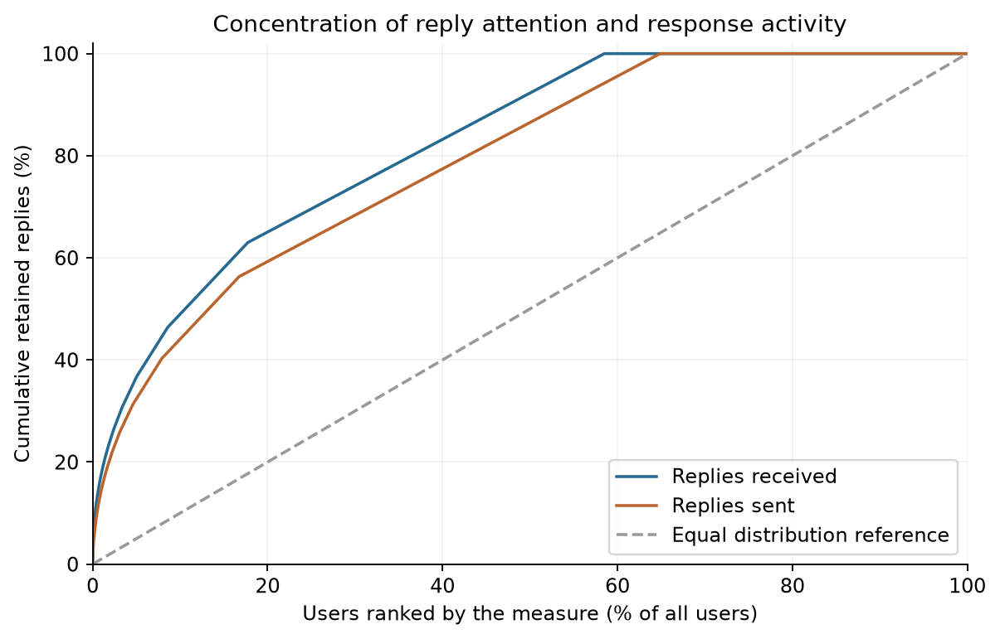
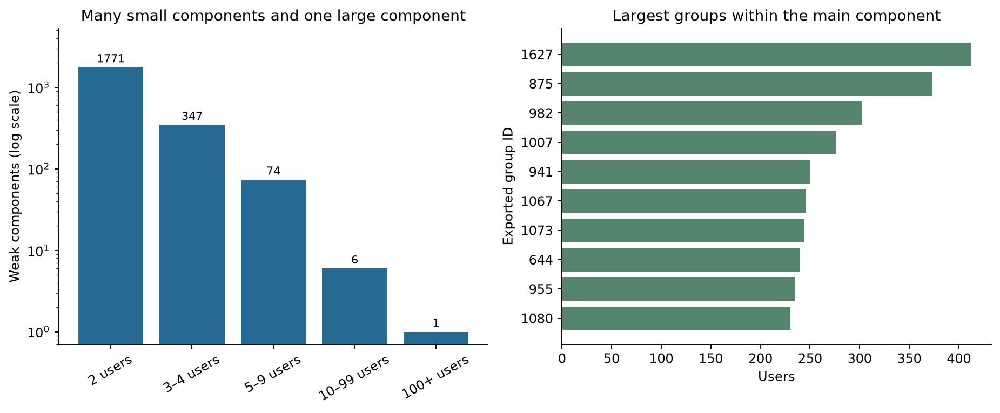
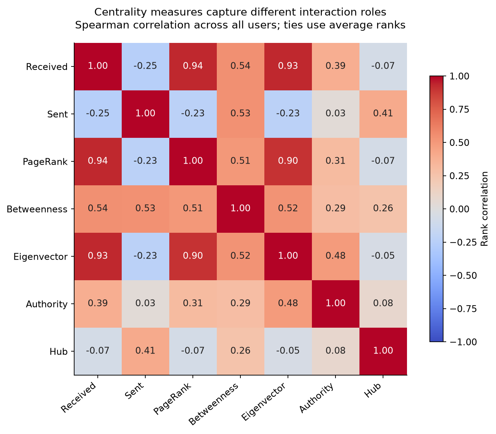
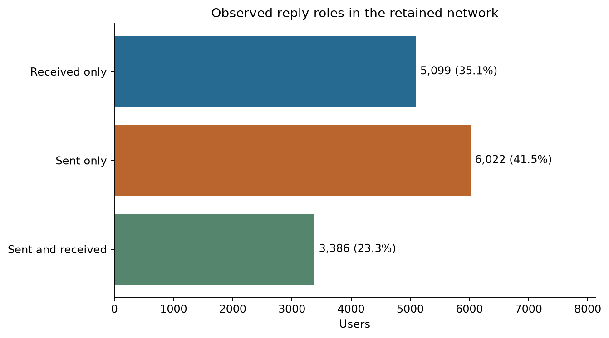

# Gephi author network: preliminary findings

Python analysis of the user's `authors_keyword-comments.csv`, using the original author-edge export to verify topology. All 14,507 node IDs match the original network. Retained and Gephi-calculated degrees/weights agree exactly. Both weak and strong component partitions independently match the edges. Imported centrality values are complete, finite, and nonnegative. The source CSV is preserved.

## 1. Connectedness

The network contains **14,507 users**, **15,427 directed user pairs**, and **15,977 retained replies**. There are **2,199 weak components**. The largest includes **9,330 users (64.3%)**; 1,771 components contain just two users. No isolates are present because the export includes only endpoints of retained edges.

There are **12,951 strong components**. The largest contains **1,210 users (8.3% of all users)**. Weak connection through a chain of replies is therefore much more widespread than mutual directed reachability. A directed path in this aggregated graph can combine different threads and times; it does not demonstrate a contemporaneous conversation or information diffusion.

See [weak components](weak_components.csv), [strong components](strong_components.csv), and [summary](summary.json).

## 2. Attention and response activity

The top 20 recipients receive **7.32%** of retained replies. The top 1% of users (rounded up) receive **17.81%**, and the top 5% receive **36.67%**. The top 20 senders contribute **4.89%**. These percentages describe the collected network; no external concentration benchmark is assumed.

**Reader 8f9b18e1** receives 300 replies from 296 distinct users and sends 1 retained replies. **Reader 92d7611b** sends 89 replies to 88 distinct users and receives 89. This distinguishes an attention recipient from an active responder. Only **9 users** appear in both top-20 lists.

| Observed role | Users | Share |
|---|---:|---:|
| Received only | 5,099 | 35.1% |
| Sent only | 6,022 | 41.5% |
| Sent and received | 3,386 | 23.3% |

Roles apply only to retained edges. "Received only" does not mean the person never responds on Reddit: their replies may not match keywords or may have been excluded. Replies indicate response attention, which may include disagreement, criticism, or support.

See [concentration](reply_concentration.csv), [roles](reply_roles.csv), and [rankings](top20_rankings.csv). The rankings file contains 20 users per measure, with every analyzed metric. Equal values remain ties even when displayed positions differ.

## 3. Repeated and mutual exchanges

**97.1% of directed pairs represent just one retained reply.** There are 446 directed pairs with repeated replies, and only 18 directed pairs recur across multiple threads. This export therefore contains mostly one-off directed connections. That finding cannot establish that the users have no ongoing relationships elsewhere.

There are **859 unordered user pairs with replies in both directions**, representing 5.90% of unordered connected pairs. Reverse edges may occur in different threads or times, so reciprocity here means mutual observed responding rather than a verified dialogue.

See [repeated pairs](repeated_pairs.csv), including reverse weights and thread counts.

## 4. Interpreting modularity groups

The export assigns **2,253 modularity classes**, but **55 are within the main component**. The other 2,198 weak components each correspond to one class. Thus the full class count largely reflects fragmentation, rather than thousands of demonstrated thematic communities.

Within the main component, **82.8% of retained replies connect users in the same exported group** (10,634 of 12,845). This is descriptive of a partition optimized using these connections; it is not independent evidence that the groups are meaningful or share narratives.

| Largest main-component group | Users | Share of main component |
|---|---:|---:|
| 1627 | 412 | 4.42% |
| 875 | 373 | 4.00% |
| 982 | 302 | 3.24% |
| 1007 | 276 | 2.96% |
| 941 | 250 | 2.68% |

For an explicit reference calculation, weighted undirected modularity at gamma=1 for the exported labels is 0.8474 on the full graph and 0.8060 within the main component. This assesses the supplied partition; it does not rerun detection or recover an undocumented Gephi setting. The high full-graph value includes separation of disconnected components. Group labels within the main component were detected in the full graph and have not been optimized separately for the subset.

See [group sizes and traffic](modularity_groups.csv) and [directed group-to-group replies](main_component_group_replies.csv). Group IDs have no intrinsic topic meaning. Gephi's standard Modularity uses an [undirected view](https://github.com/gephi/gephi/blob/master/modules/StatisticsPlugin/src/main/java/org/gephi/statistics/plugin/Modularity.java).

## 5. Centralities capture different roles

The leading betweenness user is **Reader 92d7611b**, who also sends 89 replies and receives 89. Only **9 users** occur in both the top-20 incoming-reply and betweenness lists. Betweenness identifies positions on modeled shortest paths; it does not prove brokerage, information transmission, or influence. Its exported scale appears unnormalized and is preserved rather than compared with normalized values from other software.

Incoming reply counts and PageRank have a Spearman correlation of **0.935**, but only **16 users** overlap between their top-20 lists. For example, the second-highest PageRank belongs to **Reader 7e0864bf**, with 2 incoming partners and 2 received replies. PageRank weights network position and can elevate users with relatively few incoming connections. It is not a direct popularity count. The exported PageRank values sum to 1.000122, consistent with rounding of a probability-like vector.

**Closeness is not used to identify influential users here.** 4,110 users have the maximum exported closeness of 1; 3,566 of those have one outgoing partner whose own outgoing degree is zero. A perfect score can therefore arise from reaching only one immediate neighbor. Gephi's [distance implementation](https://github.com/gephi/gephi/blob/master/modules/StatisticsPlugin/src/main/java/org/gephi/statistics/plugin/GraphDistance.java) computes directed outgoing distances and averages over reachable nodes. The zero-eccentricity pattern is consistent with directed distance calculations; the setting was not separately recorded.

The top HITS authority accounts for **99.78% of the squared authority-score norm**. This is a numerical concentration measure, not a share of replies or an estimate of authority among workers. HITS and eigenvector rankings are exploratory and depend on topology, algorithm settings, and exported rounding. Only 243 users have a positive exported clustering coefficient; the graph contains little observed local closure, although the exact directed/undirected clustering option is unrecorded.

See [metric distributions](metric_summary.csv) and [rank correlations and top-20 overlaps](centrality_comparisons.csv). Correlations use average ranks for ties and have no inferential p-values. Rounded centralities can introduce ties.

## Settings, scope, and research meaning

The user reports using mostly default settings with edge weights enabled, and mentioned a value of 1 as resolution. The user confirmed PageRank probability **0.85** and epsilon **0.001**. The exact association of the resolution value with a dialog is unconfirmed: resolution is a Modularity parameter; PageRank has a separate probability setting. Software version, distance normalization, clustering direction, and randomization are not saved in the CSV. See [reported settings](run_settings.json) and [validation and methods](manifest.json). Analysis describes the exported centralities without silently replacing them. PageRank's confirmed parameters and optional weights correspond to its [implementation](https://github.com/gephi/gephi/blob/master/modules/StatisticsPlugin/src/main/java/org/gephi/statistics/plugin/PageRank.java).

The network includes replies sourced from selected layoff-matching comments, with parent authors as targets. The parent record does not have to match. Unknown authors, missing parents, self-replies, and invalid cross-thread links were excluded. Selective retrieval can remove exchanges and break paths. Collection coverage differs across communities and dates. The original edge export supplies topology; the user supplied a node export, not a newly exported Gephi edge table.

This stage supports claims about observed interaction structure, attention distribution, response activity, and candidate groups/users for later reading. It does not establish support networks, competing narratives, worker status, diffusion, temporal causality, or population-level behavior. Those require conversation content and compatible contextual data. The qualitative pilot remains aside.

## Reproduce

From the project root:

```bash
python gephi/scripts/analyze_gephi.py
```

For the four static figures, use a Python environment with Matplotlib. The existing project plotting environment can run:

```bash
.venv-eda/bin/python gephi/scripts/analyze_gephi.py --plots
```

The original source CSV is unchanged. Output names are stable and regenerated in this folder. Core calculations need only Python's standard library. See [all analyzed nodes](nodes_analyzed.csv) for readable metric names and full/main-component membership.

## Figures









Each figure is also supplied as an editable SVG in the figures folder. These plots describe the retained network and exported metrics.
