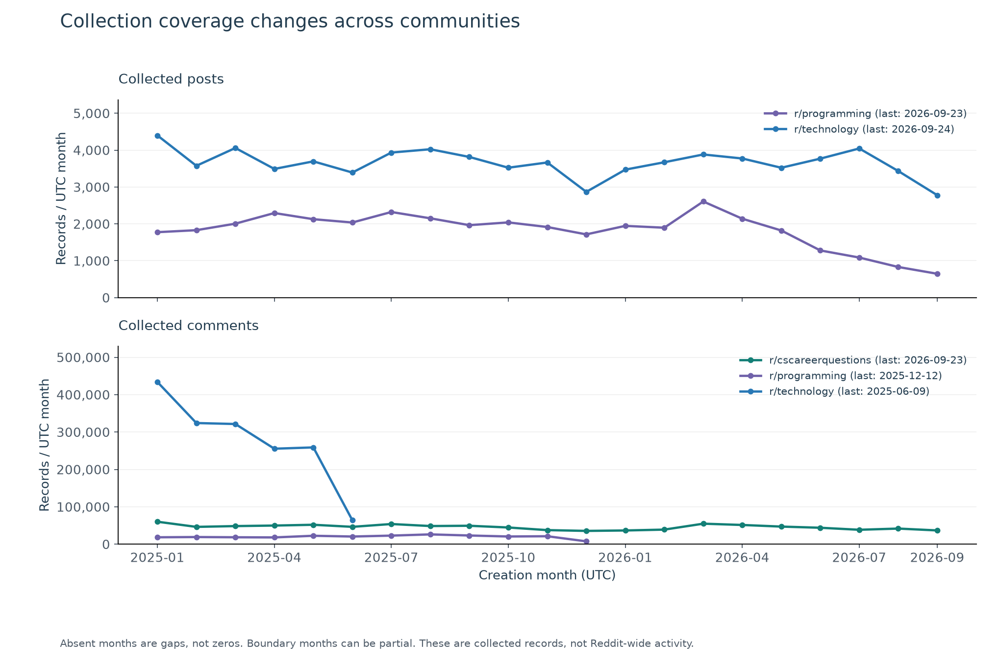
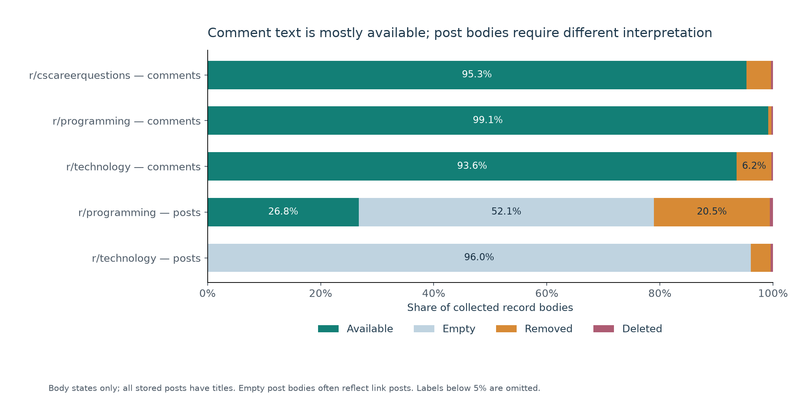
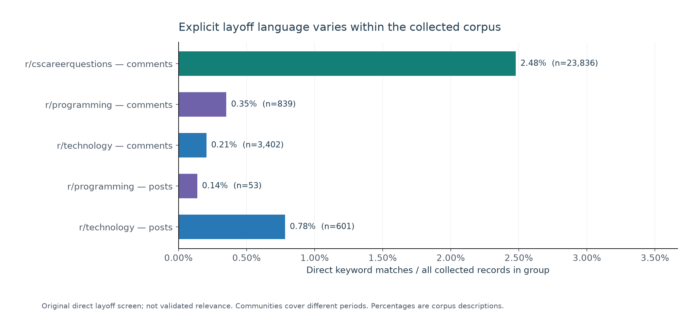
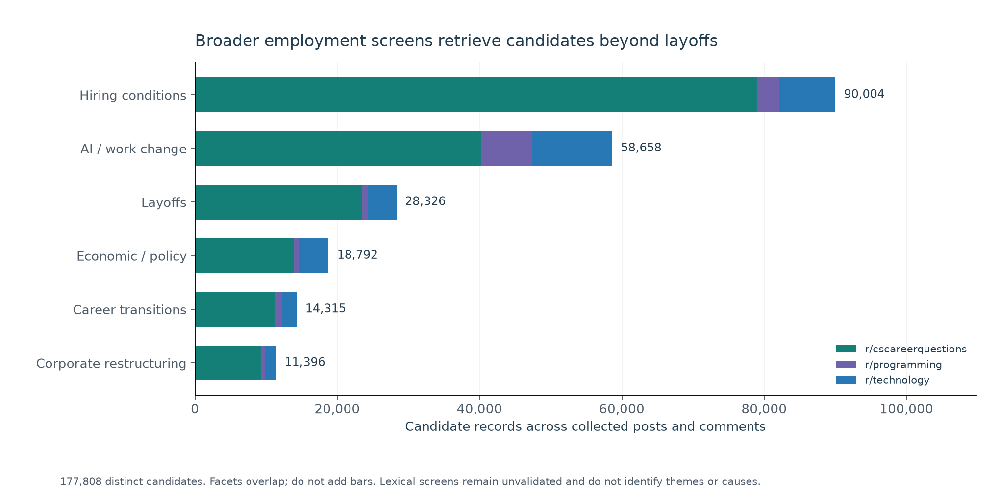
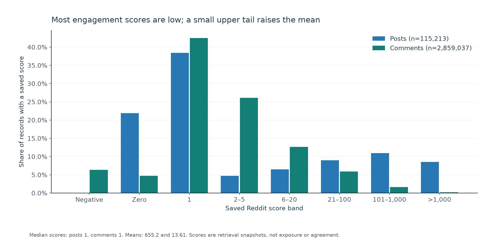

# EDA figures and preliminary insights

Five static figures complement the existing descriptive tables. PNG files are ready for presentation; SVG files support vector export. This is descriptive EDA, with no inferential significance tests or qualitative labels.

## Coverage constrains time comparisons

Technology comments stop on 2025-06-09 and programming comments on 2025-12-12; career-question comments extend to 2026-09-23. Pooled time patterns can reflect collection changes. Missing months are not plotted as zero activity.



[Vector figure](01_monthly_coverage.svg)

## Body availability differs between record types

94.61% of comment bodies are available. Many post bodies are empty while their titles remain present; these require title/link-aware analysis rather than blanket removal.



[Vector figure](02_text_availability.svg)

## Explicit layoff language is concentrated in career comments

Career-question comments contain 23,836 of the 28,077 directly matching comments (84.90%). This is a finding about collected language, not worker prevalence or actual layoffs; community coverage and missing roots matter.



[Vector figure](03_direct_layoff_shares.svg)

## The broader project scope has a substantial candidate pool

The six screens retrieve 177,808 distinct candidates. Compare overlapping facet counts to identify material for review, not confirmed narratives or causes.



[Vector figure](04_broader_candidates.svg)

## Means alone poorly describe saved engagement

Post median/mean scores are 1/655.2; comment median/mean scores are 1/13.61. Inspect score distributions and varied engagement levels rather than relying only on popular examples.



[Vector figure](05_score_distribution.svg)

## Reproduce

```bash
# Run from the folder containing README.md
.venv-eda/bin/python scripts/plot_eda.py
```

See [the running guide](../../../docs/RUNNING.md) for optional environment setup. Gephi graph visualization and interpretation and human qualitative coding remain pending.
