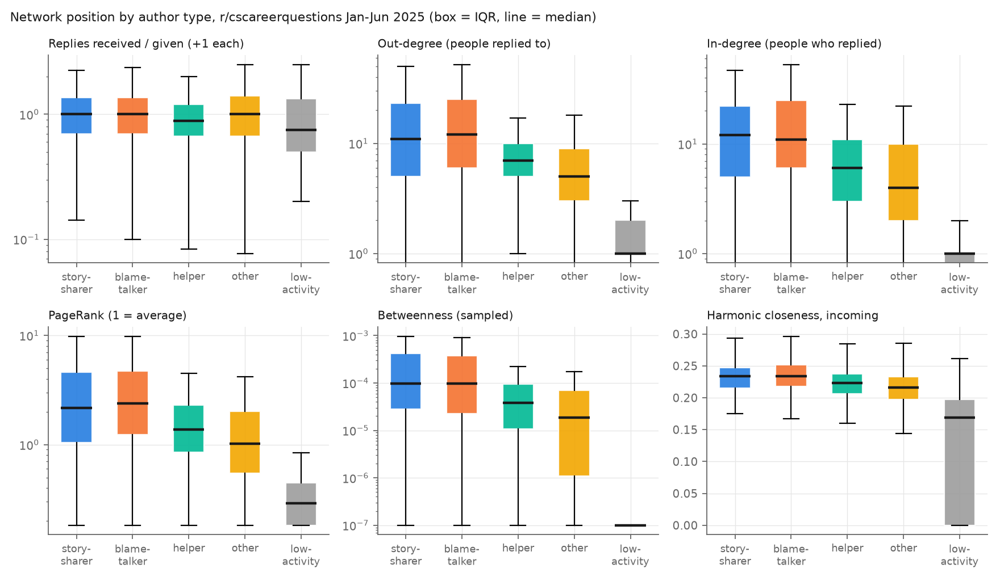
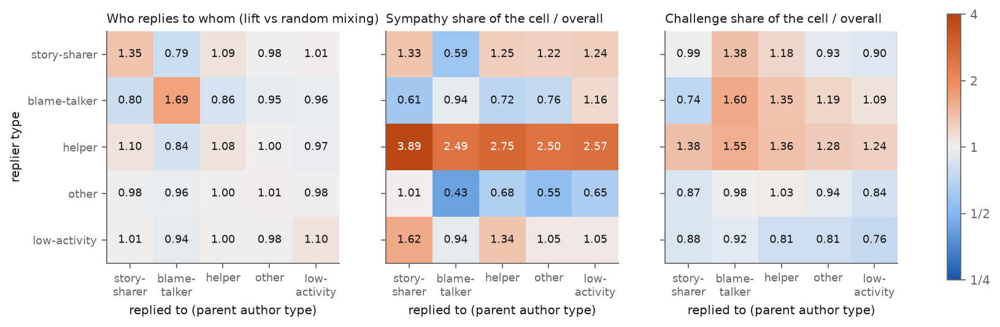

# R4. Where author types sit in the cscq reply network

*25 November 2026. Script: `scripts/explore_network.py` (seeded; two runs gave identical CSVs). Scope: r/cscareerquestions, Jan–Jun 2025. Every label is a rule-based marker from `explore_replies.py` that has not been checked by a human, so nothing below is a Finding.*

| | Question | Answer | Label |
|---|---|---|---|
| N1 | Are story-sharers on the edge and helpers at the centre? | **No.** Once activity is held equal, position depends on how much someone posts, not on their type. | Supported (a no-difference result) |
| N2 | Does sympathy flow from helpers to story-sharers? | **Yes.** Everyone, helpers included, comforts story-sharers about 1.6–1.9× more than other authors. Helpers supply most of that comfort. | Lead |
| N3 | Do blame-talkers form their own group, and does their debate stay inside it? | **Yes.** They reply to each other 1.7× more than chance, beyond what sharing threads explains. Inside the group they *challenge* each other, but do not agree more than usual. | Supported |
| N4 | Do interaction communities line up with author types? | **No.** The 59 Louvain communities are mixed by type, and k-means clusters do not follow them either. | Supported (a no-difference result) |
| N5 | Do the behavioural archetypes emerge without rules? | **Partly.** k-means finds story-sharers and two kinds of blame-talker, but not helpers. | Lead |

---

## The network

| | |
|---|---|
| Comments in the window | 302,881 (274,850 by humans) |
| Dropped | **108,722 replies to posts: the database has no cscq posts at all**, so original posters are unknown · 2,501 replies to comments that were not collected · 16 to deleted authors · 628 self-replies · 165 to bots |
| Graph | 31,953 authors · 135,549 directed pairs · 162,818 replies |
| **LWCC** | **30,976 authors (96.9%) · 99.5% of replies.** The next largest component has 5 authors. |
| Density | 0.00014 · reciprocity 0.44 |
| Degree | median 2, max 860 · the top 1% of authors hold 20% of all ties · tail α ≈ 2.2 (heavy-tailed; descriptive fit only) |
| Clustering | global 0.015, average local 0.035 (few closed triangles) · largest clique 8 |
| Distance | average path ≈ 4.3, diameter ≥ 11 (from 500 sampled starting points) |

**In plain words:** this is a large, sparse network with a small core and a long tail. Almost everyone who replies is connected, within about 4 steps. It is a crowd answering questions, not a set of friendship circles.

**Coverage limit (for R5).** All 15,986 cscq threads in the window have no post in the database, so 40% of human comments (the top-level replies to original posters) have no target.
- The network is **comment-to-comment conversation only**.
- People who tell their layoff story *as a post*, and the comfort they get, are invisible.
- These are probably the most peripheral story-sharers. So N1's "not peripheral" applies to story-sharers who disclose in comments.

## Author types (rules, applied in this order)

These rules cover **profiled authors**: those with **N ≥ 5 comments** in the window. That is 10,778 authors in the LWCC, who wrote about 80% of comments. Below 5 comments, one comment can push a rate to 0% or 100%. Content rates are computed on employment-screened comments, because that is where the markers were precision-checked.

| Type | Rule | n |
|---|---|---:|
| story-sharer | ≥2 employment comments; ≥1 tells their own layoff; at least as many layoff stories as blame-topic comments | 233 |
| blame-talker | ≥2 employment comments; ≥2 mention executives, offshoring or "AI is the excuse"; these are ≥25% of their employment comments | 577 |
| helper | ≥5 replies given; ≥11% of them contain advice or sympathy | 1,770 |
| other | profiled, matches none of the above | 8,198 |
| low-activity | fewer than 5 comments (still in the graph and in the mixing analysis) | 20,198 |

- **Helper cut-off.** The plan said 30%, but advice and sympathy replies are rare: median 2%, p75 11%, p90 20%. A 30% cut-off would keep 191 people. The cut-off was set at the upper quartile, 11%, before looking at any result that depends on it.
- **Overlap.** 56 story-sharers and 111 blame-talkers would also qualify as helpers. 17 story-sharers also meet the blame rule.
- **"Blame-talker" means the topic, not the stance.** The rule finds people who *talk about* executives, offshoring or AI-as-excuse. In the H3 check, most offshoring mentions were not blame aimed at foreign workers.

---

## N1. Position follows activity, not role

1. **Say it.** Before adjusting, story-sharers and blame-talkers look central:
   - median PageRank about 2.2–2.4 (1 = average), against 1.0 for "other";
   - betweenness about 5× that of "other".

   Helpers sit *between* them and "other". The expected picture, where story-sharers receive and helpers act as hubs, does not appear:
   - story-sharers give as many replies as they receive (ratio 1.0);
   - helpers give slightly *more* than they receive (0.89).
2. **Expected?** No. We expected story-sharers on the edge, receiving, and helpers as hubs.
3. **Rivals.**
   - (a) Role shapes position.
   - (b) **Activity (boring).** The types require ≥2 employment comments, which selects active people, and active people have more ties.
4. **Check** (`rivals.csv`, `activity_matched`). Each typed author was matched with an "other" author of the same activity level (12 comment-count bins). Median paired differences:

   | | received/given | PageRank | betweenness | out-degree |
   |---|---|---|---|---|
   | story-sharer − matched other | 0.00 (CI −0.10, 0.05) | −0.06 (CI −0.27, 0.15) | ≈ 0 | 0 |
   | blame-talker − matched other | 0.00 | **+0.18** (CI 0.03, 0.27) | ≈ 0 | 0 |
   | helper − matched other | **−0.09** (CI −0.13, −0.04) | +0.11 (CI 0.05, 0.18) | small + | **+1** |

   **Activity bands** (`activity_band`) show the same thing. Within each band (5–9, 10–19, 20–49, 50+), the median PageRank of story-sharers, blame-talkers and "other" stays within about 0.5 of each other. PageRank rises roughly 10× from the lowest band to the highest.
5. **Name.** *Activity-driven centrality*, a composition effect. In a question-and-answer crowd, how central you are depends on how much you post.
6. **Claim.**
   - Story-sharers are **not** on the edge. When activity is held equal, they sit where everyone else sits.
   - Helpers reach slightly more people and give more than they get, but they are not hubs.
   - Blame-talkers have a small PageRank advantage.
   - **Do not claim** that role makes people central.
7. **Examples** (paraphrased). Story-sharers also answer other people. Typical replies from them:
   - *"Just apply to other jobs while working. Makes you more desirable…"*, from someone who mentions supporting a family;
   - blunt advice on not naming a salary number first.

   They are participants who also give, not just recipients.

## N2. Sympathy flows to story-sharers, mostly from helpers (H3, author level)

1. **Say it.** Of every 100 replies a story-sharer receives, about 2.6 contain sympathy. For "other" authors the figure is 1.6, and the overall average is 1.7. The pattern holds whoever is replying:

   | | to story-sharers | to "other" |
   |---|---|---|
   | Helpers' replies that are sympathy | **6.5%** (CI 4.7–8.4) | 4.2% (CI 3.8–4.6) |
   | "Other" authors' replies that are sympathy | **1.7%** (CI 1.2–2.2) | 0.9% (CI 0.8–1.0) |

   Helpers write 57 of the 121 sympathy replies that story-sharers get from profiled authors, although helpers are only 16% of profiled authors.
2. **Expected?** Confirmed, but the effect is smaller than at comment level. H3 found 5.1% against 1.8% when the reply was to the layoff story itself. Here the type describes the *author*, so most replies they get are to their other comments.
3. **Rivals.**
   - (a) A norm of comforting people who disclose.
   - (b) **Circularity.** Helpers are partly defined by giving sympathy. This explains why helper rows are high overall, but not why they are higher *towards story-sharers*. That comparison is within the helper row.
   - (c) **Label noise (R1).** The sympathy marker also catches "congrats" and "good luck".
   - (d) Thread co-location: story-sharers and helpers meet in the same layoff threads.
4. **Checks.**
   - **Within-thread null** (`null_models.csv`). Replies were reshuffled *within threads*, so authors stay in the same threads. Under that null:
     - helper → story-sharer contact is 1.10 observed against 1.04 expected (z = 1.8, p = 0.05);
     - meeting is mostly explained by being in the same threads;
     - the *sympathy share* inside those contacts is not explained by thread co-location.
   - **Mega-threads.** Dropping the 112 largest threads (≥305 comments) leaves it at 6.8% against 4.3%.
   - **Label noise.** Removing 25% of marker hits gives 5.9% against 4.0%. Adding missed hits equal to 50% of the observed hits gives 5.8% against 4.5%. The gap shrinks but survives.
   - **Threshold N.** Sympathy received by story-sharers is 2.5–2.7% for N = 3, 5, 10 and 20.
5. **Examples** (`examples.txt`, paraphrased):
   - A helper answers someone who said a job "didn't work out": *"sorry this happened to you… it's extremely mentally and emotionally taxing. Take care of yourself."*
   - Another replies to someone rejected after long preparation: *thanks them for the kind words* and wishes them better luck.
   - **Counter-examples (R1):**
     - *"Congrats on the bump but 120k at a FAANG is very low"* is matched as sympathy;
     - several parent comments are unrelated to layoffs (one is just "Yes"), because type describes the person, not the comment.
6. **Name.** *Emotional support follows disclosure, and a small set of regular supporters provides much of it.*
7. **Claim (lead).**
   - People who tell their layoff story get more comfort from everyone.
   - Helpers are where most of it comes from.
   - **Becomes Supported** once a human checks the sympathy marker (`12_replies/check_sheet.csv`).

## N3. Blame-talkers form a group that argues with itself

1. **Say it.**
   - Blame-talkers reply to other blame-talkers **1.69×** more often than random mixing predicts.
   - That is the strongest same-type tie in the network:
     - story-sharers → story-sharers 1.35;
     - helpers → helpers 1.08.
   - Inside the group, replies are **challenges**: 7.2% of blame-talker → blame-talker replies, against 4.5% overall and 5.3% from blame-talkers to "other".
   - Agreement inside the group is not raised: 5.7%, the same as the overall average.
   - 19% of the challenges blame-talkers write go to other blame-talkers, against 15% of all their replies.
2. **Expected?**
   - The **group: confirmed.**
   - **Surprise:** it is an *argument* group, not an echo chamber. H3 found blame-topic comments draw slightly more agreement. At author level, agreement is flat and challenge rises.
3. **Rivals.**
   - (a) People with opposing views on offshoring and AI seek each other out to argue.
   - (b) **Thread co-location (R3).** They meet in the same H-1B and layoff-news threads.
   - (c) Mega-threads.
   - (d) Label noise.
   - (e) Degree: a few prolific arguers.
4. **Checks.**
   - **Degree-preserving null** (200 stub shuffles):
     - lift 1.69 observed against 1.00 ± 0.03, z = 27;
     - type assortativity 0.029 against −0.0005, z = 15.
   - **Within-thread null:** 1.69 observed against 1.46 ± 0.03, z = 8. **About two-thirds of the excess comes from sharing threads. The rest comes from choosing each other inside threads.**
   - **Mega-threads dropped:** 1.76.
   - **Label noise:**
     - removing 10% or 25% of hits gives 1.77 or 2.08 (stronger when the labels are stricter);
     - adding 25% or 50% missed hits gives 1.45 or 1.28 (diluted, but still above 1).
   - **Threshold N:** 1.70, 1.69, 1.64 and 1.49 for N = 3, 5, 10 and 20.
5. **Examples** (paraphrased, H-1B threads):
   - One blame-talker corrects another: the visa involved *"would be L1… you're just illiterate about immigration."*
   - *"You can't draw conclusions… without examining their efforts to hire American talent."*
   - *"I have an H1-B and I've read my paperwork, but go off."*
   - One exchange ends: *"I ain't gonna put up with this gish gallop."*
   - The agreement inside the group is often qualified: *"I agree… but what happens if other countries also do the same?"*
   - **Label check (R1) on "agree".** The agree marker fires on any reply starting with "This". Several hits are hostile:
     - *"This is complete crazy talk"*;
     - *"This comment shows how aware you are… Such stupidity can't be helped"*.

     Agreement counts are therefore **overstated with hostile replies**. That strengthens the "argument, not echo chamber" reading. It also weakens R3's "blame draws agreement" (×1.05–1.3). Report that one as debate.
6. **Name.** *Homophily of topic, not of opinion.* The people who talk about offshoring and executives find each other, and then disagree. This fits the "argument arena" reading of H3 better than the echo-chamber one.
7. **Claim (Supported, structurally).**
   - Blame talk is concentrated among a recognisable set of authors who reply to each other.
   - They do so more than sharing threads explains.
   - Their exchanges are debate.
   - **Do not claim** a shared stance: the markers are topic markers.

*Left panel: who replies to whom, as lift over random mixing. Middle and right panels: the share of each cell's replies that are sympathy or challenge, divided by the overall share. Helper rows are high in the middle panel partly by definition (rival b in N2). Compare along a row.*

## N4. Interaction communities are not type communities

1. **Say it.**
   - Louvain splits the network into **59 communities**, with modularity Q = 0.43, which is clear structure. Every community has 50 or more authors; the largest are about 990.
   - The author-type mix inside a community is almost the same as overall: median type entropy 1.08 bits against 1.07 overall.
   - Agreement between community and type is about zero: ARI 0.0001, NMI 0.005. The same holds for k-means clusters (NMI 0.009).
   - A few communities have 2–2.7× the usual share of blame-talkers (4 communities) or of story-sharers (5).
2. **Expected?** Partly. We expected some blame communities. Instead blame-talkers are spread out and concentrated in only a handful.
3. **Rivals.**
   - (a) Communities are *topic and thread neighbourhoods*, not role groups.
   - (b) Louvain resolution.
4. **Check.**
   - **Bipartite co-participation:** author–thread incidence of 10,778 × 9,485, density 0.0013. Projected onto authors who share 2 or more threads, it gives 1,917 communities (Q = 0.15). They do not match the reply-graph communities (ARI 0.002): *being in the same threads* is a different structure from *replying to each other*.
   - **Girvan–Newman** on the 300 most connected authors: the best split has Q ≈ 0.00 (it peels off single nodes). Louvain on the same core gets Q = 0.22 with 10 groups (ARI 0.001). The core is one well-mixed block. Divisive splitting finds nothing there, and the modest structure Louvain finds is not organised by type either (ARI with k-means ≈ 0).
5. **Name.** *Role is orthogonal to community.* Types meet each other everywhere. N3's clustering of blame-talkers happens *inside* mixed communities, not as a separate one.
6. **Claim.** cscq has no "blame corner" or "support corner" at the community level. The sorting happens reply by reply.

## N5. Do the archetypes emerge on their own? (k-means and Ward)

- **Choosing k.** Features: activity, 5 content rates, 4 reply-giving rates and received/given, all standardised. The sample is the 5,027 profiled authors with ≥2 employment comments.
  - Silhouette picks k = 2 (0.44), which separates people with any content markers from those with none.
  - Rule set in advance: when k = 2 wins, use the best k from 3 to 8. That is **k = 4** (0.33, a clear local peak).
- **Clusters** (`fig_kmeans_profiles.png`):

  | Cluster | Profile | n | Overlap with the rule types |
  |---|---|---:|---|
  | 0 | story-tellers (experience +5.0 SD) | 151 | 143 of the 233 rule story-sharers |
  | 1 | everyone else | 4,477 | |
  | 2 | executive-talkers (+3.1 SD) | 329 | |
  | 3 | "AI is the excuse" talkers (+7.4 SD, with some executive talk) | 70 | |

- **No helper cluster.** Reply-giving rates do not separate anyone. Helpers fall into the big cluster.
- **Agreement.** ARI with the rules is 0.14, because 941 helpers and the large "other" group merge. Ward with k = 4 gives ARI 0.42 against k-means and 0.16 against the rules (dendrogram in `fig_dendrogram.png`).
- **Meaning.**
  - The *content* archetypes are real and found without rules.
  - Blame-talkers split into an executive group and an AI-as-excuse group.
  - "Helper" is a matter of degree, not a separate kind of person.
- **Label:** Lead.

---

## Validity summary (R5 material)

| Conclusion | Activity | Mega-threads | Label noise (−25% hits / +50% missed) | N = 3…20 | Null model |
|---|---|---|---|---|---|
| N1 no position difference | is the check | — | — | PageRank order stable | — |
| N2 sympathy → story-sharers | (rates, not counts) | holds | holds, gap shrinks | 2.5–2.7% | thread co-location explains contact, not the share |
| N3 blame-talkers cluster and challenge | holds | 1.76 | 2.08 / 1.28 | 1.49–1.70 | z = 27 (degree), z = 8 (thread) |
| N4 communities ≠ types | — | — | — | — | NMI ≈ 0 |

**Most sensitive to label error:**
- the story-sharer → story-sharer lift, 1.35, which falls to 1.09 when 50% missed hits are added and is not above the within-thread null (z = 0.9). **Do not report it.**
- the size of N2, because sympathy is rare.

**Most robust:** N3's group clustering, and N1's no-difference result.

## Notes on method
- **Sampled estimates.** Betweenness uses 1,000 sampled sources, closeness 2,000 sampled sources (harmonic, incoming and outgoing), and path length 500 sampled sources. Medians by type are stable enough for comparison but are not exact values.
- **Packages.** networkx 3.7, scipy 1.18 and scikit-learn 1.9 were added to `.venv-eda` for this analysis.
- **`network_profiled.gexf` (15 MB).**
  - Contents: 10,778 profiled authors and 91,657 weighted edges. Nodes are relabelled `a0…`, and the file holds no author keys.
  - Node attributes: type, cluster, community, centralities and content rates.
  - In Gephi, colour nodes by `type` and lay out with ForceAtlas2. The blame-talker clumps inside mixed communities are N3.
- **Ethics.**
  - Outputs carry **no author keys**. Ids are neutral and consistent with the GEXF: `a0…` for profiled authors, `n0…` for the rest. The project's `u_` keys are unsalted SHA-256 hashes of usernames and can be confirmed by guessing.
  - `examples.txt` holds verbatim excerpts.
  - Quotes in these notes are short or paraphrased and have no usernames.
  - `examples.txt` is for reading only. Keep it out of the public repo.

## For the report (2–3 sentences)

In r/cscareerquestions, where an author sits in the reply network depends on how much they post, not on the role they play. Story-sharers are not on the periphery and helpers are not hubs. The roles do shape *who replies to whom and how*: people who tell their layoff story get about 1.6–1.9× more comfort from everyone, much of it from a small group of regular helpers. People who keep raising executives, offshoring or AI form a tight group that replies to itself 1.7× more than chance and mostly argues rather than agrees.
